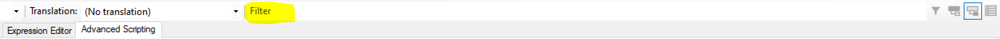

Have you ever had the idea of finding which measures in your model use a particular function? Or a quick view of all the calculated columns in a model? These are relatively simple tasks but it can be quite tedious to actually find these specific objects in your model.

The basics of such advanced filtering techniques are officially documented [here](https://docs.tabulareditor.com/Advanced-Filtering-of-the-Explorer-Tree.html). In this post, I will discuss additional filtering scenarios which tend to come up over and over again. I really think every tabular developer should know these patterns as they will save you lots of time in the long run.

These filtering techniques are done in [Tabular Editor](https://github.com/otykier/TabularEditor/releases/), so make sure you have it installed. Within Tabular Editor, the filtering commands below are entered into the highlighted 'Filter' box.



Now...let's get started!

## View only calculated columns

Since calculated columns should be avoided, here is an easy way to find them (and hopefully turn them into data columns!).

```csharp
:ObjectType = "Column" and Type = "Calculated"
```

## View Bi-Directional Relationships

This filters the object list to show only relationships that are enabled for bi-directional crossfiltering.

```csharp
:ObjectType = "Relationship" and CrossFilteringBehavior = "BothDirections"
```

## View Many-to-Many Relationships

This filters the object list to show only many-to-many relationships.

```csharp
:ObjectType = "Relationship" and FromCardinality = "Many" and ToCardinality = "Many"
```

## View Measures that use a particular DAX function

If you want to search which measures use a particular function - just replace where it says 'SWITCH' below with the function you want to search.

```csharp
:ObjectType = "Measure" and RegEx.IsMatch(Expression,"(?i)SWITCH\s*\(")
```

## View Multi-Partitioned Tables

This shows all tables in your model that have more than 1 partition.

```csharp
:ObjectType = "Table" and Partitions.Count > 1
```

## View KPIs

This shows all the measures in your model which are also KPIs.

```csharp
:ObjectType = "Measure" and KPI != null
```

## View Columns Which Use Sort-By Columns

This shows all columns in your model which are sorted by another column within the model.

```csharp
:ObjectType = "Column" and SortByColumn != null
```

## View Sort-by Columns

This shows all columns in your model which are used in order to sort other columns.

```csharp
:ObjectType = "Column" and Model.AllColumns.Any(SortByColumn.Name == current.Name)
```

## View Calculated Tables

This shows all the calculated tables in your model.

```csharp
:ObjectType = "Table" and SourceType = "Calculated"
```

## View Calculated Tables

This shows all the calculation groups in your model.

```csharp
:ObjectType = "CalculationGroupTable"
```

## View Direct Query Tables/Partitions

This shows all the partitions in your model which are in Direct Query mode.

```csharp
:ObjectType = "Partition" and (Mode = "DirectQuery" or (Model.DefaultMode = "DirectQuery" and Mode = "Default" || Mode = "DirectQuery"))
```

## View Import mode Tables/Partitions

This shows all the partitions in your model which are in Import mode.

```csharp
:ObjectType = "Partition" and (Mode = "Import" or (Model.DefaultMode = "Import" and Mode = "Default" || Mode = "Import"))
```

## View Relationship columns

This shows all the columns in your model which are used in relationships

```csharp
:ObjectType = "Column" and UsedInRelationships.Any()
```

## View foreign key columns

This shows columns used on the 'from' side of relationships (generally foreign keys).

```csharp
:ObjectType = "Column" and UsedInRelationships.Any(FromTable.Name == current.Table.Name and FromColumn.Name = current.Name)
```

## View Primary key columns

This shows columns used on the 'to' side of relationships (generally primary keys).

```csharp
:ObjectType = "Column" and UsedInRelationships.Any(ToTable.Name == current.Table.Name and ToColumn.Name = current.Name)
```

## VIEW Objects with blank descriptions

This shows all (relevant) objects with no description.

```csharp
:string.IsNullOrWhiteSpace(Description)
```

## VIEW Measures with no format string

This shows all measures in your model that are not formatted (i.e. currency, whole number).

```csharp
:ObjectType = "Measure" and string.IsNullOrWhiteSpace(FormatString)
```

## SEARCH FOR Text within Partition Queries

This allows you to search for partition queries which contain a specified text string. Simply replace `'SEARCH TEXT'` with the text you want to search.

```csharp
:ObjectType = "Partition" and RegEx.IsMatch(Query,"(?i)SEARCH TEXT")
```

## Partitions used by a specific data source

This allows you to search for all partitions which use a specific data source.

```csharp
:ObjectType = "Partition" and Datasource.Name = "SqlServer MyServerName"
```

## Columns using a particular Translated Name

This allows you to search for columns with a particular translated name. Simply update the translation language (en-EN is used in the example below) and translated name text.

```csharp
:ObjectType = "Column" and TranslatedNames["en-EN"] = "translated name"
```

## Conclusion

Tabular Editor has some slick ways of filtering your model to see exactly the objects on which you want to focus. The key is to know how to use it. These examples give common scenarios which may help you immediately or at least should give you a better idea of how to do advanced filtering using [Dynamic LINQ](https://github.com/zzzprojects/System.Linq.Dynamic/wiki/Dynamic-Expressions) expressions.
