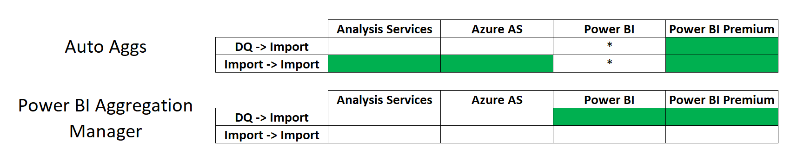

Looking to boost your tabular model's performance? [Aggregations](https://docs.microsoft.com/en-us/power-bi/transform-model/desktop-aggregations) are a great way to do so. Power BI Desktop has a built-in tool to ease the setup process. This tool, the Aggregation Manager, works when the detail table is in Direct Query and the aggregation table is In-Memory. It also works for models built in Power BI Desktop. However, what can we do about models that are only In-Memory? And what about models built in [Tabular Editor](https://github.com/otykier/TabularEditor/releases) (or SSDT)? And, what to do about models deployed to Azure Analysis Services or SSAS?

To work around these limitations, some tabular developers manually create aggregation tables. However, this is time consuming and not for the novice developer.

But now there is a solution! In this post I am sharing a [script](https://github.com/m-kovalsky/Tabular/tree/master/AutoAggs) which automatically creates aggregation tables for you. It is accomplished via [Tabular Editor](https://github.com/otykier/TabularEditor/releases) so it can work for practically any model ([SSAS](https://docs.microsoft.com/en-us/analysis-services/analysis-services-overview?view=asallproducts-allversions), [Azure Analysis Services](https://azure.microsoft.com/en-us/services/analysis-services/), [Power BI Premium](https://docs.microsoft.com/en-us/power-bi/admin/service-premium-what-is)) and any offers Import -\> Import as an option as well.



\* Note: Auto Aggs does not support non-premium Power BI models as it requires [XMLA Endpoints](https://docs.microsoft.com/en-us/power-bi/admin/service-premium-connect-tools) (since it uses Tabular Editor).

DQ -\> Import: Detail table is in Direct Query; Agg table is In-Memory

Import -\> Import: Detail table & Agg table are both In-Memory

## Creating the Aggs

1. Open your model in [Tabular Editor](https://github.com/otykier/TabularEditor/releases).
2. Copy the [script](https://github.com/m-kovalsky/Tabular/tree/master/AutoAggs) into the [Advanced Scripting](https://docs.tabulareditor.com/Advanced-Scripting.html) window in Tabular Editor.
3. Select the columns from the fact table that you would like to be in the agg table (using Ctrl+Select). Ensure you only select foreign keys or columns which are summarized in measures.
4. Run the script by clicking the play button in the Advanced Scripting window (or pressing F5).

The final step is to create the view(s)/table(s) which the agg table will reference. The C# [script](https://github.com/m-kovalsky/Tabular/tree/master/AutoAggs) updates the agg table's partition query (or queries) to point to the same table/view as the detail table - only suffixed with "\_Agg". See the example below (it works the same for multi-partitioned tables).

Detail Table's Partition Query Example

```sql
SELECT * FROM [ModelView].[FACT_Revenue]
```

Agg Table's Partition Query Example

```sql
SELECT * FROM [ModelView].[FACT_Revenue_Agg]
```

Below is an example of the difference between the view for a detail table and the view for an agg table. Note that you can use the following functions to accomplish the various aggregation types:

SUM: [`SUM`](https://www.w3schools.com/sql/sql_count_avg_sum.asp)()

COUNT: [`COUNT`](https://www.w3schools.com/sql/sql_count_avg_sum.asp)()

MIN: [`MIN`](https://www.w3schools.com/sql/sql_min_max.asp)()

MAX: [`MAX`](https://www.w3schools.com/sql/sql_min_max.asp)()

Detail Table's View Example

```sql
CREATE VIEW [ModelView].[FACT_Revenue] AS

SELECT
 [CustomerID]
,[CalendarID]
,[ProductID]
,[GeographyID]
,[RevenueAmt]
,[AdjustedRevenueAmt]
FROM [SchemaName].[FACT_Revenue] WITH(NOLOCK)
```

Agg Table's View Example

```sql
CREATE VIEW [ModelView].[FACT_Revenue_Agg] AS

SELECT
 [CalendarID]
,[ProductID]
,SUM([RevenueAmt]) AS [RevenueAmt]
,SUM([AdjustedRevenueAmt]) AS [AdjustedRevenueAmt]
FROM [SchemaName].[FACT_Revenue] WITH(NOLOCK)
GROUP BY
 [CalendarID]
,[ProductID]
```

Note that you must process the corresponding partitions of the agg table whenever partitions of the detail table are processed. This will maintain parity and ensure no agg-related accuracy issues occur when querying the model.

My [GitHub repository](https://github.com/m-kovalsky/Tabular) also has a C# [script](https://github.com/m-kovalsky/Tabular/tree/master/AutoAggs) for removing aggregations made in this manner - just in case. See the [script](https://github.com/m-kovalsky/Tabular/tree/master/AutoAggs) called 'AutoAggs\_Remove.cs'.

## How it Works

Here is a more detailed explanation of how the [script](https://github.com/m-kovalsky/Tabular/tree/master/AutoAggs) works.

1.) Create the agg table.

This step creates the agg table - but only if one with the same name does not already exist. Note that the agg table has the same name as the original (detail) table only it is suffixed with "\_Agg".

```csharp
var tableName = Selected.Table.Name;
string aggSuffix = "_Agg";
string aggTableName = tableName + aggSuffix;

// Ensure no duplication of agg table
if (!Model.Tables.Any(y => y.Name == aggTableName))
{
    // Create agg table
    var aggTable = Model.AddTable(aggTableName);
    aggTable.IsHidden = true;
```

2.) Create the Partitions

This step replicates the partitions in the detail table for the agg table. If there are multiple partitions, it creates the same ones. It also ensures the data source remains the same for the detail table and the agg table. The only real difference here between the detail and agg table are the partition names (use the "\_Agg" suffix) and the partition queries also use the "\_Agg" suffix.

```csharp
int pCount = Model.Tables[tableName].Partitions.Count();
var dataSource = Model.Tables[tableName].Source;

// For multi-partitioned tables
if (pCount > 1)
{
     // Add partitions
     foreach(var p in Model.Tables[tableName].Partitions.ToList())
     {
            var aggPartitionName = p.Name.Replace(tableName,aggTableName);
            var aggQuery = p.Query.Replace(tableName,aggTableName);
            var pName = Model.Tables[aggTableName].AddPartition(aggPartitionName);

     // Update Data Source
     pName.DataSource = Model.DataSources[dataSource];

     // Update Query
     pName.Query = aggQuery;
     }

     // Remove default partition
     Model.Tables[aggTableName].Partitions[aggTableName].Delete();
}

// For single-partition tables
else
{
     var par = Model.Tables[tableName].Partitions[tableName];
     var aggPar = Model.Tables[aggTableName].Partitions[aggTableName];

     // Update Data Source
     aggPar.DataSource = Model.DataSources[dataSource];

     // Update Query
     aggPar.Query = par.Query.Replace(tableName,aggTableName);
}
```

3.) Create the columns in the agg table.

This step loops through the selected columns and creates them in the agg table - with the same properties as in the detail table.

```csharp
foreach (var c in Selected.Columns)
{
    // Add Columns
    string columnName = c.Name;
    bool hide = c.IsHidden;
    var colfs = c.FormatString;
    var dt = c.DataType;
    var sourceColumn = (Model.Tables[tableName].Columns[columnName] as DataColumn).SourceColumn;

    // Add Column Properties
    var obj = Model.Tables[aggTableName].AddDataColumn(columnName);
    obj.SourceColumn = sourceColumn;
    obj.IsHidden = hide;
    obj.FormatString = colfs;
    obj.DataType = dt;
}
```

4.) Create the relationships.

This step generates the relationships for the foreign key columns in the agg table based on the relationships they have in the detail table.

```csharp
// Add Relationships
foreach (var r in Model.Relationships.ToList().Where(a=> a.FromTable == Model.Tables[tableName] && a.FromColumn == Model.Tables[tableName].Columns[columnName]))
{
         var addRel = Model.AddRelationship();
         addRel.FromColumn = Model.Tables[aggTableName].Columns[columnName];
         addRel.ToColumn = Model.Tables[r.ToTable.Name].Columns[r.ToColumn.Name];
         addRel.CrossFilteringBehavior = r.CrossFilteringBehavior;
         addRel.SecurityFilteringBehavior = r.SecurityFilteringBehavior;
         addRel.IsActive = r.IsActive;

Model.Tables[aggTableName].Columns[columnName].SetAnnotation(aggTableName,"ForeignKey");

Model.Tables[tableName].Columns[columnName].SetAnnotation(aggTableName,"ForeignKey");
}
```

5.) Create agg measures.

This step creates a measure in the agg table for each measure referenced by non-foreign key columns in the detail fact table. Each agg measure's DAX is updated to use the appropriate column from the agg table (instead of the detail table). These new measures are also updated to be in the same perspective(s) as their corresponding detail measures.

```csharp
// For non-key columns, create agg measures
if ( Model.Tables[aggTableName].Columns[columnName].GetAnnotation(aggTableName) == null)
{
      foreach (var x in Model.Tables[tableName].Columns[columnName].ReferencedBy.OfType<Measure>().ToList())
      {
          var newMeasureName = x.Name + aggSuffix;
          var measureDAX = x.Expression;
          var newDAX = measureDAX.Replace(tableName + "[" + columnName + "]",aggTableName + "[" + columnName + "]");
                newDAX = newDAX.Replace("'" + tableName + "'" + "[" + columnName + "]","'" + aggTableName + "'" + "[" + columnName + "]");
          var fs = x.FormatString;
          var df = x.DisplayFolder;
          var k = x.KPI;

// Create agg measure, format same as non-agg measure
          var newMeasure = Model.Tables[aggTableName].AddMeasure(newMeasureName);
          newMeasure.Expression = newDAX;
          newMeasure.IsHidden = true;
          newMeasure.FormatString = fs;
          newMeasure.DisplayFolder = df;
          newMeasure.KPI = k;

         // Add new measures to respective perspectives
         foreach (var p in Model.Perspectives.ToList())
                {
                    foreach (var mea in Model.AllMeasures.Where(a=> a.Name == x.Name))
                    {
                        bool inPer = mea.InPerspective[p];
                        newMeasure.InPerspective[p] = inPer;

                        // Set Annotation for base measures
                        mea.SetAnnotation(aggTableName,"BaseMeasure");
                    }
                }

// Set annotation denoting column as an agg column                Model.Tables[aggTableName].Columns[columnName].SetAnnotation(aggTableName,"AggColumn");
Model.Tables[tableName].Columns[columnName].SetAnnotation(aggTableName,"AggColumn");
       }
}
```

6.) Add the columns to perspectives.

This step ensures that the columns in the agg table are in the same perspective(s) as their counterparts in the detail table.

```csharp
// Add columns to respective perspective(s)
foreach (var p in Model.Perspectives.ToList())
{
    bool inPersp = c.InPerspective[p];
    obj.InPerspective[p] = inPersp;
}
```

7.) Create the agg-check measure.

We will need a measure that will indicate whether a query can use the agg table or whether it needs the detail table. The simplest way to check this is to see if dimension tables related to the detail fact table but not related to the agg table are in the user-query. This is accomplished by using the [`IF(`](https://dax.guide/if/)[`ISCROSSFILTERED`](https://dax.guide/iscrossfiltered/)()) logic for each of these tables. Additionally, we need to check if any non-key columns that are in the detail table but not in the agg table are in the user-query. For these, we can use [`IF(`](https://dax.guide/if/)[`ISFILTERED`](https://dax.guide/isfiltered/)()). The code below creates the check measure and creates the DAX for this measure by finding the tables and columns mentioned above. This measure returns a 0 if the detail table is needed and returns a 1 if the agg table can be used.

```csharp
// Initialize DAX Statement string for Agg-check measure
var sb = new System.Text.StringBuilder();
sb.Append("IF (");

// Create ISCROSSFILTERED Statement
foreach (var c in Model.Tables[tableName].Columns.Where(b => b.GetAnnotation(aggTableName) != "ForeignKey" && b.GetAnnotation(aggTableName) != "AggColumn").ToList())
{
     foreach (var r in Model.Relationships.ToList().Where(a=> a.FromTable == Model.Tables[tableName] && a.FromColumn == Model.Tables[tableName].Columns[c.Name]))
     {
         sb.Append("ISCROSSFILTERED('"+r.ToTable.Name+"') || ");
            Model.Tables[tableName].Columns[c.Name].SetAnnotation(aggTableName,"ForeignKeyNotInAgg");
     }
}

// Create ISFILTERED Statement
foreach (var c in Model.Tables[tableName].Columns.Where(b => b.GetAnnotation(aggTableName) == null).ToList())
{
    sb.Append("ISFILTERED('"+tableName+"'["+c.Name+"]) || ");
}

    string dax = sb.ToString(0,sb.Length - 3) + ",0,1)";

    var m = Model.Tables[aggTableName].AddMeasure(aggTableName+"check");
    m.Expression = dax;
    m.IsHidden = true;
```

8.) Add agg check measure to perspective(s).

This step adds the agg check measure to the same perspective(s) as the detail table.

```csharp
foreach (var t in Model.Tables.Where (a => a.Name == tableName))
{
    // Add Agg check measure to respective perspective(s)
    foreach (var p in Model.Perspectives.ToList())
    {
        bool inPersp = t.InPerspective[p];
        m.InPerspective[p] = inPersp;
    }
}
```

9.) Update the DAX of non-agg measures.

This step updates the DAX of the non-agg base measures in the detail table so that when they are queried they use the agg table if feasible.

```csharp
// Update non-agg measures to switch between agg & non-agg
foreach (var a in Model.AllMeasures.Where(a => a.GetAnnotation(aggTableName) == "BaseMeasure").ToList())
{
    a.Expression = "IF([" + aggTableName + "check] = 1,[" + a.Name + aggSuffix + "],[" + a.Expression+ "])";
}
```

## Conclusion

With this script, there now is a quick and efficient way to create aggregations for models that are not developed in Power BI Desktop. In addition, this makes it easy to do aggregations while having both the detail and agg table as In-Memory tables which offers superior performance and functionality in comparison to Direct Query. Finally, authors of SSAS or Azure Analysis Services models no longer have to go through the cumbersome process of manually setting up aggregations.
