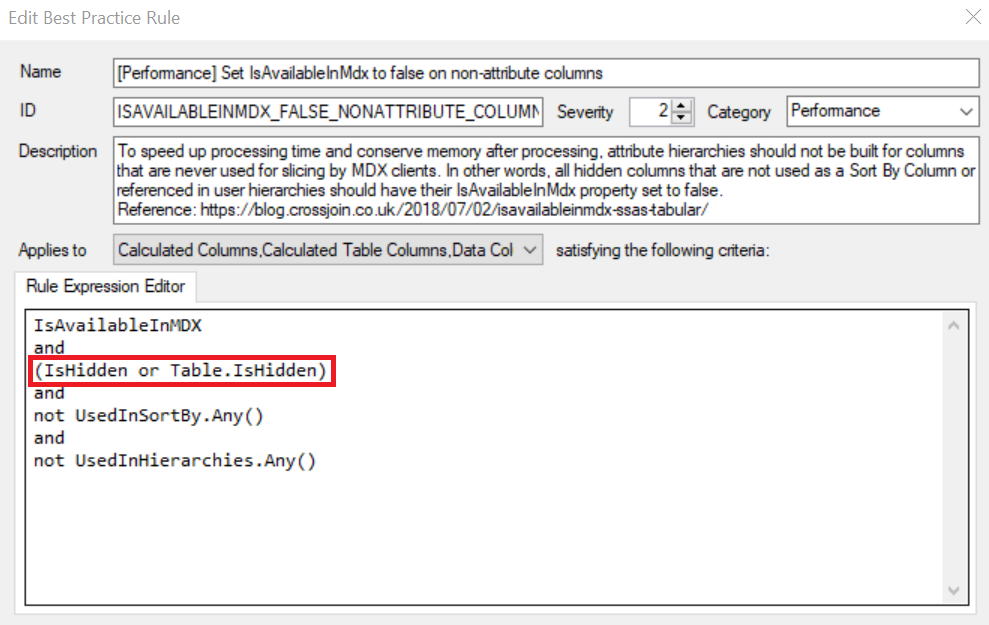
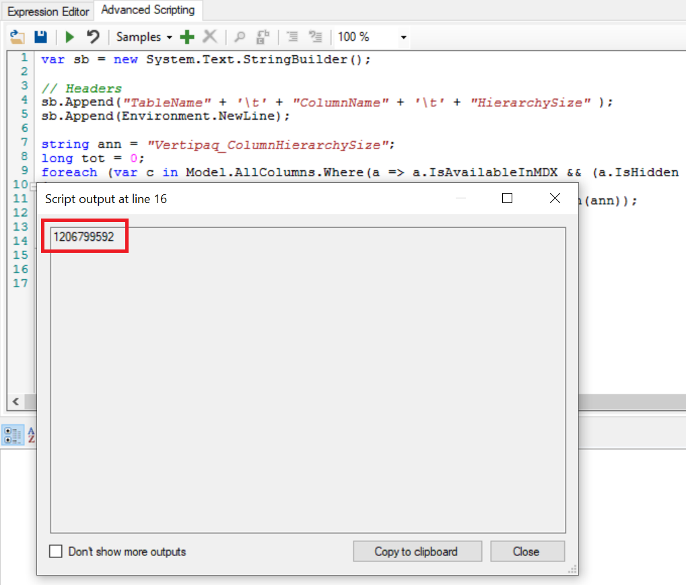
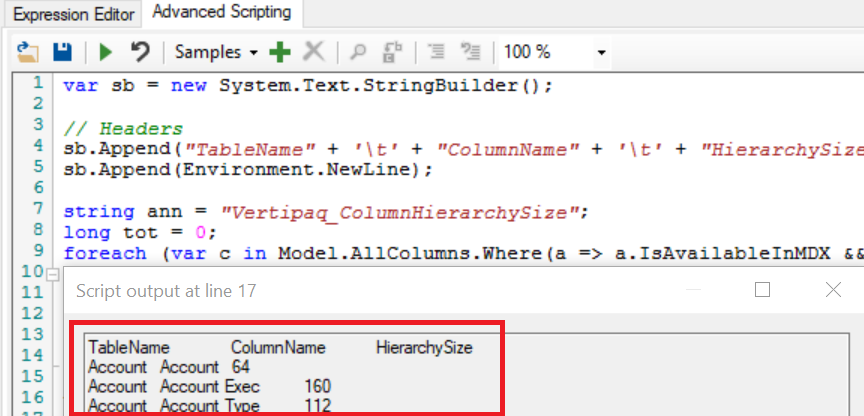

A few weeks ago I wrote a [post on the Power BI Blog](https://powerbi.microsoft.com/blog/best-practice-rules-to-improve-your-models-performance/) detailing [Best Practice Rules](https://github.com/microsoft/Analysis-Services/tree/master/BestPracticeRules) to help improve the design and performance of your model. After viewing the rules, many people have asked which rules are the most critical to follow and if there is a way to quantify the savings of following a particular rule within a given model.

## Rule Priority

Generally speaking, one should use the rule categories to determine their priority. Hence, the rules within the 'Performance' category should be your top priority. That being said, other rules which are not classified as 'Performance' can also have a big impact on your model. For example, the rule 'Remove unnecessary columns' can be quite significant for some models. As a result, I would also place this as one of the 'top priority' rules.

Naturally, rules in the 'Error Prevention' category are also important as breaking such a rule would cause a fundamental issue with the model. Additionally, rules in the 'Formatting' category are less critical and are more for improving model aesthetics. However, these aesthetic rules can also be quite important as I will explain in the next paragraph.

## Rule Synergy

As mentioned earlier, some rules may seem trivial and strictly for aesthetic purposes. An example is the formatting rule 'Hide fact table columns'. Following this may be a best practice but how could it really help a model?

Well...check this out!

The performance rule 'Set IsAvailableInMdx to false on non-attribute columns' can be a highly effective way to reduce the size of your model and decrease model processing times. However, the logic for this rule only looks for columns that are hidden or where the column's table is hidden. Therefore, if you don't hide columns appropriately (i.e. foreign keys, fact table columns), the IsAvailableInMdx rule will not trigger for columns which could benefit from this rule.

Not all the aesthetic-focused rules may have synergy with performance-related rules. However, the above example shows that the rules may function independently but actually also have a way of working together.

## Quantifying the Savings of a Rule

Now, for the second question - how can we measure the savings gained of a particular rule. I wrote two C# scripts, each associated with a [Best Practice Rule](https://github.com/microsoft/Analysis-Services/tree/master/BestPracticeRules), which do just this. Each script can be executed in the [Advanced Scripting window](https://docs.tabulareditor.com/Advanced-Scripting.html#working-with-the-model-object) in [Tabular Editor](https://tabulareditor.com/).

- [Remove Unnecessary Columns](https://github.com/m-kovalsky/Tabular/blob/master/RemoveUnnecessaryColumns_MemorySavings.cs)
- [Set IsAvailableInMdx to false on non-attribute columns](https://github.com/m-kovalsky/Tabular/blob/master/SetIsAvailableInMDXProperty_MemorySavings.cs)

Before running these scripts, you need to load the Vertipaq Analyzer data into Tabular Editor using one of the methods below.

- [Load Vertipaq Analyzer data into Tabular Editor](/post/vertipaqintabulareditor)
- [Import .vpax file into Tabular Editor](/post/vpaxtotabulareditor)

Each of these methods stores [Vertipaq Analyzer](https://www.sqlbi.com/tools/vertipaq-analyzer/) data as [annotations](https://docs.microsoft.com/dotnet/api/microsoft.analysisservices.tabular.model.annotations?view=analysisservices-dotnet) within your model. The C# scripts for the two rules above scan these annotations and provide you with two outputs:

1. The first output is the bytes of memory which would be removed if the rule was followed for all the objects that the rule identifies.
2. The second output is a breakdown of each object which breaks the rule and the bytes of memory which would be removed if the rule was followed for all the object that the rule identifies. This can be copied into Excel and sorted to create a prioritized list.

<figure>

<figcaption>

This shows the total number of bytes which could be saved..

</figcaption>
</figure>

<figure>

<figcaption>

This provides a breakdown of bytes which could be saved for each object.

</figcaption>
</figure>

Each of these rules can have a significant impact towards improving your model. Decreasing memory usage will also speed up the processing of the model (not exactly easy to quantify). Furthermore, reductions in memory may allow you to use a smaller machine which could yield in cost savings.

## Conclusion

The benefits for many of the rules is not so easy to quantify but I have demonstrated that it is possible for some of the rules. This also shows the power of using the [Advanced Scripting](https://docs.tabulareditor.com/Advanced-Scripting.html) feature in [Tabular Editor](https://tabulareditor.com/) to combine metadata with [Vertipaq Analyzer](https://www.sqlbi.com/tools/vertipaq-analyzer/) data. Once you have all this information in once place there are literally tons of things you can discover in a highly efficient manner.
