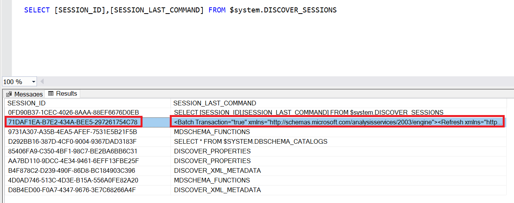
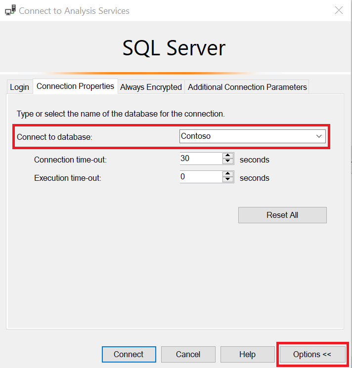

\*\*\* Be sure to also check out related posts which take this to the next level:

[Cancelling a Data Refresh Using Tabular Editor](/post/canceldatarefreshte)

[Cancelling a Power BI Data Refresh Using Azure DevOps](/post/canceldatarefreshado)

---

There are many posts on cancelling the refresh of an Analysis Services model. They typically involve using the DISCOVER\_COMMANDS [DMV](https://docs.microsoft.com/analysis-services/instances/use-dynamic-management-views-dmvs-to-monitor-analysis-services?view=asallproducts-allversions) to find the SPID of the refresh and then running a 'Cancel SPID' command (shown below) which cancels the refresh.

```xml
<Cancel xmlns="http://schemas.microsoft.com/analysisservices/2003/engine">
     <SPID>123</SPID>
     <CancelAssociated>true</CancelAssociated>
</Cancel>
```

However, this does not work when cancelling a [Power BI Premium](https://docs.microsoft.com/power-bi/admin/service-premium-what-is) dataset refresh. Running this results in the following error message.

*`The '<pii>`*[*joe@abc.com\</pii*](mailto:mikova@microsoft.com%3c/pii)*`>' user does not have permission to perform a cancel operation.`*

## The Solution

In order to properly cancel a Power BI Premium dataset refresh in this manner, you must first [enable XMLA R/W endpoints](https://docs.microsoft.com/en-us/power-bi/admin/service-premium-connect-tools#enable-xmla-read-write) for your Premium capacity. Next, instead of using the DISCOVER\_COMMANDS, use DISCOVER\_SESSIONS.

Locate and copy the Session\_ID which has a SESSION\_LAST\_COMMAND value that starts with '\<Batch Transaction=' (as shown below). It will also mention '\<Refresh' and will include the Dataset ID.



Next, you need to run a Cancel command on the Session ID in an XMLA window. Make sure that you set the database (Premium dataset) within the Connection Properties window (select 'Options \>\>' to see this window).



As for the Cancel command, you MUST set the CancelAssociated value to false. Keeping the value as true will result in the same error shown earlier.

```xml
<Cancel xmlns="http://schemas.microsoft.com/analysisservices/2003/engine">
     <SessionID>71DAF1EA-B7E2-434A-BEE5-297261754C78</SessionID>
     <CancelAssociated>false</CancelAssociated>
</Cancel>
```

Or, even easier, you can simply skip the CancelAssociated part.

```xml
<Cancel xmlns="http://schemas.microsoft.com/analysisservices/2003/engine">
     <SessionID>71DAF1EA-B7E2-434A-BEE5-297261754C78</SessionID>
</Cancel>
```

## Why Session ID?

You may be wondering why this method uses the Session ID instead of the SPID. Actually, they both work - as long as you do not set the CancelAssociated value to true. However, in the future cancelling the SPID will not be possible in Power BI Premium so using the Session ID is future-proof.

## What about Cancel Associated?

Setting the CancelAssociated property to 'true' will [also cancel associated connections](https://docs.microsoft.com/en-us/analysis-services/multidimensional-models-scripting-language-assl-xmla/canceling-commands-xmla?view=asallproducts-allversions#canceling-associated-sessions-and-connections). Power BI Premium does not allow Server Admin access to connections (i.e. DISCOVER\_CONNECTIONS). As such, setting the CancelAssociated property to 'true' will cause an error when using Power BI Premium.

## Power BI Refresh Retry

If the dataset refresh was requested via the [Dataset Refresh API](https://docs.microsoft.com/rest/api/power-bi/datasets/refreshdatasetingroup) or within the Power BI Service, Power BI will attempt the refresh again upon failure. In fact, it will retry several times. In that case, you would have to go through the process above for each retry attempt in order to make sure that the refresh is actually cancelled. This does not seem very efficient. It is why I do not recommend refreshing your model using the Power BI Service or using the API. In fact, I will be releasing a tool in the near future which will ease processing for Power BI Premium models - where the processing is completely independent of the Power BI Service or API.

## Conclusion

This post presents a relatively crude method to cancelling a Power BI Premium refresh. As such, it is only a prelude to a more sophisticated approach - and not just for Power BI Premium but for any variation of tabular. If you've read my blog before, you know I like to automate tasks. This is no exception. Be on the lookout for an upcoming post on a more automated and advanced approach to this subject!
