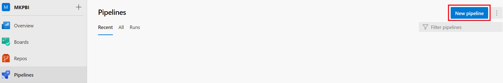
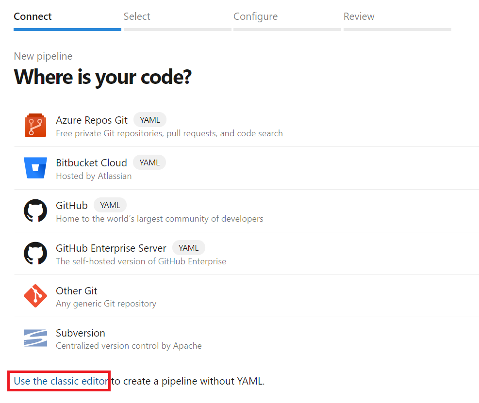
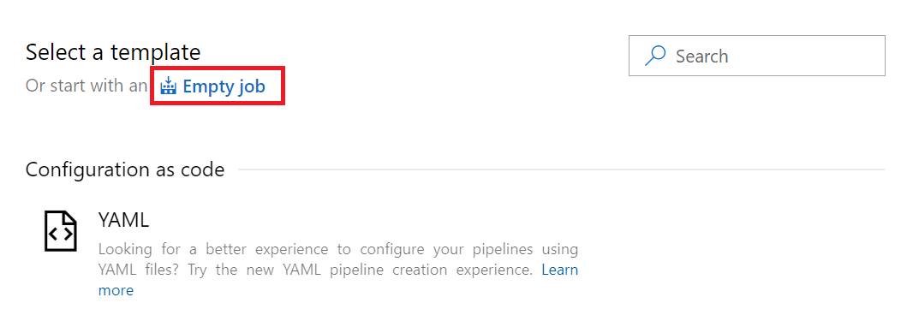
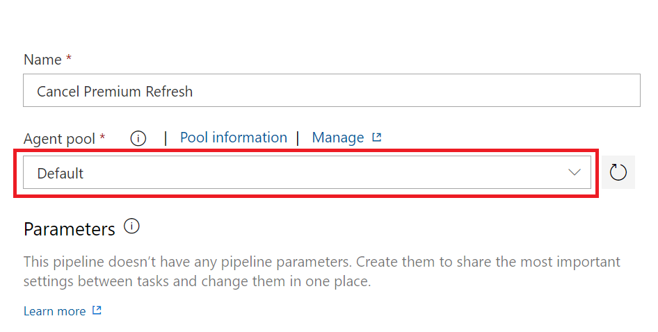
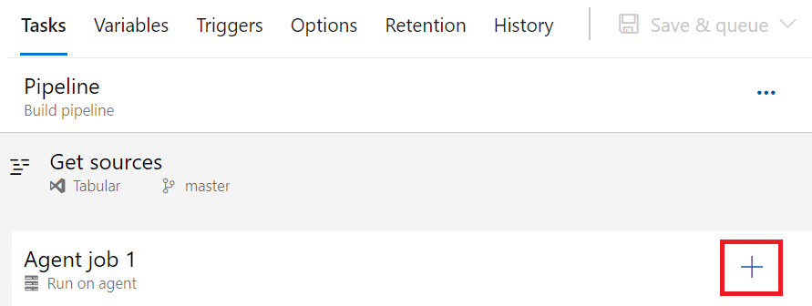
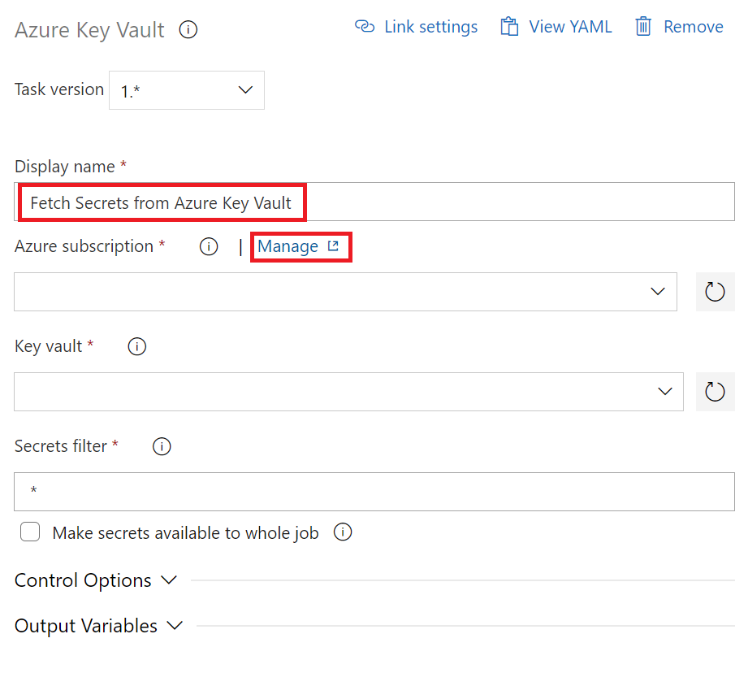
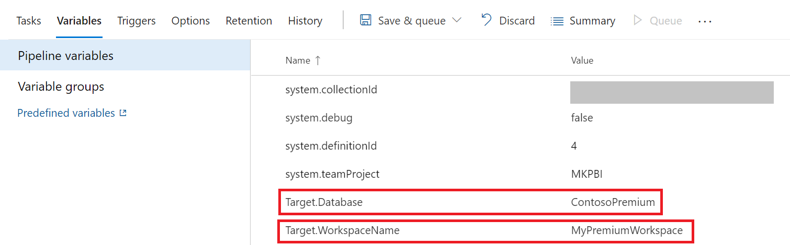
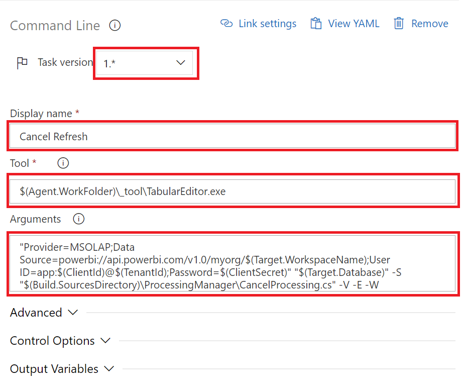
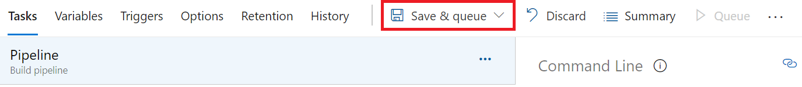
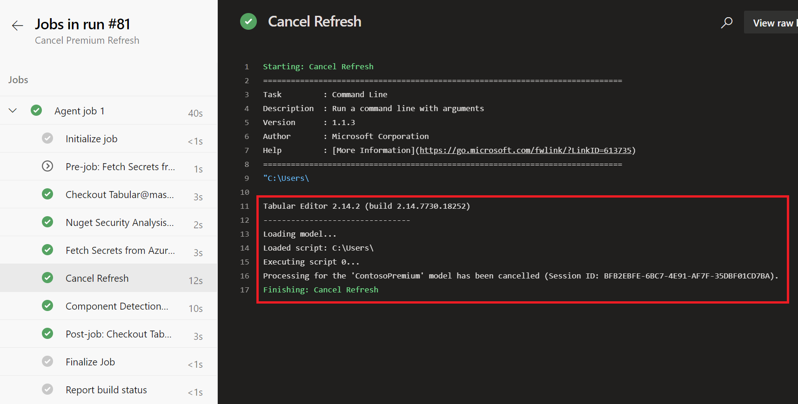

In a recent post I discussed how to cancel a dataset refresh using [Tabular Editor](https://github.com/otykier/TabularEditor/releases/latest). This method is substantially better than the manual method but let's take it up another level of sophistication by integrating the process into [Azure DevOps](https://azure.microsoft.com/services/devops/).

In order to cancel a Power BI Premium dataset refresh, we will need to fetch the authentication credentials. This is achieved by using XMLA R/W endpoints, setting up a Service Principal and using Azure Key Vault. We will still be using [Tabular Editor](https://github.com/otykier/TabularEditor/releases/latest) since it provides an easy method for invoking commands to Analysis Services (or in this case Power BI Premium). Also, we will be using the same [C# script](https://github.com/m-kovalsky/Tabular/blob/master/Processing/CancelProcessing.cs) from my previous post.

## Preliminary Steps

1. [Enable XMLA R/W endpoints](https://docs.microsoft.com/power-bi/admin/service-premium-connect-tools#enable-xmla-read-write) on your Premium capacity.
2. Set up a [Service Principal](https://tabulareditor.github.io/2020/06/02/PBI-SP-Access.html) with tenant access.
3. Download and install [Tabular Editor](https://github.com/otykier/TabularEditor/releases/latest).
4. Create a [Key Vault](https://azuredevopslabs.com/labs/vstsextend/azurekeyvault/#task-2-creating-a-key-vault).
5. Download this [C# script](https://github.com/m-kovalsky/Tabular/blob/master/Processing/CancelProcessing.cs) from GitHub.

## Next Steps

\1. Save the C# script as a file within your Azure DevOps repo.

\2. Create a new Pipeline within Azure DevOps.



\3. Select 'Use the classic editor'.



\4. Select your repository (likely the Azure Repos Git).

\5. Select 'start with an Empty job'.



\6. Name your job and set up your Agent Pool using the instructions provided [here](https://tabulareditor.com/youre-deploying-it-wrong-as-edition-part-3/). Ensure that you make Tabular Editor available within the '\_work/\_tool' folder for the Agent by following [these](https://tabulareditor.com/youre-deploying-it-wrong-as-edition-part-3/) instructions.

\7. Once your Agent Pool is configured, set the Pipeline to your Agent Pool.



\8. Create a new 'Azure Key Vault' task (click the 'plus' sign and search for 'Azure Key Vault').



\9. Update the display name and click 'Manage' within the Azure subscription.



\10. Follow [these steps](https://azuredevopslabs.com/labs/vstsextend/azurekeyvault/#task-3-check-the-azure-pipeline) to create a new Service Connection.

\11. Once the Service Connection is created, enter the values into the 'Azure subscription' and 'Key vault' text boxes.

\12. Enter '\*' into the Secrets filter (this will fetch all the Key Vault secrets).

\13. Navigate to the 'Variables' tab and add the following variables

*Target.Database: This is the name of your Premium Dataset*

*Target.WorkspaceName: This is the name of your Premium Workspace*



\14. Create a new 'Command line' task in your pipeline. Make sure it is set to Task version '1.\*'.

\15. Fill in the 'Display name', 'Tool', and 'Arguments' as shown below.

*\*\*\*Note that I have saved the CancelProcessing.cs script into a folder called 'Processing Manager'.*

Tool:

```text
$(Agent.WorkFolder)\_tool\TabularEditor.exe
```

Arguments:

```text
"Provider=MSOLAP;Data Source=powerbi://api.powerbi.com/v1.0/myorg/$(Target.WorkspaceName);User ID=app:$(ClientId)@$(TenantId);Password=$(ClientSecret)" "$(Target.Database)" -S "$(Build.SourcesDirectory)\ProcessingManager\CancelProcessing.cs" -V -E -W
```



After completing these steps, you will be able to 'Save & queue' this pipeline. This will trigger the processing to be cancelled.



<figure>



<figcaption>

The pipeline completed successfully and has cancelled the data refresh for the Premium dataset.

</figcaption>
</figure>

Now, whenever you want to cancel processing for this Premium dataset you can simply click 'Run Pipeline' within this pipeline. Additionally, you can change the dataset or Premium Workspace to easily cancel other dataset refreshes (as long as the Service Principal has admin access to them).

## Conclusion

The setup for this method is more complicated than the methods previously discussed. However, once it is set up it just requires a single click of a button to execute. It should be noted that this method can also be applied to [SQL Server Analysis Services](https://docs.microsoft.com/analysis-services/ssas-overview?view=asallproducts-allversions) and [Azure Analysis Services](https://azure.microsoft.com/services/analysis-services/) models with just a few modifications.

This method also introduces Azure DevOps as a way to manage and automate various components and processes for your tabular model. Simply for that, I recommend using this method as it will open up many opportunities for creating a more robust Power BI platform. Look out for a new post coming out soon which will further show how powerful the integration of Power BI and Analysis Services is with Azure DevOps!
