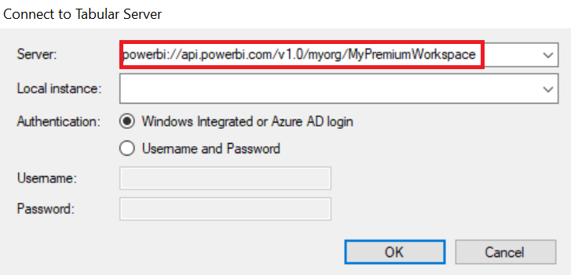

In my [previous post](/post/canceldatarefresh) I discussed how to cancel a [Power BI Premium](https://docs.microsoft.com/power-bi/admin/service-premium-what-is) dataset refresh. However, the method used was quite crude and too manual. Let's kick it up a notch and make it easier to accomplish this mundane activity.

First, make sure that you have enabled [XMLA R/W endpoints](https://docs.microsoft.com/power-bi/admin/service-premium-connect-tools#enable-xmla-read-write). And, be sure to set up a Service Principal by following the steps outlined [here](https://tabulareditor.github.io/2020/06/02/PBI-SP-Access.html).

## Steps

Once you have XMLA R/W endpoints enabled and have set up a service principal, simply follow these steps.

1. Download and install [Tabular Editor](https://tabulareditor.com/) (version 2.12.1 or higher).
2. Download the [C# script from GitHub](https://github.com/m-kovalsky/Tabular/blob/master/Processing/CancelProcessing.cs).
3. Open Tabular Editor and go to File-\>Open-\>From DB...
4. Connect to your Power BI Premium workspace (as shown below). See [this link](https://docs.microsoft.com/power-bi/admin/service-premium-connect-tools#connecting-to-a-premium-workspace) for more details about obtaining the Premium workspace.



\5. When prompted, choose the Premium dataset (model name).

\6. Paste the C# script into the [Advanced Scripting](https://docs.tabulareditor.com/Advanced-Scripting.html#working-with-the-model-object) window of Tabular Editor.

\7. Now you can cancel a dataset refresh for this model by clicking the 'Play' button (or 'F5').

## The Script

The [C# script](https://github.com/m-kovalsky/Tabular/blob/master/Processing/CancelProcessing.cs) is quite simple. It first runs the same [DMV](https://docs.microsoft.com/analysis-services/instances/use-dynamic-management-views-dmvs-to-monitor-analysis-services?view=asallproducts-allversions) as outlined in my [previous post](/post/canceldatarefresh) and filters the query to acquire the Session ID of the refresh command. This uses the [Querying Analysis Services](https://docs.tabulareditor.com/Useful-script-snippets.html#querying-analysis-services) capability released in Tabular Editor v2.12.1.

```csharp
var DMV_Cmd = ExecuteDax("SELECT [SESSION_ID],[SESSION_LAST_COMMAND] FROM $SYSTEM.DISCOVER_SESSIONS").Tables[0];
string databaseID = Model.Database.ID;
string databaseName = Model.Database.Name;
string sID = string .Empty;
```

```csharp
for (int r = 0; r < DMV_Cmd.Rows.Count; r++)
{
    string sessionID = DMV_Cmd.Rows[r][0].ToString();
    string cmdText = DMV_Cmd.Rows[r][1].ToString();

    // Capture refresh command for the database
    if (cmdText.StartsWith("<Batch Transaction=") && cmdText.Contains("<Refresh xmlns") && cmdText.Contains("<DatabaseID>"+databaseID+"</DatabaseID>"))
    {
        sID = sessionID;
    }
}
```

Next, it runs the [Cancel Session](https://docs.microsoft.com/dotnet/api/microsoft.analysisservices.core.server.cancelsession?view=analysisservices-dotnet) command using the Session ID and executes it against the Power BI Premium dataset.

```csharp
Model.Database.TOMDatabase.Server.CancelSession(sID);
Info("Processing for the '"+databaseName+"' model has been cancelled (Session ID: "+sID+").");
```

## Conclusion

Using this method, you no longer have to go through all the manual steps outlined in my [previous post](/post/canceldatarefresh). It is all automated by using the [C# script](https://github.com/m-kovalsky/Tabular/blob/master/Processing/CancelProcessing.cs). Despite this post being centered around [Power BI Premium](https://docs.microsoft.com/power-bi/admin/service-premium-what-is), it should be known that this process can also be applied to SQL Server Analysis Services (SSAS) & Azure Analysis Services (Azure AS) models. Simply replace Step 4 by connecting to your SSAS or Azure AS model.

Perhaps you think this is as far as we can go to automate the process. However, we can take it to yet another level of sophistication. Stay tuned for my next post where I'll show you exactly that!
