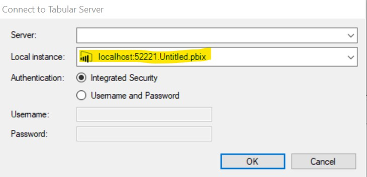
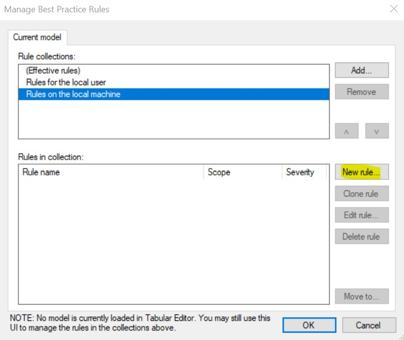
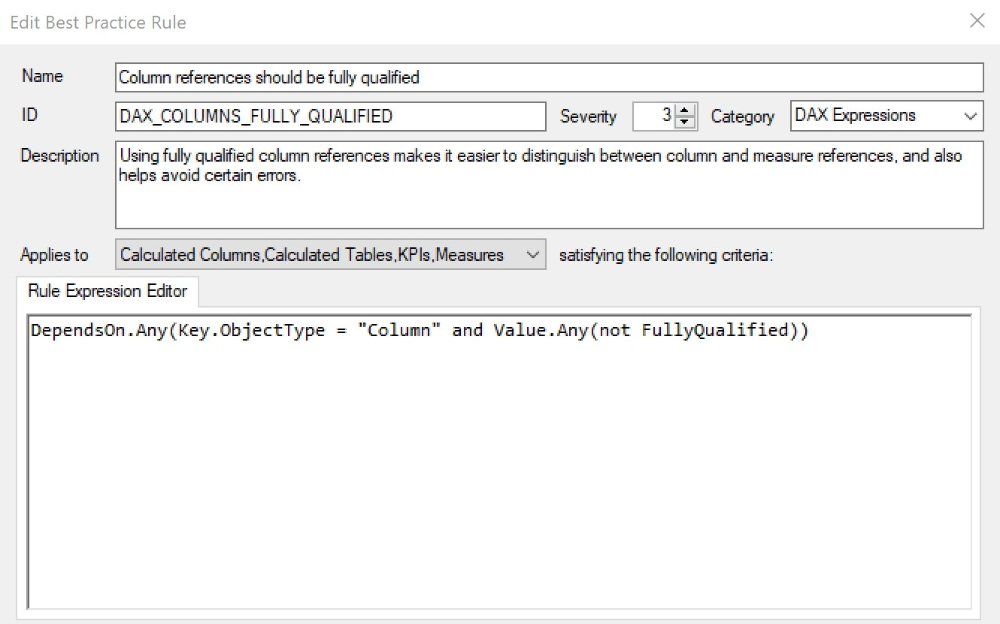
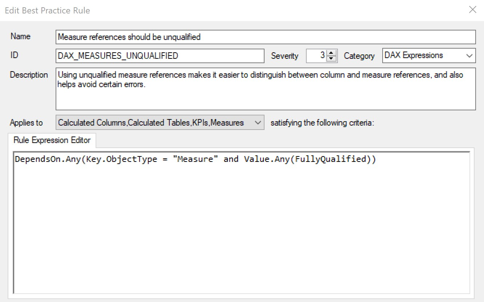
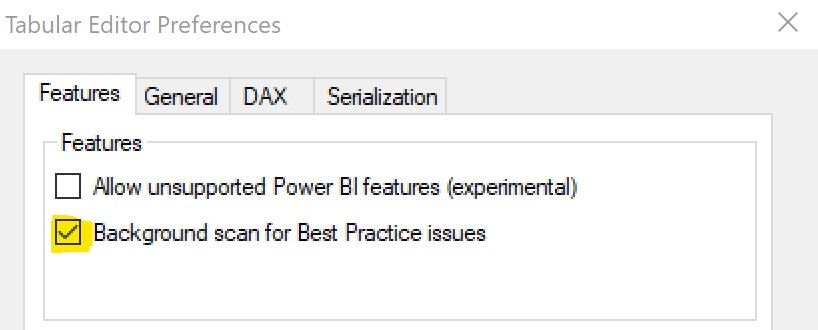
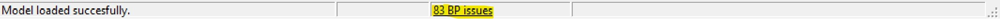

It has been [demonstrated](https://www.sqlbi.com/tv/dax-best-practices/) that improperly referencing columns and measures in DAX can yield inaccurate results. Such improper references also make DAX less readable and more ambiguous as it is unclear which references are measures and which references are columns.

The solution is simple:

ALWAYS specify the table when referencing a column.

Incorrect:

```dax
Revenue = SUM ( [RevenueAmt] )
```

Correct:

```dax
Revenue = SUM ( 'Revenue'[RevenueAmt] )
```

NEVER specify the table when referencing a measure.

Incorrect:

```dax
Budget Attainment % = DIVIDE ( 'Revenue'[Revenue], 'Budget'[Budget] )
```

Correct:

```dax
Budget Attainment % = DIVIDE ( [Revenue], [Budget] )
```

Making proper references not only avoids potential inaccurate results but also increases readability as this best practice makes it is easy to differentiate columns from measures.

## let's automate

You may be thinking - "there's no way I'm going to go through all the measures in my model to check for this - it's too much work!" Well you are in luck - there is an easy way to check your model for these issues using [Tabular Editor](https://github.com/otykier/TabularEditor/releases)'s [Best Practice Analyzer](https://docs.tabulareditor.com/Best-Practice-Analyzer.html). It doesn't matter if your model was created in Power BI Desktop, SSDT, or Tabular Editor.

If your model was created in Power BI Desktop, follow from step 1. If not, skip ahead to step 4B.

\1. Open the Power BI Desktop file that contains your model.

\2. Open [Tabular Editor](https://github.com/otykier/TabularEditor/releases).

\3. Go to File -\> Open -\> From DB...

4A. Click on the drop down under 'Local instance' and select your Power BI Desktop file (as shown below).



4B. If your model is outside of Power BI Desktop, connect to the .bim file or database.json file in [Tabular Editor](https://github.com/otykier/TabularEditor/releases) (File -\> Open -\> From File...).

\5. Once connected, go to 'Tools' -\> 'Manage BPA Rules...'.

\6. Click 'New rule...'



\7. Enter the following to create the rule to check columns.

<figure>



<figcaption>

This rule checks for column references without table names

</figcaption>
</figure>

\8. Add another rule and enter the following to create the rule to check measures.

<figure>



<figcaption>

This rule checks for measure references with table names

</figcaption>
</figure>

\9. Enable the Best Practice Analyzer: File -\> Preferences -\> Features. Select as shown below.



Now that you have the rules set up and the Best Practice Analyzer enabled, any issues you have will show at the bottom of the Tabular Editor window (see image below). Clicking on the BP issues link will take you to a window where you can see all of the columns/measures that violate the 2 rules. Once you know the offending columns/measures, you can easily fix them by following the rules stated at the beginning of this post.\*



\**Note that you cannot yet make changes to Power BI Desktop (.pbix) files in Tabular Editor. If your model is in Power BI Desktop make sure to make the changes to your model there. Otherwise you can make the changes directly in Tabular Editor.*

---

## Conclusion

The [Best Practice Analyzer](https://docs.tabulareditor.com/Best-Practice-Analyzer.html) in [Tabular Editor](https://github.com/otykier/TabularEditor/releases) enables us to quickly scan a model for common issues. In this case we used it to detect column/measure reference issues but the range of issues we can check is practically limitless (naming standards, formatting, DAX syntax etc.). And, it is incredibly fast - even for models with many tables, measures and columns.
