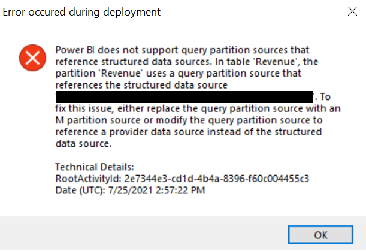

When migrating a tabular model from [Analysis Services](https://docs.microsoft.com/analysis-services/ssas-overview?view=asallproducts-allversions) or [Azure Analysis Services](https://azure.microsoft.com/services/analysis-services/) to [Power BI Premium](https://docs.microsoft.com/power-bi/admin/service-premium-what-is), you may run into an issue related to the data sources you are using and the table partitions referencing those data sources. To understand this, let's cover some basics.

There are 2 types of data sources: 'provider' data sources (sometimes called 'legacy') and 'structured' data sources.

## Provider Data Sources

As their name suggests, provider data sources require the user to enter a 'provider' (i.e. Microsoft SQL Server). The table partitions which reference a provider data source generally use SQL (or a form of it - depending on the exact data source). Models built in Visual Studio which are of compatibility level 1200 will default to use provider data sources. Additionally, models built in [Tabular Editor](https://tabulareditor.com/) will also default to use provider data sources.

## Structured Data Sources

Structured data sources are essentially [Power Query](https://docs.microsoft.com/power-query/) connecters which are designed to use the [M language](https://docs.microsoft.com/powerquery-m/). The table partitions which reference a structured data source generally use M. Models built in Visual Studio which are of compatibility level 1400 or higher will default to use structured data sources and use the M language in partitions which reference these data sources.

## Power BI Desktop

When you create a table in [Power BI Desktop](https://powerbi.microsoft.com/desktop/), it deviates from the outline above. It actually does not create a data source. It simply stores the data source information within the table's partition as M-code.

## Recap and Potential Issue

In general, provider data sources align with partitions using SQL while structured data sources align with partitions using M. However, Analysis Services and Azure Analysis Services support partitions which use SQL and reference a structured data source. Note that Power BI (Premium) [does not support this](https://docs.microsoft.com/power-bi/admin/service-premium-connect-tools#data-source-declaration). In Power BI, a partition that uses SQL must reference a provider data source. Due to this difference between Analysis Services and Power BI, it is essential to make sure your data sources and partitions are aligned before migrating to Power BI Premium. Below is an example of the error message you will get if you try to deploy such a model to Power BI Premium.

## Solution

As the error message indicates, there are two solutions to this problem. First, you can update the 'problematic' partitions to use M. The other option is to convert the structured data source into a provider data source. I will give you a hint - the second option is much simpler. Additionally, if your partitions use SQL, I generally recommend using a provider data source anyways.

Well, as has become common with my blog, I have written a [C# script](https://github.com/m-kovalsky/Tabular/blob/master/ConvertStructuredToProvider.cs) which automates this process for you. Now, your migration to [Power BI Premium](https://docs.microsoft.com/power-bi/admin/service-premium-what-is) becomes that much simpler.

Download the script [here](https://github.com/m-kovalsky/Tabular/blob/master/ConvertStructuredToProvider.cs).

Running this script in the [Advanced Scripting](https://docs.tabulareditor.com/Advanced-Scripting.html) window within [Tabular Editor](https://tabulareditor.com/) will do the following:

1. Loop through all structured data sources
2. Create a provider data source with the same connection properties as the structured data source.
3. Update any partitions which reference the structured data source to reference the new provider data source.
4. Delete the structured data source.
5. Update the name of the provider data source to match the name of the original structured data source.

*Note: If your data source requires authentication credentials, you may have to enter the password into the connection string properties of the data source before you deploy.*

*Note: The above script works in both Tabular Editor 2 and 3.*

And just like that - a potential blocker has been removed and you should be on your way to successfully migrating to [Power BI Premium](https://docs.microsoft.com/power-bi/admin/service-premium-what-is)!

## Integration with Best Practice Analyzer

This potential issue has been encapsulated in a newly released rule in Version 1.2 of the [Best Practice Rules](https://github.com/microsoft/Analysis-Services/tree/master/BestPracticeRules) for [Tabular Editor](https://tabulareditor.com/)'s [Best Practice Analyzer](https://docs.tabulareditor.com/Best-Practice-Analyzer.html).

The name of the new rule is: \[Error Prevention\] Avoid structured data sources with provider partitions

Make sure to download the latest rules [here](https://github.com/microsoft/Analysis-Services/tree/master/BestPracticeRules)!

## Conclusion

Before migrating to Power BI Premium, it is important to align on your data source and partition strategy. If you are using SQL-type sources, I highly recommend using provider data sources. It will be more natural and will easily transfer to Power BI Premium. Many people believe that Power BI Premium requires structured data sources and that the partitions must be in 'M'. However, this is not the case. Provider data sources work just fine in Premium and can be managed quite easily when working with [Tabular Editor](https://tabulareditor.com/) (version 2 or 3). For more information on data sources in Power BI and Analysis Services, see this [link](https://docs.microsoft.com/azure/analysis-services/analysis-services-datasource#understanding-providers).
