There are 3 critical elements which one must understand *before* using a data model.

1. The definition of model objects (i.e. measures and attributes) and their business context. This is accomplished by the [Automated Data Dictionary](/post/datadictionary).
2. How the tables work together - what can be sliced by what.
3. When and how often each dataset within the model is refreshed.

In this post, I will focus on the 2nd element. Understanding how tables work together means understanding the [table relationships](https://docs.microsoft.com/en-us/analysis-services/tabular-models/relationships-ssas-tabular) - which tables are related, how they're related, and what that relationship means.

## Understanding which tables are related

Models can quickly become complicated, so we need a way to distill their relationship complexity into a simple and digestible diagram.

One solution to this problem is to show a [matrix](https://docs.microsoft.com/en-us/power-bi/visuals/desktop-matrix-visual) of [Fact tables](https://en.wikipedia.org/wiki/Fact_table) vs [Dimension tables](<https://en.wikipedia.org/wiki/Dimension_(data_warehouse)#Dimension_table>). This solution involves the following steps:

1. Creating a stored procedure
2. Executing the stored procedure
3. Importing the output table into your tabular model
4. Creating the diagram

That being said, let's begin!

## Creating the stored procedure

The following SQL stored procedure outputs a table showing all the relationships that exist in your tabular model. Akin to the [Automated Data Dictionary](/post/datadictionary), this also leverages [DMVs](https://docs.microsoft.com/en-us/analysis-services/instances/use-dynamic-management-views-dmvs-to-monitor-analysis-services). It denotes the important attributes of relationships which are listed below.

- Fact tables vs Dimension tables
- Foreign and Primary Keys
- Single-direction or Bi-directional (Cross Filtering Behavior)
- Is the relationship active? (Active Flag)
- Many-to-One or Many-to-Many\* (Relationship Type)

\*[*Many-to-Many*](https://blogs.msdn.microsoft.com/analysisservices/2019/03/26/whats-new-for-sql-server-2019-analysis-services-ctp-2-4/) *is available in* [*SQL 2019 CTP 2.4 or higher*](https://docs.microsoft.com/en-us/sql/sql-server/sql-server-ver15-release-notes?view=sqlallproducts-allversions)*,* [*Azure Analysis Services*](https://azure.microsoft.com/en-us/services/analysis-services/)*,* [*Power BI Desktop*](https://powerbi.microsoft.com/en-us/desktop/) *&* [*P*](https://powerbi.microsoft.com/en-us/power-bi-premium/)*ower BI Premium.*

```sql
CREATE PROC [dbo].[usp_Load_DataStructure]

 @ServerName VARCHAR(100)
,@DatabaseName VARCHAR(100)

AS

DECLARE @SnapshotDate DATETIME SET @SnapshotDate = (SELECT GETDATE())
DECLARE @SQL NVARCHAR(MAX)
DECLARE @DropCreate NVARCHAR(MAX)
DECLARE @DatabaseNameNoSpaces VARCHAR(50) SET @DatabaseNameNoSpaces = (SELECT REPLACE(@DatabaseName,' ',''))

/**************Dynamically drop/create the output table*************/
SET @DropCreate =
'
DROP TABLE IF EXISTS [dbo].[DataStructure_'+@DatabaseNameNoSpaces+']

CREATE TABLE [dbo].[DataStructure_'+@DatabaseNameNoSpaces+']
(
	[ModelName] [varchar](60) NOT NULL,
	[FactTableName] [varchar](200) NULL,
	[DimensionTableName] [varchar](200) NULL,
	[DimensionTableNameSort] [int] NULL,
	[PrimaryKeyName] [varchar](200) NULL,
	[ForeignKeyName] [varchar](200) NULL,
	[CrossFilteringBehavior] [varchar](15) NULL,
	[RelationshipType] [varchar](15) NULL,
	[ActiveFlag] [varchar](10) NULL,
	[RelationshipFlag] [decimal](3,2) NULL,
	[SnapshotDate] [datetime] NULL
)'

EXEC (@DropCreate)

/**************Use DMVs to capture the required metadata*************/
SET @SQL =

'WITH
Relationships as
(
	 SELECT *
	 FROM OPENROWSET(''MSOLAP'',''DATASOURCE='+@ServerName+'; Initial Catalog='+@DatabaseName+';'',
	 ''SELECT * FROM [$SYSTEM].[TMSCHEMA_RELATIONSHIPS]'')
)
,PerspectiveTableList as
(
	 SELECT *
	 FROM OPENROWSET(''MSOLAP'',''DATASOURCE='+@ServerName+'; Initial Catalog='+@DatabaseName+';'',
	 ''SELECT * FROM [$SYSTEM].[TMSCHEMA_PERSPECTIVE_TABLES]'')
)
,TableList as
(
	 SELECT *
	 FROM OPENROWSET(''MSOLAP'',''DATASOURCE='+@ServerName+'; Initial Catalog='+@DatabaseName+';'',
	 ''SELECT * FROM [$SYSTEM].[TMSCHEMA_TABLES]'')
)
,ColumnList as
(
	 SELECT [ID],[ExplicitName]
	 FROM OPENROWSET(''MSOLAP'',''DATASOURCE='+@ServerName+'; Initial Catalog='+@DatabaseName+';'',
	 ''SELECT * FROM [$SYSTEM].[TMSCHEMA_COLUMNS]'')
)
,PerspectiveList as
(
	 SELECT *
	 FROM OPENROWSET(''MSOLAP'',''DATASOURCE='+@ServerName+'; Initial Catalog='+@DatabaseName+';'',
	 ''SELECT * FROM [$SYSTEM].[TMSCHEMA_PERSPECTIVES]'')
)
'
/********Build the output table by joining the metadata tables together*********/
+'
,Stage AS
(
SELECT DISTINCT
'''+@DatabaseName+''' AS [ModelName]
,CAST(t.[name] AS VARCHAR(MAX)) AS [FactTableName]
,CAST(t2.[name] AS VARCHAR(MAX)) AS [DimensionTableName]
,CAST(c.[ExplicitName] AS VARCHAR(MAX)) AS [PrimaryKeyName]
,CAST(c2.[ExplicitName] AS VARCHAR(MAX)) AS [ForeignKeyName]
,CASE CAST(r.[CrossFilteringBehavior] AS INT)
	 WHEN 1 THEN ''Single''
	 WHEN 2 THEN ''Bi-Di''
	 END AS [CrossFilteringBehavior]
,CASE WHEN CAST(r.[FromCardinality] AS INT) = 1 AND CAST(r.[ToCardinality] AS INT) = 1 THEN ''One-to-One''
	  WHEN CAST(r.[FromCardinality] AS INT) = 2 AND CAST(r.[ToCardinality] AS INT) = 1 THEN ''Many-to-One''
	  WHEN CAST(r.[FromCardinality] AS INT) = 2 AND CAST(r.[ToCardinality] AS INT) = 2 THEN ''Many-to-Many''
	  ELSE ''Other''
	  END AS [RelationshipType]
	,CASE CAST(r.[IsActive] AS INT)
	 WHEN 1 THEN ''Yes''
	 WHEN 0 THEN ''No''
	 END AS [ActiveFlag]'

/*Denote inactive relationships as 0.7 so the KPI will show yellow for inactive and green for active*/
+'
,CASE WHEN CAST(r.[IsActive] AS INT) = 0 THEN 0.7 ELSE 1 END AS [RelationshipFlag]
FROM Relationships				AS r
LEFT JOIN TableList				AS t	ON r.[FromTableId] = t.[id]
LEFT JOIN PerspectiveTableList	AS pt	ON t.[Id] = pt.[TableId]
LEFT JOIN PerspectiveList		AS p	ON pt.[PerspectiveId] = p.[Id]
LEFT JOIN TableList				AS t2	ON r.[ToTableId] = t2.[id]
LEFT JOIN PerspectiveTableList		AS pt2	ON T.[Id] = pt2.[TableId]
LEFT JOIN PerspectiveList		AS p2	ON PT.[PerspectiveId] = p2.[Id]
LEFT JOIN ColumnList			AS c	ON r.[ToColumnID] = c.[ID]
LEFT JOIN ColumnList			AS c2	ON r.[FromColumnID] = c2.[ID]
)'

SET @SQL = @SQL +

/*****Count the number of relationships held by each Dimension*****/
'
,Counts AS
(
 SELECT [DimensionTableName]
 ,SUM([RelationshipFlag]) AS [RelationshipCount]
 FROM Stage
 GROUP BY [DimensionTableName]
)'
/*****Rank the Dimensions by how many relationships each has*****/
+'
,CountRank AS
(
 SELECT *
 ,ROW_NUMBER() OVER (ORDER BY [RelationshipCount] DESC,[DimensionTableName]) AS [DimensionTableNameSort]
 FROM Counts
)'
/*****Add the Dimension ranking (DimensionTableNameSort) to the base table*****/
+'
INSERT INTO [dbo].[DataStructure_'+@DatabaseNameNoSpaces+']
SELECT
 a.[ModelName]
,a.[FactTableName]
,a.[DimensionTableName]
,b.[DimensionTableNameSort]
,a.[PrimaryKeyName]
,a.[ForeignKeyName]
,a.[CrossFilteringBehavior]
,a.[RelationshipType]
,a.[ActiveFlag]
,a.[RelationshipFlag]
,'''+CONVERT(NVARCHAR(20),@SnapshotDate)+''' AS [SnapshotDate]
FROM Stage AS a
LEFT JOIN CountRank AS b ON a.[DimensionTableName]  = b.[DimensionTableName]
ORDER BY 1,2,3
'

EXEC (@SQL)
GO
```

## Executing the stored procedure

To execute the stored procedure, run the following command. Just fill in the proper Server Name and Database Name.

```sql
EXEC [dbo].[usp_Load_DataStructure] 'ServerName','DatabaseName'
```

Executing the stored procedure will give you a table like this (I've omitted the SnapshotDate column).

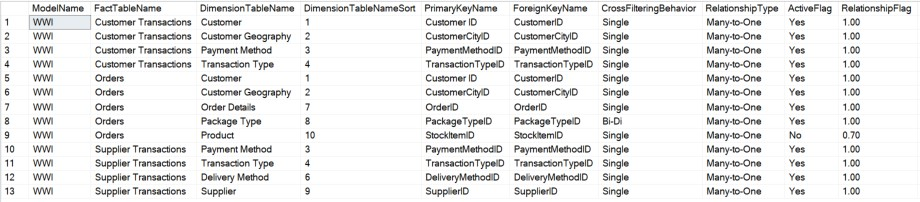

## Adding the Table to your Model

As done in the [Automated Data Dictionary](/post/datadictionary), we can feed this table into the tabular model so that users can easily access it via a Power BI Report/Dashboard. In the process, we'll turn it into a diagram.

Create a view that is a '`SELECT` \* `FROM`' the table produced by the stored procedure. It is best to use views as a decoupling layer between the database and model. This comes in handy just in case any filters need to be added. It's also best to be consistent so that all objects in your model come from the same object type (all from views instead of some from tables and some from views). Next, add this table to your model as shown below and format all columns so they are easy to read.

<figure>

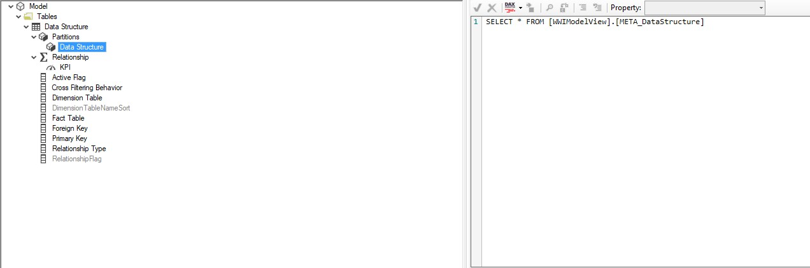

<figcaption>

Properly formatted Data Structure table in Tabular Editor

</figcaption>
</figure>

Next, make sure to have the Dimension Table column sort by the DimensionTableNameSort column (as shown below in Tabular Editor).

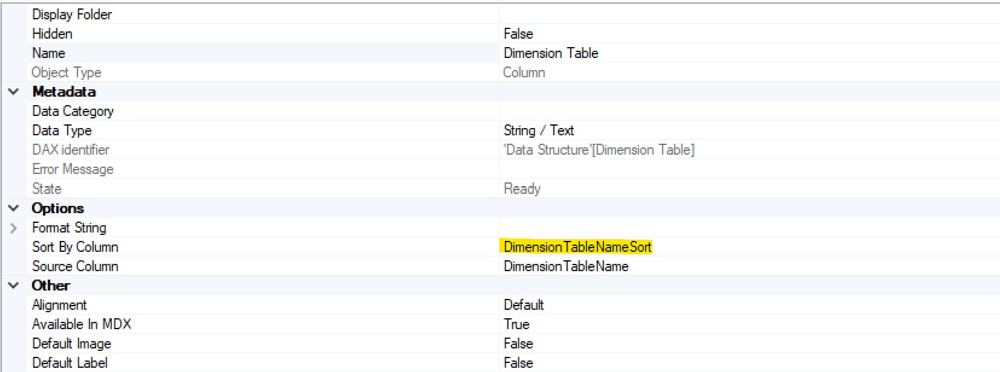

Next, make a measure called 'Relationship' as follows:

```dax
Relationship = SUM('Data Structure'[RelationshipFlag])
```

Lastly, turn the 'Relationship' measure into a KPI where the icon shows as green when \>0.7 and Red when \<0.4. Using a KPI allows the diagram to display a different color for active/inactive relationships.

<figure>

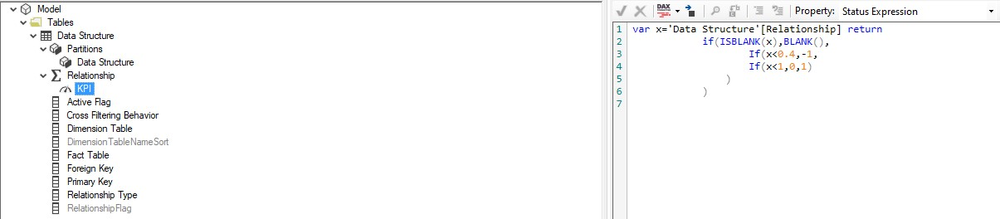

<figcaption>

KPI logic as shown in Tabular Editor

</figcaption>
</figure>

## CREATING the Diagram

Once the Data Structure table is loaded into your model and processed, complete the following steps to create the diagram.

1.) Add a Matrix visual to the report page.

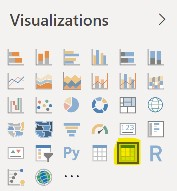

2.) Add the following columns and KPI from the Data Structure table to the visual.

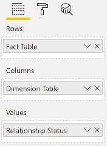

3.) In the formatting pane, turn off Row and Column Subtotals.

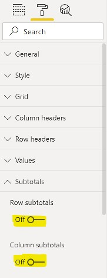

4.) In the formatting pane, increase the font size of the Column headers (Column headers -\> Text size), Row headers (Row headers -\> Text size), and Values (Values -\> Text size) to 10pt.

5.) Turn Title off and [Tooltips](https://docs.microsoft.com/en-us/power-bi/desktop-tooltips) on. Turning on Tooltips allows you to see more detailed data points when you hover over an object in the visual.

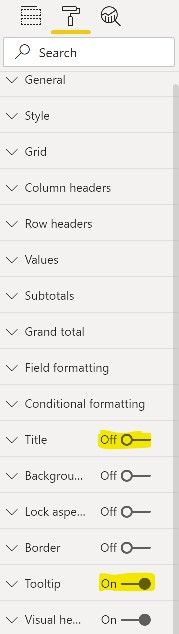

At this point, your diagram should look like this (with the facts/dims from your model).

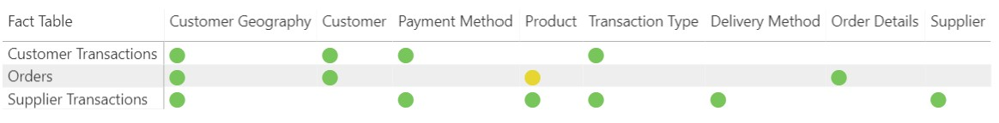

The next steps will complete the legend, axis labeling and title so it looks like this:

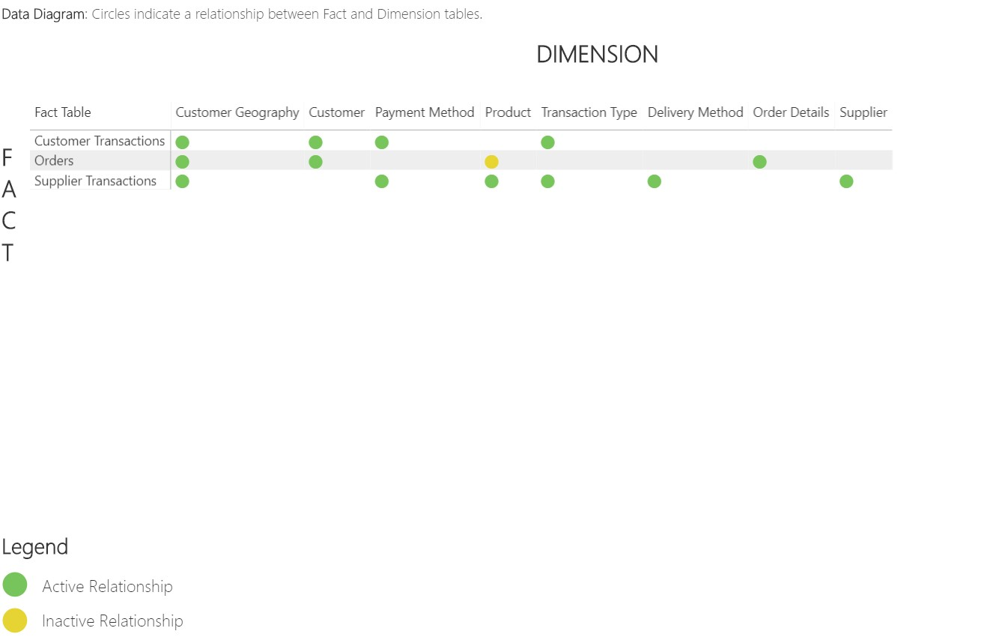

6.) Create a text boxes for 'FACT', 'DIMENSION' and 'Legend'. All should be in bold caps.

7.) Create two more text boxes with 'Active Relationship' and 'Inactive Relationships' for the legend. The text here is not in bold or caps.

8.) Create a text box for the title (text shown in the picture above).

9.) To create the green/yellow icons in the legend, make a new oval shape within the Shapes drop-down (shown below). Set the Line color to white with a Weight of 3pt.

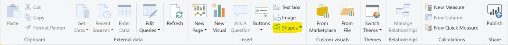

The fill colors are shown below. Simply choose to enter a custom color and then enter the [Hex Color Code](https://www.color-hex.com/).

Green: #78C55C

Yellow: #E7D531

In the 'General' section of the 'Format Shape' pane, set the Width and Height to 40 each. Having an equal height and width turns the shape into a circle.

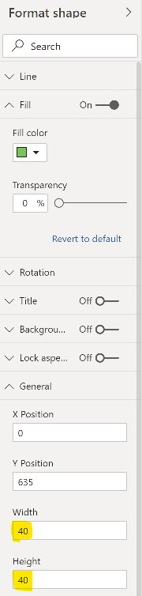

10.) Lastly, add the following report filters to the page: Fact Table, Dimension Table, Relationship Type, Active Flag, and Cross Filtering Behavior.

## How to Interpret the Diagram

The diagram organizes Fact tables on rows (on the left side) and Dimension tables on columns (across to the right). Green circles indicate an active relationship whereas yellow circles denote an inactive relationship between the two tables. Even if you have a large model with many tables you can still effectively see the table relationships within this construct. Since we added page filters, you can easily modify the view as you wish. For example, you can filter to a specific table, remove inactive relationships, or focus on Bi-Di relationships. Also, since we sorted the Dimension Table column by the DimensionTableNameSort column, the Dimension Tables are shown from left to right by the most commonly related dimensions. In other words, dimension tables with the most relationships show on the left. This reduces scrolling to the right by putting the most important dimensions within quickest reach.

## Active vs Inactive

An active relationship between two tables means that measures in the fact table can be sliced by columns from the dimension table. An inactive relationship means that measures in the fact table cannot be sliced by columns from the dimension table unless there is DAX in said measure triggering the inactive relationship to become active. This is accomplished via the [`USERELATIONSHIP`](https://dax.guide/userelationship/)\* function.

\**The* [*`USERELATIONSHIP`*](https://dax.guide/userelationship/) *function may not be used if there is* [*Row Level Security*](https://docs.microsoft.com/en-us/power-bi/desktop-tutorial-row-level-security-onprem-ssas-tabular) *on the 'To' (Dimension) Table.* [*Click here*](https://blog.crossjoin.co.uk/2013/05/10/userelationship-and-tabular-row-security/) *for more details.*

---

## Conclusion

This diagram distills a lot of information into a digestible format. It can be used not only by developers but by report creators as well as report users. Understanding which tables are related and how they are related will create a more informed user group, yielding better designed reports and user queries. This ultimately leads to better performance and easier access to insights for all.
