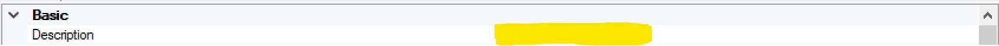
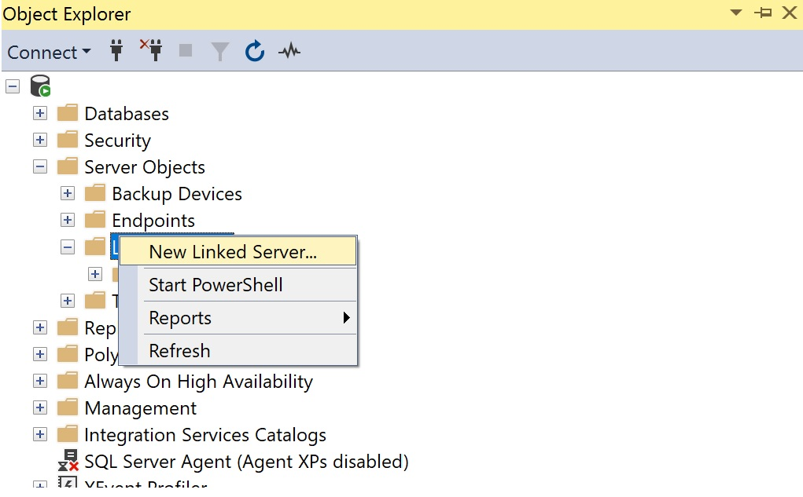
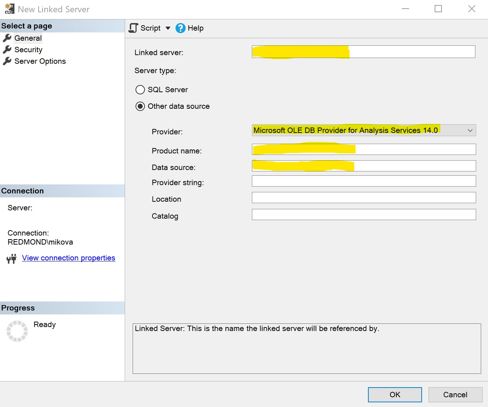
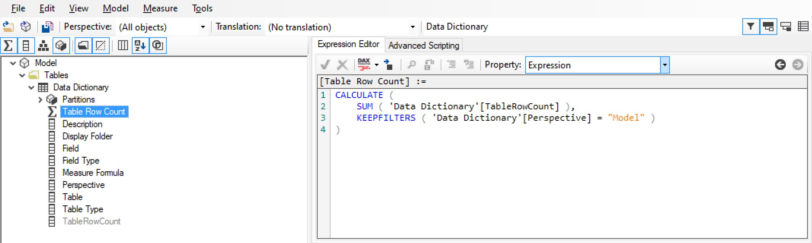
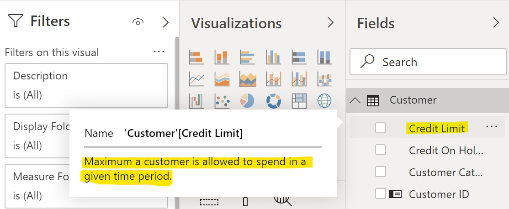
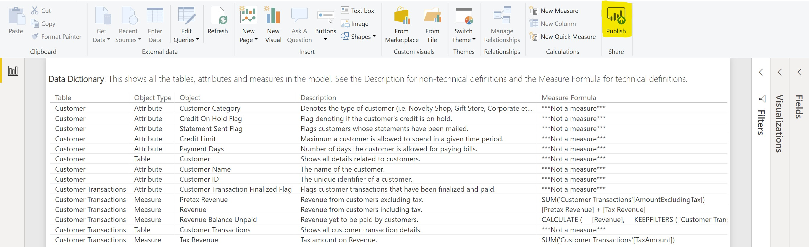

Documenting your model is incredibly important - both for users and developers. Manually tracking all the measures and other objects in a model would be extremely time consuming. Luckily, there is a way to automate it using metadata. [Dynamic Management Views](https://docs.microsoft.com/en-us/analysis-services/instances/use-dynamic-management-views-dmvs-to-monitor-analysis-services) (DMVs) are the key to automating such documentation.

The optimal way to set this up is to have a stored procedure in SQL take in the metadata from the model on the server and format it in a way that produces an easily readable and filterable dictionary as a table. That table is then fed back into the model so it will be available for all users. One may ask why use a stored procedure? The answer is that it ensures less issues with regard to linked servers and model processing.

The only part of this that is manual is the entry of descriptions. Descriptions are entered as shown below (in [Tabular Editor](https://github.com/otykier/TabularEditor/releases)).



However, even descriptions can be automated in some fashion. More on that to be detailed later in this post.

## Here is how to do it

\1. On a SQL Database instance, run the following commands. You must be an admin on the server to run them.

```sql
EXECUTE SP_CONFIGURE 'show advanced options', 1
RECONFIGURE WITH OVERRIDE
GO

EXECUTE SP_CONFIGURE 'Ad Hoc Distributed Queries', 1
RECONFIGURE WITH OVERRIDE
GO

EXECUTE SP_CONFIGURE 'show advanced options', 0
RECONFIGURE WITH OVERRIDE
GO
```

\2. Create a linked server to the Analysis Services instance where the model is hosted for processing.

<figure>



<figcaption>

Server Objects -\> Linked Servers -\> New Linked Server...

</figcaption>
</figure>



Fill in the parameters as such:

Linked server: *Enter the name of your Analysis Services instance*

Provider: *Select 'Microsoft OLE DB Provider for Analysis Services 14.0'*

Product name: *Enter* '*MSOLAP'*

Data source: *Enter the name of your Analysis Services instance*

When complete, click OK.

*Note: I suggest suffixing Analysis Services linked servers with '-AS' as a way to differentiate them from other types of linked servers.*

\3. Create the stored procedure

Below is the code for the stored procedure. This captures important columns such as the Table Name, Field Name/Type, DAX (Measure Expression), Description and Display Folder. This proc also extracts metadata for the overall model as well as all perspectives. DMVs are queried via [Common Table Expressions](https://docs.microsoft.com/en-us/sql/t-sql/queries/with-common-table-expression-transact-sql?view=sql-server-2017) (CTEs) because it is the simplest way to reference them all together. Additionally, the data types must be changed to 'normal' data types (i.e. `varchar`, `int`) and using CTEs allows us to accomplish that. [Dynamic SQL](http://www.sqlservertutorial.net/sql-server-stored-procedures/sql-server-dynamic-sql/) is also used in this procedure as it allows us to parameterize the server and database names within the query which makes for a very simple execution method.

```sql
CREATE PROC [dbo].[usp_Load_DataDictionary]

 @ServerName VARCHAR(100)
,@DatabaseName VARCHAR(100)

AS

DECLARE @SnapshotDate DATETIME SET @SnapshotDate = (SELECT GETDATE())
DECLARE @SQL NVARCHAR(MAX)
DECLARE @DropCreate NVARCHAR(MAX)
DECLARE @DatabaseNameNoSpaces VARCHAR(50) SET @DatabaseNameNoSpaces = (SELECT REPLACE(@DatabaseName,' ',''))

/******************This section drops and recreates the output table*******************/
SET @DropCreate =
'
DROP TABLE IF EXISTS [dbo].[DataDictionary_'+@DatabaseNameNoSpaces+']

CREATE TABLE [dbo].[DataDictionary_'+@DatabaseNameNoSpaces+']
(
	[ModelName] [varchar](80) NOT NULL,
	[PerspectiveName] [varchar](100) NULL,
	[TableName] [varchar](200) NULL,
	[ObjectType] [varchar](20) NULL,
	[ObjectName] [varchar](200) NULL,
	[HiddenFlag] [varchar](10) NULL,
	[Description] [varchar](200) NULL,
	[DisplayFolder] [varchar](200) NULL,
	[TableRowCount] [bigint] NULL,
	[MeasureFormula] [varchar](200) NULL,
	[SnapshotDate] [datetime] NOT NULL

)'

EXEC (@DropCreate);

SET @SQL =

/**************This section extracts the metadata from the model via DMVs***********/
'WITH
PerspectiveTables as
(
	 SELECT *
	 FROM OPENROWSET(''MSOLAP'',''DATASOURCE='+@ServerName+'; Initial Catalog='+@DatabaseName+';'',
	 ''SELECT * FROM [$SYSTEM].[TMSCHEMA_PERSPECTIVE_TABLES]'')
)
,Perspectives AS
(
	 SELECT *
	 FROM OPENROWSET(''MSOLAP'',''DATASOURCE='+@ServerName+'; Initial Catalog='+@DatabaseName+';'',
	 ''SELECT * FROM [$SYSTEM].[TMSCHEMA_PERSPECTIVES]'')
)
,PerspectiveMeasures AS
(
	 SELECT *
	 FROM OPENROWSET(''MSOLAP'',''DATASOURCE='+@ServerName+'; Initial Catalog='+@DatabaseName+';'',
	 ''SELECT * FROM [$SYSTEM].[TMSCHEMA_PERSPECTIVE_MEASURES]'')
)
,PerspectiveColumns AS
(
 SELECT *
 FROM OPENROWSET(''MSOLAP'',''DATASOURCE='+@ServerName+'; Initial Catalog='+@DatabaseName+';'',
 ''SELECT * FROM $SYSTEM.[TMSCHEMA_PERSPECTIVE_COLUMNS]'')
)
,Tables AS
(
 SELECT *
 FROM OPENROWSET(''MSOLAP'',''DATASOURCE='+@ServerName+'; Initial Catalog='+@DatabaseName+';'',
 ''SELECT * FROM $SYSTEM.[TMSCHEMA_TABLES]'')
)
,Columns AS
(
 SELECT *
 FROM OPENROWSET(''MSOLAP'',''DATASOURCE='+@ServerName+'; Initial Catalog='+@DatabaseName+';'',
 ''SELECT * FROM $SYSTEM.[TMSCHEMA_COLUMNS]'')
)
,Measures AS
(
 SELECT *
 FROM OPENROWSET(''MSOLAP'',''DATASOURCE='+@ServerName+'; Initial Catalog='+@DatabaseName+';'',
 ''SELECT * FROM $SYSTEM.[TMSCHEMA_MEASURES]'')
)
,PartitionStorages AS
(
 SELECT *
 FROM OPENROWSET(''MSOLAP'',''DATASOURCE='+@ServerName+'; Initial Catalog='+@DatabaseName+';'',
 ''SELECT * FROM [$System].[TMSCHEMA_PARTITION_STORAGES]'')
)
,Partitions AS
(
 SELECT *
 FROM OPENROWSET(''MSOLAP'',''DATASOURCE='+@ServerName+'; Initial Catalog='+@DatabaseName+';'',
 ''SELECT * FROM [$System].[TMSCHEMA_PARTITIONS]'')
)
,SegmentStorages AS
(
 SELECT *
 FROM OPENROWSET(''MSOLAP'',''DATASOURCE='+@ServerName+'; Initial Catalog='+@DatabaseName+';'',
 ''SELECT * FROM [$System].[TMSCHEMA_SEGMENT_MAP_STORAGES]'')
)'
/***************************************************************************************/

/*************The Stage CTE captures all the perspectives in the model****************/
+'
,Stage AS
('
/********************This section captures the tables in the model*********************/
+'
SELECT
 '''+@DatabaseName+''' AS [ModelName]
,CAST(CT.[Name] AS VARCHAR(200)) AS [TableName]
,''Table'' AS [ObjectType]
,CAST(CT.[Name] AS VARCHAR(200)) AS [ObjectName]
,CASE CAST(CT.[IsHidden] AS TINYINT)
 WHEN 1 THEN ''Yes'' ELSE ''No'' END AS [HiddenFlag]
,CAST(CT.[Description] AS VARCHAR(200)) AS [Description]
,NULL AS [DisplayFolder]
,SUM(CAST(SS.[RecordCount] AS BIGINT)) AS [TableRowCount]
,CAST(''***Not a measure***'' AS VARCHAR(MAX)) AS [MeasureFormula]
,CAST(P.[Name] AS VARCHAR(200)) AS [PerspectiveName]
FROM PerspectiveTables AS PT
JOIN Tables AS CT ON PT.[TableId] = CT.[ID]
JOIN Perspectives AS P ON PT.[PerspectiveId] = P.[ID]
JOIN Partitions AS CP ON CP.[TableId] = CT.[ID]
JOIN PartitionStorages AS PS ON PS.[PartitionId] = CP.[ID]
JOIN SegmentStorages AS SS ON PS.[SegmentMapStorageId] = SS.[Id]
WHERE 1=1
AND CAST(CT.[Name] AS VARCHAR(200)) NOT IN(''Measures'',''Data Dictionary'')
GROUP BY
 CAST(CT.[Name] AS VARCHAR(200))
,CAST(CT.[Name] AS VARCHAR(200))
,CAST(CT.[Description] AS VARCHAR(200))
,CAST(P.[Name] AS VARCHAR(200))
,CAST(CT.[IsHidden] AS TINYINT)'
/***************************************************************************************/

SET @SQL = @SQL +
' UNION ALL '

/**************This section captures the columns (attributes) in the model*************/
+'
SELECT
 '''+@DatabaseName+''' AS [ModelName]
,CAST(CT.[Name] AS VARCHAR(200)) AS [TableName]
,''Attribute'' AS [ObjectType]
,CAST(CC.[ExplicitName] AS VARCHAR(200)) AS [ObjectName]
,CASE CAST(CC.[IsHidden] AS TINYINT)
 WHEN 1 THEN ''Yes'' ELSE ''No'' END AS [HiddenFlag]
,CAST(CC.[Description] AS VARCHAR(200)) AS [Description]
,CAST(CC.[DisplayFolder] AS VARCHAR(200)) AS [DisplayFolder]
,NULL AS [TableRowCount]
,CAST(''***Not a measure***'' AS VARCHAR(MAX)) AS [MeasureFormula]
,CAST(P.[Name] AS VARCHAR(200)) AS [PerspectiveName]
FROM PerspectiveColumns AS PC
JOIN Columns AS CC ON PC.[ColumnId] = CC.[ID]
JOIN PerspectiveTables AS PT ON PC.[PerspectiveTableId] = PT.[ID]
JOIN Perspectives AS P ON PT.[PerspectiveId] = P.[ID]
JOIN Tables AS CT ON CC.[TableId] = CT.[ID]
WHERE 1=1
AND CAST(CT.[Name] AS VARCHAR(200)) NOT IN(''Measures'',''Data Dictionary'')
AND CAST(CC.[ExplicitName] AS VARCHAR(200)) NOT LIKE ''%RowNumber-%'''
/***************************************************************************************/
+' UNION ALL '
/*******************This section captures the measures in the model*******************/
+'
SELECT
 '''+@DatabaseName+''' AS [ModelName]
,CAST(CT.[Name] AS VARCHAR(200)) AS [TableName]
,''Measure'' AS [ObjectType]
,CAST(CC.[Name] AS VARCHAR(200)) AS [ObjectName]
,CASE CAST(CC.[IsHidden] AS TINYINT)
 WHEN 1 THEN ''Yes'' ELSE ''No'' END AS [HiddenFlag]
,CAST(CC.[Description] AS VARCHAR(200)) AS [Description]
,CAST(CC.[DisplayFolder] AS VARCHAR(200)) AS [DisplayFolder]
,NULL AS [TableRowCount]
,CAST(CC.[Expression] AS VARCHAR(200)) AS [MeasureFormula]
,CAST(P.[Name] AS VARCHAR(200)) AS [PerspectiveName]
FROM PerspectiveMeasures AS PC
JOIN Measures AS CC ON PC.[MeasureId] = CC.[ID]
JOIN PerspectiveTables AS PT ON PC.[PerspectiveTableId] = PT.[ID]
JOIN Perspectives AS P ON PT.[PerspectiveId] = P.[ID]
JOIN Tables AS CT ON CC.[TableId] = CT.[ID]
WHERE 1=1
AND CAST(CT.[Name] AS VARCHAR(200)) NOT IN(''Measures'',''Data Dictionary'')
)'
/***************************************************************************************/

/*******************The StageModel CTE captures the full model**********************/
+'
,StageModel AS
(
SELECT
 '''+@DatabaseName+''' AS [ModelName]
,CAST(CT.[Name] AS VARCHAR(200)) AS [TableName]
,''Table'' AS [ObjectType]
,CAST(CT.[Name] AS VARCHAR(200)) AS [ObjectName]
,CASE CAST(CT.[IsHidden] AS TINYINT)
 WHEN 1 THEN ''Yes'' ELSE ''No'' END AS [HiddenFlag]
,CAST(CT.[Description] AS VARCHAR(200)) AS [Description]
,NULL AS [DisplayFolder]
,SUM(CAST(SS.[RecordCount] AS BIGINT)) AS [TableRowCount]
,CAST(''***Not a measure***'' AS VARCHAR(MAX)) AS [MeasureFormula]
,''Model'' AS [PerspectiveName]
FROM Tables AS CT
JOIN Partitions AS CP ON CP.[TableId] = CT.[ID]
JOIN PartitionStorages AS PS ON PS.[PartitionId] = CP.[ID]
JOIN SegmentStorages AS SS ON PS.[SegmentMapStorageId] = SS.[Id]
WHERE 1=1
AND CAST(CT.[Name] AS VARCHAR(200)) NOT IN(''Measures'',''Data Dictionary'')
GROUP BY
 CAST(CT.[Name] AS VARCHAR(200))
,CAST(CT.[Name] AS VARCHAR(200))
,CAST(CT.[Description] AS VARCHAR(200))
,CAST(CT.[IsHidden] AS TINYINT)

UNION ALL

SELECT DISTINCT
 '''+@DatabaseName+''' AS [ModelName]
,CAST(CT.[Name] AS VARCHAR(200)) AS [TableName]
,''Attribute'' AS [ObjectType]
,CAST(CC.[ExplicitName] AS VARCHAR(200)) AS [ObjectName]
,CASE CAST(CC.[IsHidden] AS TINYINT)
 WHEN 1 THEN ''Yes'' ELSE ''No'' END AS [HiddenFlag]
,CAST(CC.[Description] AS VARCHAR(200)) AS [Description]
,CAST(CC.[DisplayFolder] AS VARCHAR(200)) AS [DisplayFolder]
,NULL AS [TableRowCount]
,CAST(''***Not a measure***'' AS VARCHAR(MAX)) AS [MeasureFormula]
,''Model'' AS [PerspectiveName]
FROM Columns AS CC
JOIN Tables AS CT ON CC.[TableId] = CT.[ID]
WHERE 1=1
AND CAST(CT.[Name] AS VARCHAR(200)) NOT IN(''Measures'',''Data Dictionary'')
AND CAST(CC.[ExplicitName] AS VARCHAR(200)) NOT LIKE ''%RowNumber-%''

UNION ALL

SELECT DISTINCT
 '''+@DatabaseName+''' AS [ModelName]
,CAST(CT.[Name] AS VARCHAR(200)) AS [TableName]
,''Measure'' AS [ObjectType]
,CAST(CC.[Name] AS VARCHAR(200)) AS [ObjectName]
,CASE CAST(CC.[IsHidden] AS TINYINT)
 WHEN 1 THEN ''Yes'' ELSE ''No'' END AS [HiddenFlag]
,CAST(CC.[Description] AS VARCHAR(200)) AS [Description]
,CAST(CC.[DisplayFolder] AS VARCHAR(200)) AS [DisplayFolder]
,NULL AS [TableRowCount]
,CAST(CC.[Expression] AS VARCHAR(200)) AS [MeasureFormula]
,''Model'' AS [PerspectiveName]
FROM Measures AS CC
JOIN Tables AS CT ON CC.[TableId] = CT.[ID]
WHERE 1=1
AND CAST(CT.[Name] AS VARCHAR(200)) NOT IN(''Measures'',''Data Dictionary'')
)
'
/***************Last step is to insert the data into the output table****************/
SET @SQL = @SQL +

'INSERT INTO [dbo].[DataDictionary_'+@DatabaseNameNoSpaces+']

SELECT
 [ModelName]
,[PerspectiveName]
,[TableName]
,[ObjectType]
,[ObjectName]
,[HiddenFlag]
,[Description]
,[DisplayFolder]
,[TableRowCount]
,[MeasureFormula]
,'''+CONVERT(NVARCHAR(20),@SnapshotDate)+''' AS [SnapshotDate]
FROM Stage

UNION

SELECT
 [ModelName]
,[PerspectiveName]
,[TableName]
,[ObjectType]
,[ObjectName]
,[HiddenFlag]
,[Description]
,[DisplayFolder]
,[TableRowCount]
,[MeasureFormula]
,'''+CONVERT(NVARCHAR(20),@SnapshotDate)+''' AS [SnapshotDate]
FROM StageModel
'

EXEC (@SQL)
```

## How to execute the stored procedure

Executing the stored procedure is simple. Just fill in the proper Server Name and Database Name per the code below.

```sql
EXEC [dbo].[usp_Load_DataDictionary] 'ServerName','DatabaseName'
```

Executing the stored procedure will produce the Data Dictionary table. From here, create a view that is simply a '`SELECT` \* `FROM`' the table produced by the stored procedure. It is best to use views as a decoupling layer between the database and model. This comes in handy just in case any filters need to be added. It's also best to be consistent so that all objects in your model come from the same object type (all from views instead of some from tables and some from views). Next, add this table to your model as shown below and format all columns so they are easy to read.



## How to integrate this into your model's processing steps

When you deploy the model to your processing server, I recommend first processing tables except for the Data Dictionary (as needed). Then have a step for executing the above stored procedure. Lastly, process the Data Dictionary table in the model. Just to be safe, it's always a good idea to do a [process recalc](https://docs.microsoft.com/en-us/analysis-services/tabular-models/process-database-table-or-partition-analysis-services) as the final step before moving the model to a production server.

## How to automate the entry of descriptions

As stated earlier, the entry of descriptions is the only manual step. The method below simplifies the process considerably by allowing for bulk edits to descriptions (or really any object in the model). I recommend providing the output of Step 3 to your business stakeholders - allowing them to complete the descriptions - and then bulk-adding them to the model via steps 5 and 6.

1. Run this command in the [Advanced Scripting](https://docs.tabulareditor.com/Advanced-Scripting.html) window in [Tabular Editor](https://github.com/otykier/TabularEditor/releases)

```csharp
ExportProperties(
    Model.AllMeasures.OfType<TabularNamedObject>()
   .Concat(Model.AllColumns)
   .Concat(Model.Tables),
   "Parent,SourceColumn,ObjectType,Name,Description,Dummy"
   ).Output();
```

\2. Copy the output to the clipboard

\3. Paste into Excel

\4. Add descriptions

\5. Save as a .txt file

\6. Run the following in the Advanced Scripting window, repointing this to the location of the file saved. Make sure to use double slash '\\\\' ([escape clause](https://stackoverflow.com/questions/18532691/how-do-i-write-a-backslash-in-a-string)) as done below.

```csharp
var tsv = ReadFile("C:\\FolderName\\FileName.txt");
ImportProperties(tsv);
```

After running the above steps the descriptions in the Excel (text) file will have been transferred to your model in Tabular Editor.

*Note: The above technique for bulk-adding descriptions to your model can also be done for other model elements. Feel free to modify the code and see how you can leverage this technique to swiftly make other bulk changes.*

Another reason to add descriptions into the model in this manner is that they show when hovering over the Fields List as shown below.



## Taking it a step further

We can go beyond this by turning it into a Power BI Dashboard so users can easily reference it. If your users have a better understanding of the model they will design better reports and dashboards. This leads to better queries hitting the server which yields better performance and an improved experience for all.

As shown below, a simple [Table visual](https://docs.microsoft.com/en-us/power-bi/visuals/power-bi-visualization-tables) in [Power BI Desktop](https://powerbi.microsoft.com/en-us/desktop/) will do the trick. I recommend setting the filters to either the Model or a specific perspective. It is also a good idea to filter out hidden objects (Hidden Flag = 'No').

Once complete, click Publish as highlighted below. That will publish the dataset as well as this report to the [Power BI Service](https://powerbi.microsoft.com/en-us/landing/signin/) where you can pin items in the report to a [Dashboard](https://docs.microsoft.com/en-us/power-bi/service-dashboard-create) that can be shared among your users.



## Conclusion

Metadata drawn from DMVs are extremely powerful for automating documentation and analytics on your model. Each model should have such a dictionary to enable users to be more self-sufficient in understanding the model.
