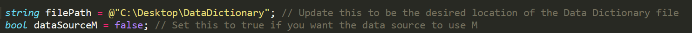

Two of my previous posts are related to creating an automated data dictionary - something I believe is essential to inform users about your model and to promote a more optimal use of your model. The [first post](/post/datadictionary) showed how to do this using DMVs & SQL. The [second post](/post/datadictionaryreinvented) showed how to do this using C# and SQL. Both are completely viable solutions. However, what does one do if they do not have access to SQL or a proper data warehouse? In this post I will share a third option which can be used to solve this scenario.

## The solution

Not everyone has access to SQL, but pretty much everyone has access to Excel. Therefore, Excel seems like a good option for solving this problem. Another idea would be to query the Analysis Services instance directly within the model itself however this is not really viable as directly joining DMVs is not feasible.

When I mention Excel as the solution, let me explain what I mean. We can run a C# script that will export the data dictionary metadata to an Excel file, create a Data Dictionary table within the model, and connect the table within the model to the Excel file. In fact, I have created a [C# script](https://github.com/m-kovalsky/Tabular/blob/master/AutomatedDataDictionary_Excel.cs) which does exactly that.

Before we get to the script, let me mention that this solution is viable for all varieties of tabular modeling: [SSAS](https://docs.microsoft.com/analysis-services/ssas-overview?view=asallproducts-allversions), [Azure AS](https://azure.microsoft.com/services/analysis-services/) and [Power BI Premium](https://powerbi.microsoft.com/power-bi-premium/) (using the [XMLA R/W endpoint](https://docs.microsoft.com/power-bi/admin/service-premium-connect-tools)).

## Running the Script

Follow these steps to create your Data Dictionary in this method:

1. Open your model in [Tabular Editor](https://tabulareditor.com/).
2. Download the [C# script](https://github.com/m-kovalsky/Tabular/blob/master/AutomatedDataDictionary_Excel.cs) from GitHub.
3. Paste the C# script into the [Advanced Scripting](https://docs.tabulareditor.com/Advanced-Scripting.html#working-with-the-model-object) window in Tabular Editor.
4. Update the filePath parameter to be the location where you want to store the Data Dictionary Excel file (do *NOT* include the .xlsx suffix!).
5. Update the dataSourceM parameter to 'true' if you want the data source for the Data Dictionary table to use the [M language](https://docs.microsoft.com/powerquery-m/) (otherwise it will create a '[legacy](https://docs.tabulareditor.com/Importing-Tables.html)' partition.
6. Click the 'Play' button or press 'F5'.



After running this script, you will see the Excel file containing your Data Dictionary within the filePath location. Additionally, you will see that a new data source has been created as well as a new table called 'Data Dictionary'. All of the columns and their properties have been added and the table in the model has been connected to the aforementioned data source.

## Legacy vs M Partitions

As implied in the steps above, this script is able to generate SQL or M when creating the partition for the Data Dictionary table within the model. Both work equally well and it should be noted that using the 'legacy' partition option which generates SQL does not actually necessitate SQL Server. It's just the traditional way that a tabular data model reads from an Excel file. Generally speaking, one would specify to use an M-partition if the model already uses M-partitions for other tables.

## Assembly References

If you look at the top of this script you will see references (denoted with #r) to .NET assemblies. This was made possible as of Tabular Editor 2.8.6 and is officially documented [here](https://docs.tabulareditor.com/Advanced-Scripting.html#net-references). In this case, the ability to make assembly references allows Tabular Editor to interact with Excel and the File Class (System.IO). There are many other assembly references which can be added using this method and each such references gives new abilities to the [Advanced Scripting](https://docs.tabulareditor.com/Advanced-Scripting.html#working-with-the-model-object) functionality within Tabular Editor.

```csharp
#r "System.IO"
#r "Microsoft.Office.Interop.Excel"

using System.IO;
using Excel = Microsoft.Office.Interop.Excel;
```

## Additional Notes

Running this script takes just a few seconds - even for a large model with many tables, columns and measures. One reason it is so fast is because the metadata is collected into a single tab-delimited string, saved into a text file, and then copied into an Excel file (the text file is deleted afterwards as it is no longer necessary). The other option would be to copy the metadata directly into Excel but this process takes much longer. Speed is ultimately very important when it comes to programming so I'm happy to say this script is quite effective in that area.

## Conclusion

If your team has a data warehouse, I recommend following the methods in my previous post. This method is strictly for folks without a data warehouse. Hopefully this post shows that there's always another option out there!

Lastly, I strongly encourage developers to not just execute these scripts but to read through them and use them as examples from which to learn. One year ago I knew literally nothing about C#. However, after defining problems for myself and solving them bit by bit (literally!) it is now simple to manipulate a model in any way - and even make various [tools](/post/processingmanager) and applications. The amount of things you can do with C# is literally limitless - plus I think it's great fun!
