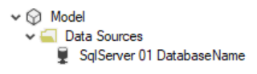

One of my first posts on this blog was about creating an [automated data dictionary](/post/datadictionary). Previously, I thought this was the best method. However, after delving into coding in C# more in the past year, I believe there is a better way to go about it.

## What we left behind

This new method does not rely on [linked servers](https://docs.microsoft.com/sql/relational-databases/linked-servers/create-linked-servers-sql-server-database-engine?view=sql-server-ver15) as the previous method did. And, as a result, this method is suitable for [Power BI Premium](https://powerbi.microsoft.com/power-bi-premium/) models (I don't think it's possible to create a linked server connection to a Power BI Premium workspace - even with [XMLA R/W endpoints](https://docs.microsoft.com/power-bi/admin/service-premium-connect-tools) enabled). This method also does not use [DMVs](https://docs.microsoft.com/analysis-services/instances/use-dynamic-management-views-dmvs-to-monitor-analysis-services?view=asallproducts-allversions). DMVs are great, however they can be a bit cumbersome to wrangle.

## The new method

As I alluded to earlier, this new method uses C#. In fact, all you have to do is enter a few parameters into the C# script and off you go. One point to clarify is that this script *only works for models that use legacy partitions (not M partitions)*. And, if using Power BI Premium, you must enable [XMLA R/W endpoints](https://docs.microsoft.com/power-bi/admin/service-premium-connect-tools).

Here's a breakdown of what the C# script does.

1. Creates a Data Dictionary table in your model (if one does not already exist) with the proper column names, source columns, data type, partition query and data source (provided by the user).
2. Drops (if it exists) and recreates a Data Dictionary table within a SQL environment (server, database, schema, table name provided by the user).
3. Extracts the metadata from the model file and inserts it into the table created in Step 2.

Now, all that is left is to deploy and process the model. However, we can take it a step further!

## Integrated deployment

Since [Tabular Editor](https://tabulareditor.com/) allows C# scripts to be executed during a [command line](https://docs.tabulareditor.com/Command-line-Options.html) deployment, you can run this script each time you deploy your model. That way, it's literally no touch (well, except for entering the descriptions of objects in your model). The fully automated approach would be to integrate this into an automated deployment (via Azure DevOps) as outlined [here](https://tabulareditor.com/2019/02/20/DevOps1.html).

Here is an example of the code you would run to execute this (or other) C# scripts while deploying your model. For deploying other file types (i.e. database.json) or to other incarnations of tabular, see [Step 5 within this post](/post/extractmodelmetadata).

```bat
start /wait /d "C:\Program Files (x86)\Tabular Editor" TabularEditor.exe "<Model.bim File>" -S "<C# Script File>" -D "<Server Name>" "<Model Name>"
```

## Steps

1. Download and install [Tabular Editor](https://tabulareditor.com/).
2. Download the [C# script](https://github.com/m-kovalsky/Tabular/blob/master/AutomatedDataDictionary.cs).
3. Copy and paste the C# script into the [Advanced Scripting window](https://docs.tabulareditor.com/Advanced-Scripting.html#working-with-the-model-object) in Tabular Editor.
4. Modify the following parameters at the top of the C# script.

```csharp
string dataSource = @"";
string serverName = @"";
string databaseName = "";
string schemaName = "";
string dbTableName = "";
```

`dataSource`: This is the name of the data source in your model for your Data Dictionary.



`serverName`: This is the name of the server (in your data warehouse) where the Data Dictionary will reside (note that this is the same server that is referenced by the dataSource.

`databaseName`: This is the database within the data warehouse for the Data Dictionary table.

`schemaName`: This is the schema for the Data Dictionary table within the data warehouse.

`dbTableName`: This is the name of the Data Dictionary table in the data warehouse. I recommend 'META\_DataDictionary' to adhere to the [Tabular Style Guide](/post/tabularstyleguide).

\5. Click the 'play' button (or press F5).

## Conclusion

This method is more concise and I believe more elegant than the previous method. Additionally, it simultaneously creates both the data warehouse side, the model side, and the data side in one go. Furthermore, it enables this self-documenting feature to work for Power BI Premium models as well.
