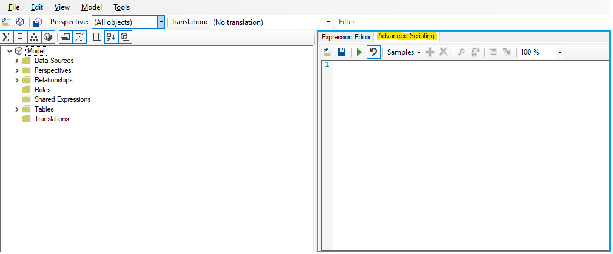
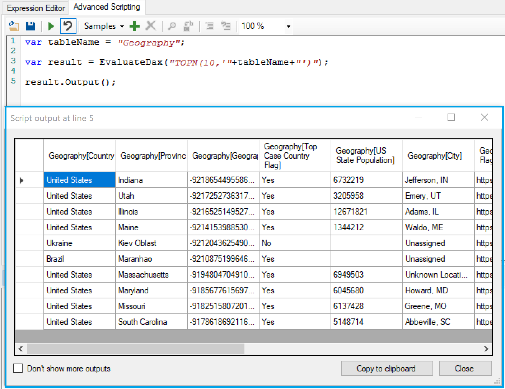
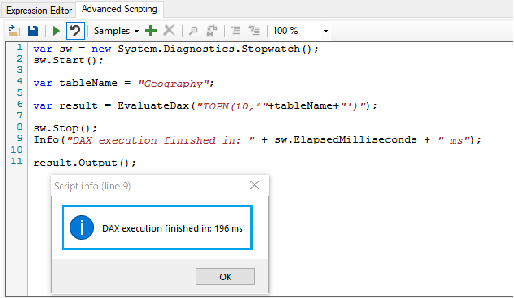

After speaking with many tabular developers over the years, I've heard several reasons why some folks are hesitant to switch their development from SSDT or Power BI Desktop to [Tabular Editor](https://github.com/otykier/TabularEditor/releases). We can now check one of those items off the list.

The concern I'm referring to is how SSDT and Power BI Desktop show you a preview of your data - so you can actually see the data you're working with. Tabular Editor generally works with metadata only so you don't see a preview of the data (except for when [importing new data sources](https://docs.tabulareditor.com/Importing-Tables.html)). This is no longer a concern as Tabular Editor can do it quite simply - as I will demonstrate below. And, just to clarify, Tabular Editor still performs changes in metadata only so the tremendous speed of development remains intact.

As of Tabular Editor version [2.12.1](https://github.com/otykier/TabularEditor/releases), you can write and execute DAX queries inside the [Advanced Scripting](https://docs.tabulareditor.com/Advanced-Scripting.html) window. And, since Tabular Editor lets you output advanced scripting results, you can see the results of your query.

\*\*\*Note that this only works when your model has been loaded from an instance of Analysis Services (can be SSAS, Azure Analysis Services, Power BI Desktop, or a Power BI dataset - Premium included).

<figure>

[](https://github.com/otykier/TabularEditor/wiki/Advanced-Scripting)

<figcaption>

Advanced Scripting in Tabular Editor

</figcaption>
</figure>

## Data Preview

To get a preview of a table of data, all you need to do is copy the code below, paste it into the Advanced Scripting window, update the tableName variable to the name of a table in your model, and click the play button (or F5).

```csharp
var tableName = "Geography";

var result = EvaluateDax("TOPN(10,'"+tableName+"')");
result.Output();
```

Bam! Just like that you can see a preview of the top 10 rows of the table (shown below).

<figure>



<figcaption>

Data Preview in Tabular Editor

</figcaption>
</figure>

Naturally, you can adjust the DAX query as desired to show more rows etc. Just be careful to limit the amount of output rows - otherwise the program may crash. For a quick tutorial on querying in DAX, check out my post [here](/post/daxquerylanguage).

## Using the Selected table

One additional trick with this is to use the selected table option. Using this technique you no longer have to enter the table name into the code. Simply select the table you want to view and run this code to see the data preview. The script below is also on my [GitHub](https://github.com/m-kovalsky/Tabular/blob/master/DataPreview_Table.cs) page.

```csharp
var tableName = Selected.Table.Name;

var result = EvaluateDax("TOPN(10,'"+tableName+"')");
result.Output();
```

## Using the Selected Column(s)

We can also do this with column(s). Simply select the columns you want to view and run this code to see the distinct column values. The script below is also on my [GitHub](https://github.com/m-kovalsky/Tabular/blob/master/DataPreview_Columns.cs) page.

```csharp
string dax = string.Empty;

foreach (var x in Selected.Columns.ToList())
{
    dax = dax + x.DaxObjectFullName + ",";
}

dax = dax.Substring(0,dax.Length-1);
var result = EvaluateDax("TOPN(500,SUMMARIZECOLUMNS("+dax+")) ORDER BY " + dax);
result.Output();
```

## Check Query Times

This can be taken up a level as well - you can even track how long a DAX query takes to execute. Simply use the code below as a template, modifying the DAX query inside the EvaluateDax function. All this of course is credit to [Daniel Otykier](https://github.com/otykier), the author of Tabular Editor, who sent this specific solution on the timings which works simply and elegantly.

```csharp
var sw = new System.Diagnostics.Stopwatch();
sw.Start();

var tableName = "Geography";

var result = EvaluateDax("TOPN(10,'"+tableName+"')");

sw.Stop();
Info("DAX execution finished in: " + sw.ElapsedMilliseconds + " ms");

result.Output();
```

After running the query above, it first shows the query execution time and then shows the query result.

<figure>



<figcaption>

DAX query times in Tabular Editor

</figcaption>
</figure>

## Conclusion

These are just a few of the plethora of fantastic features within Tabular Editor. For more information on querying your model in Tabular Editor, see the official [documentation](https://docs.tabulareditor.com/Useful-script-snippets.html#querying-analysis-services). For those of you who haven't migrated your development to Tabular Editor, here is one more reason to do so!
