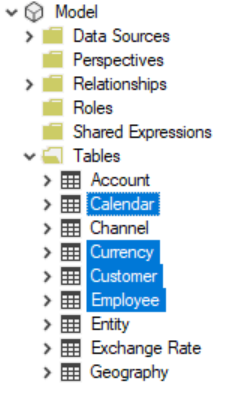

*\*\*\*The scripts shown in this post have been updated to work in both* [*Tabular Editor 2.x*](https://github.com/TabularEditor/TabularEditor) *&* [*Tabular Editor 3*](https://github.com/TabularEditor/TabularEditor3)*.*

[Tabular Editor](https://tabulareditor.com/) offers so many inherent features which make it such an invaluable tool for developing tabular models. However, what makes it even better is the ability to write custom C# code using the [Advanced Scripting](https://docs.tabulareditor.com/Advanced-Scripting.html#working-with-the-model-object) window. This creates a plethora of possibilities only limited by the imagination. Many of my recent posts take advantage of this feature and this post is no exception.

As with all nifty advanced scripts, I recommend saving these scripts as [Custom Action](https://docs.tabulareditor.com/Custom-Actions.html)s so you can have easy access to them at any time.

## Processing multiple tables

It has [previously](https://docs.tabulareditor.com/Useful-script-snippets.html#querying-analysis-services) been shown how to refresh a table within Tabular Editor but we can take it a step further. The script below is able to process multiple tables - not just a single table. Naturally, it can also process a single table. Here's how it works:

*Note: This requires Tabular Editor version 2.12.1 or higher and that you are connected live to an Analysis Services instance (File-\>Open-\>From DB...). This can also be a Power BI Premium dataset or if Tabular Editor is opened using the Power BI Desktop 'External Tools' option.*

1. Within Tabular Editor, select the tables you want to process within the Table List.



\2. Copy and paste the code below into the [Advanced Scripting](https://docs.tabulareditor.com/Advanced-Scripting.html#working-with-the-model-object) window (save it as a [Custom Action](https://docs.tabulareditor.com/Custom-Actions.html)).

```csharp
#r "Microsoft.AnalysisServices.Core.dll"
using ToM = Microsoft.AnalysisServices.Tabular;

var refreshType = ToM.RefreshType.DataOnly;
ToM.SaveOptions so = new ToM.SaveOptions();
//so.MaxParallelism = 10;

foreach (var t in Selected.Tables)
{
    string tableName = t.Name;
    Model.Database.TOMDatabase.Model.Tables[tableName].RequestRefresh(refreshType);
}

Model.Database.TOMDatabase.Model.SaveChanges(so);
```

\3. Update the refreshType parameter according to how you would like to process the tables. The options are documented [here](https://docs.microsoft.com/dotnet/api/microsoft.analysisservices.tabular.refreshtype?view=analysisservices-dotnet).

\4. If you want to use the [Sequence command](https://docs.microsoft.com/analysis-services/tmsl/sequence-command-tmsl?view=asallproducts-allversions) to specify the [Max Parallelism](https://docs.microsoft.com/en-us/analysis-services/tmsl/sequence-command-tmsl?view=asallproducts-allversions#request) option, simply uncomment the 'so.MaxParallelism' line and specify the desired MaxParallelism value.

\5. Click the play button (or press F5) to start the data refresh.

## Processing multiple partitions

The only difference in processing partitions is that you select partitions. Otherwise, the instructions are the same as for processing tables. Just use the code below.

```csharp
#r "Microsoft.AnalysisServices.Core.dll"
using ToM = Microsoft.AnalysisServices.Tabular;

var refreshType = ToM.RefreshType.DataOnly;
ToM.SaveOptions so = new ToM.SaveOptions();
//so.MaxParallelism = 10;

foreach (var p in Selected.Partitions)
{
    string tableName = p.Table.Name;
    string partitionName = p.Name;
    Model.Database.TOMDatabase.Model.Tables[tableName].Partitions[partitionName].RequestRefresh(refreshType);
}

Model.Database.TOMDatabase.Model.SaveChanges(so);
```

## Processing the model

Processing the whole model is not recommended. However, recalculating the model is fine. Just these 4 lines of code are needed to do the job. Simply paste this code into the [Advanced Scripting](https://docs.tabulareditor.com/Advanced-Scripting.html#working-with-the-model-object) window and click play.

```csharp
#r "Microsoft.AnalysisServices.Core.dll"
using ToM = Microsoft.AnalysisServices.Tabular;

var refreshType = ToM.RefreshType.Calculate;
Model.Database.TOMDatabase.Model.RequestRefresh(refreshType);
Model.Database.TOMDatabase.Model.SaveChanges();
```

## additional context

These scripts directly access the [Tabular Object Model](https://docs.microsoft.com/analysis-services/tom/introduction-to-the-tabular-object-model-tom-in-analysis-services-amo?view=asallproducts-allversions) and actually do not generate [TMSL](https://docs.microsoft.com/analysis-services/tmsl/refresh-command-tmsl?view=asallproducts-allversions) (to which many of us are accustomed). The scripts (well, the [RequestRefresh](https://docs.microsoft.com/dotnet/api/microsoft.analysisservices.tabular.table.requestrefresh?view=analysisservices-dotnet) method) generate XML. TMSL is much cleaner and easier to read which is why it is used when scripting out code in this context. However, the TMSL gets translated into XML by the engine. Therefore, the scripts used in this post skip the TMSL part and feed XML directly to the server (since the engine does not care about code beautification). You can run a SQL Server profiler trace and see this for yourself. Actually, when you run TMSL you will also see the XML command (translated from TMSL) in the profiler trace. When you run a profiler trace against the scripts in this post you will only see the XML command.

## Conclusion

It should be noted that processing large datasets within Tabular Editor is not recommended. This method is best for quickly processing relatively smaller datasets. Not to worry, I have a new tool coming out soon which offers a more robust solution for more complex processing scenarios. Stay tuned!
