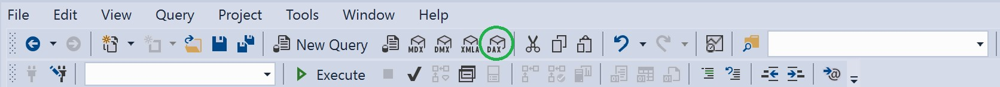
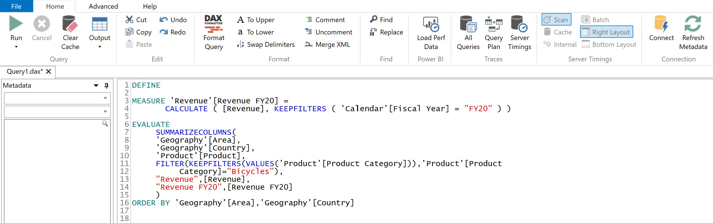

Tabular developers are familiar with DAX as a language for writing measures and calculated columns. However, DAX is also a querying language that the tabular engine uses to generate data. For example, when a report is opened in Power BI, each visual on the page triggers a DAX query. This query is a set of instructions for retrieving the exact data needed to fill the visuals.

Knowing how to read and write DAX as a query language is extremely helpful when evaluating a model for performance and when testing a new measure before adding it to the model. Adding this to your skill set as a tabular developer is a game changer. In fact, I used to frequently perform accuracy and performance tests in Excel. However, once I learned how to use DAX as a query language I literally switched all my tests to be done directly in [SSMS](https://docs.microsoft.com/en-us/sql/ssms/sql-server-management-studio-ssms?view=sql-server-ver15) and have very little need for Excel anymore. The flexibility gained by using DAX this way is tremendous.

Let's take an example of a DAX query and see exactly what is going on.

```dax
EVALUATE
     SUMMARIZECOLUMNS(
     'Geography'[Area],
     'Geography'[Country],
     'Product'[Product],
     FILTER(KEEPFILTERS(VALUES('Product'[Product Category])),'Product'[Product
          Category]="Bicycles"),
     "Revenue",[Revenue]
     )
ORDER BY 'Geography'[Area],'Geography'[Country]
```

## EVALUATE

The example above starts with an [`EVALUATE`](https://dax.guide/st/evaluate/) function. This function precedes every DAX query and instructs the engine to literally evaluate the next clause.

## SUMMARIZECOLUMNS

The next clause uses the [`SUMMARIZECOLUMNS`](https://dax.guide/summarizecolumns/) function. This function instructs the engine to create a table based on the elements within the function. Note that the order of the elements is important. If the order is not followed you will get an error. Here is the order:

1.) Attributes (a.k.a. columns): These can be data columns or calculated columns. As expected, items listed first will show up on the left side of the table. In this example we have taken 3 columns from 2 different tables (Area & Country from the Geography table, and Product from the Product table). The order of the attributes is your choice. Note that sometimes putting columns in a different order may cause performance to be different (sometimes considerably).

2.) Filters: The next element after attributes is filters. Here you can add as many filters as you would like and in any order you choose. In the example above we are filtering the Product Category attribute to only show revenue for bicycles.

3.) Measures: After listing out the filters you add the measures. In this example we added the measure 'Revenue'. It should be noted that the syntax for measures is "Column Name",\[Measure Name\]. In other words, the words in quotes appear as the column name and the item in brackets is the actual measure name. Note this will not change the name of the measure in the model itself - it just changes how it appears in the table generated by this query.

## ORDER BY

The final clause in the DAX query is the [`ORDER BY`](https://dax.guide/st/order-by/) clause. This allows you to order the table by a column (or several columns). The [`ORDER BY`](https://dax.guide/st/order-by/) function defaults to ascending order. If you want to order a column in descending order just write `DESC` after the column name. In the example above, the table is ordered first by the Area and then by Country - both in ascending order as `DESC` was not specified. Note that measures can also be used for ordering as when the table is created each measure is outputted as a column.

## SQL Equivalent

For those who are familiar with SQL, it may be easier to digest this if we translate the DAX into SQL. Honestly speaking not much has changed - which is pretty neat. In this translation I've assumed that the Revenue measure is just a `SUM` of the RevenueAmt column within the Revenue table.

```sql
SELECT
g.[Area],
g.[Country],
p.[ProductCategory] AS [Product Category],
SUM('Revenue'[RevenueAmt]) AS [Revenue]
FROM [dbo].[FACT_Revenue] AS r
LEFT JOIN [dbo].[DIM_Geography] AS g ON r.[GeographyID] = g.[GeographyID]
LEFT JOIN [dbo].[DIM_Product] AS p ON r.[ProductID] = p.[ProductID]
WHERE 'Product'[ProductCategory] = "Bicycles"
GROUP BY
g.[Area],
g.[Country],
p.[ProductCategory]
ORDER BY
 g.[Area]
```

When translating the SQL to DAX we are essentially doing this:

1.) Add the [`EVALUATE`](https://dax.guide/st/evaluate/) clause

2.) [`SUMMARIZECOLUMNS`](https://dax.guide/summarizecolumns/) replaces `SELECT`

3.) List out the attribute(s), specifying the table name instead of the table alias

4.) Add the `WHERE` clause elements as a [`FILTER`](https://dax.guide/filter/)(s) after the attributes

5.) Add the measure(s)

6.) Add the [`ORDER BY`](https://dax.guide/st/order-by/) clause, specifying the table name instead of the table alias

In DAX, the joins are already taken care of via the relationships so there's no need to specify any joins. Also, the [`SUMMARIZECOLUMNS`](https://dax.guide/summarizecolumns/) function implies an aggregation so the `GROUP BY` clause from SQL is not necessary.

## DEFINE MEASURE

The above breakdown of a DAX query shows the essentials but there is more that can be done. For example, what happens when we want to add a custom measure (that doesn't exist in the model) to the DAX query - perhaps for testing out a new measure. Let's find out below.

To add a custom/new measure to the DAX query we will use the [`DEFINE`](https://dax.guide/st/define/) function. This function must be placed before the [`EVALUATE`](https://dax.guide/st/evaluate/) statement. Since we are defining a measure, we will follow the [`DEFINE`](https://dax.guide/st/define/) function with the word `MEASURE`. Next, we must assign the measure to a table (even though in this context it doesn't really matter) and then give it a name within brackets. We then write the DAX for the new measure.

Defining the measure is not enough. If we want to see that measure within the query we must add it within the measures section of the [`SUMMARIZECOLUMNS`](https://dax.guide/summarizecolumns/) clause (it is placed just after the Revenue measure in the query below).

```dax
DEFINE

MEASURE 'Revenue'[Revenue FY20] =
       CALCULATE ( [Revenue], KEEPFILTERS ( 'Calendar'[Fiscal Year] = "FY20" ) )

EVALUATE
     SUMMARIZECOLUMNS(
     'Geography'[Area],
     'Geography'[Country],
     'Product'[Product],
     FILTER(KEEPFILTERS(VALUES('Product'[Product Category])),'Product'[Product
          Category]="Bicycles"),
     "Revenue",[Revenue],
     "Revenue FY20",[Revenue FY20]
     )
ORDER BY 'Geography'[Area],'Geography'[Country]
```

A few extra comments here. If we want to add multiple new measures into the DAX query we only specify the [`DEFINE`](https://dax.guide/st/define/) statement once. After the DAX calculation for the first custom measure is complete we specify `MEASURE` once again followed by the new measure table, name and definition (as shown below).

```dax
DEFINE

MEASURE 'Revenue'[Revenue FY20] =
       CALCULATE ( [Revenue], KEEPFILTERS ( 'Calendar'[Fiscal Year] = "FY20" ) )

MEASURE 'Revenue'[Revenue FY21] =
       CALCULATE ( [Revenue], KEEPFILTERS ( 'Calendar'[Fiscal Year] = "FY21" ) )

EVALUATE...
```

## TOPN

Another useful function within DAX queries is [`TOPN`](https://dax.guide/topn/). The Power BI service often uses this function when fulfilling data requests for tables and matrices in Power BI. Large tables/matrices only query the first 500 rows (for better performance). As the user scrolls down the table the query expands and retrieves the additional rows.

Back to our example, here is how we would add the [`TOPN`](https://dax.guide/topn/) function. This would limit the output to only the top 30 rows (while taking into account the ordering as specified in the [`ORDER BY`](https://dax.guide/st/order-by/) clause).

```dax
EVALUATE
     TOPN ( 30,
          SUMMARIZECOLUMNS(
          'Geography'[Area],
          'Geography'[Country],
          'Product'[Product],
          FILTER(KEEPFILTERS(VALUES('Product'[Product Category])),'Product'[Product
               Category]="Bicycles"),
          "Revenue",[Revenue],
          "Revenue FY20",[Revenue FY20]
          )
      )
ORDER BY 'Geography'[Area],'Geography'[Country]
```

## Where to run DAX queries

Now that you have a better understanding of DAX as a query language you may wonder where can you run these queries. The primary options are either in a DAX query window within [SSMS](https://docs.microsoft.com/en-us/sql/ssms/sql-server-management-studio-ssms?view=sql-server-ver15) or within [DAX Studio](https://daxstudio.org/). Queries may only be run against processed models on a server.

<figure>



<figcaption>

Creating a new DAX query in SSMS

</figcaption>
</figure>

<figure>



<figcaption>

Creating a new DAX query in DAX Studio

</figcaption>
</figure>

## CREATING/TESTING measures

This technique comes in handy when you are creating or testing measures. Simply define the measure within the DAX script (in SSMS or DAX Studio) while connected to the model and ensure that the measure is used within the [`SUMMARIZECOLUMNS`](https://dax.guide/summarizecolumns/) clause. It is very easy to make quick changes to the measure and check it against various dimensions or filters. Once you validate the accuracy of a measure you can then simply copy the code for the measure to your model.

## Performance Tuning

This technique is not just for ensuring measure accuracy but it can also be leveraged for performance tuning. Instead of opening up a pivot in Excel and waiting between dragging and dropping fields into a pivot table, simply write and execute a DAX script. To monitor the performance you can either use DAX Studio while executing the query or use [SQL Server Profiler](https://docs.microsoft.com/en-us/sql/tools/sql-server-profiler/sql-server-profiler?view=sql-server-ver15). If you're using SQL Server Profiler you will just need to examine the duration (shown in milliseconds) of the [Query End](https://docs.microsoft.com/en-us/analysis-services/trace-events/analysis-services-trace-events?view=asallproducts-allversions) events. Just make sure to [clear the cache](https://docs.microsoft.com/en-us/analysis-services/instances/clear-the-analysis-services-caches?view=asallproducts-allversions) before executing a query (can be done in a DAX or XMLA query) so that you don't skew the results. With this setup, you can easily modify the DAX and monitor the performance at the same time. Once you find the DAX that provides the fastest result (and provides an accurate result) you can simply copy the code to your model.

In addition to creating your own queries to test, you can also run a SQL Server Profiler trace against a Power BI or Excel report (or any tool that uses your model). Once you capture the trace against the report you can identify slow queries, copy them into SSMS or DAX Studio and commence with the aforementioned iterative process.

Here are the steps for capturing a trace of a Power BI or Excel report. If you are not testing a Power BI report, ignore steps 2-4.

1.) Open your report file

------Power BI only------

2.) Create a new blank tab

3.) Save and close your file

4.) Open the Power BI file

---------------------------------

5.) Open SQL Server Profiler

6.) Create a new trace (File -\> New Trace)

7.) Select 'Analysis Services' and the server hosting your model

8.) Within the events selection you only need the Query End (although Query Begin is helpful as well)

9.) Under 'Column Filters', filter 'NTUserName' to your alias (this ensures it shows only your queries).\*

10.) Select 'Run'

11.) Clear the cache of your data model by running the following script (as instructed above). Instead of 'Model Name' put the actual name of your model as it appears on the server.

```xml
<Batch xmlns="http://schemas.microsoft.com/analysisservices/2003/engine">
	<ClearCache>
		<Object>
			<DatabaseID>Model Name</DatabaseID>
		</Object>
	</ClearCache>
</Batch>
```

12.) In Excel select Data -\> Refresh All

13.) In Power BI, select the 'Refresh' button within the 'Home' banner.

After completing these steps you will see trace events begin to appear within SQL Server Profiler. Clicking on a Query End event will allow you to copy the DAX code generated by a particular report element and paste it within SSMS or DAX Studio for performance tuning.

\**Note that if you are doing tests while others are querying the same server it may bias your results.*

---

## Conclusion

DAX as a query language is an integral component within a tabular developer's toolkit. Having this ability allows one to read the DAX generated by [SQL Server Profiler](https://docs.microsoft.com/en-us/sql/tools/sql-server-profiler/sql-server-profiler?view=sql-server-ver15) traces and understand what is happening behind the scenes. Further, it allows one to do more robust testing on new measures before adding them to a model. This is a way of simplifying the process of improving accuracy and optimizing the performance of your model's measures. With this method you don't have to deploy the model to a server to test measure changes. All you have to do is run a DAX query specifying the new measure (assuming your model has all the necessary columns and is processed). After validating for accuracy and adequate performance you can add the measure to your model.
