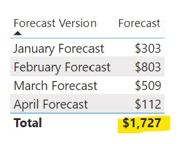
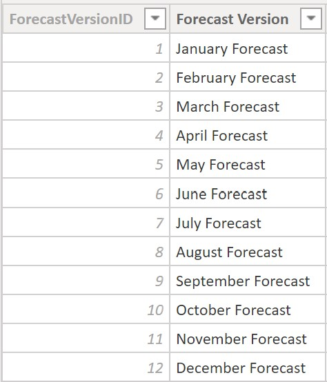
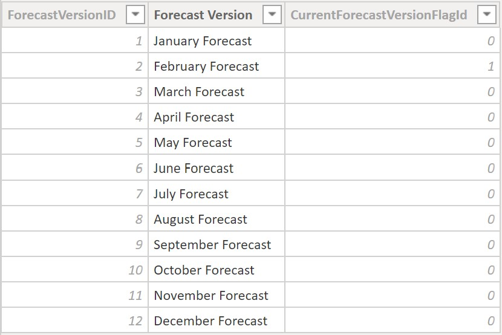
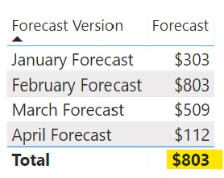

There are certain scenarios where simply summing up a column is not enough to have a fully accurate aggregation value. For example, if we have multiple currencies in our data or if we have multiple forecast versions - we want the grand total to default to a certain currency or certain forecast version. What is the best way to accomplish this?

Let's take the example of forecast versions. Oftentimes finance teams will make several forecasts per year of what they presume revenue will be. Individually, these forecasts may be aggregated, but different forecast versions must not be added together. Thus, a simple sum will not suffice.

## A Simple Sum does not work

As you can see below, a simple sum of the ForecastAmt provides the correct values within each forecast version but the grand total is nonsensical. I've seen many models that leave the DAX as such, making the assumption that users will correctly choose only a single forecast version. However, this is a false assumption and architects should always put in place features that increase the probability of proper model usage. In this example, a user may not know that there are multiple forecast versions and end up radically overestimating the forecast - which is a huge problem.

```dax
Forecast = SUM ( 'Forecast'[ForecastAmt] )
```

<figure>



<figcaption>

The grand total is overstated as one should not sum up forecast versions

</figcaption>
</figure>

<figure>



<figcaption>

The Forecast Version dimension shows a single version for each month

</figcaption>
</figure>

## Fixing the issue

In order to fix the issue, we need to decide what we want the grand total to show. In this example, we want it to show a single forecast version - February. This is best accomplished via a flag in the database layer that can be brought directly into the model. The logic that determines which month is the 'current forecast version' should also be in the database layer so that it will automatically update when the model is processed. This eliminates the need for overly-complicated DAX which will also improve the performance of your model.

As you can see below, I've added a hidden column: CurrentForecastVersionFlagId. This is an integer ([`INT`](https://dax.guide/dt/integer/)) column with values of either 0 or 1 that denotes a single forecast version as the current version. We will reference this in DAX to fix the grand total.



The next step is to create the following preparatory hidden measure. This measure checks whether the Forecast Version column is being used and that it only has one filter applied. If only one filter is applied to this column, it will return the value based on that single filter. Otherwise, it will default to a value of 1 which in our case denotes the February Forecast (that is where the flag is 1).

```dax
defaultForecastVersion =
IF (
    HASONEFILTER ( 'Forecast Version'[Forecast Version] ),
    VALUES ( 'Forecast Version'[CurrentForecastVersionFlagId] ),
    1
)
```

After creating the above measure, we need to modify the original Forecast measure as shown below. We have the original sum but we add a filter (using the [`FILTER`](https://dax.guide/filter/) function as we are filtering a column on a measure value). This filters the CurrentForecastVersionFlagId column to the \[defaultForecastVersion\] measure created above.

```dax
Forecast =
CALCULATE (
    SUM ( 'Forecast'[ForecastAmt] ),
    FILTER (
        VALUES ( 'Forecast Version'[CurrentForecastVersionFlagId] ),
        'Forecast Version'[CurrentForecastVersionFlagId] = [defaultForecastVersion]
    )
)
```



Now, the grand total shows properly - the same as the February Forecast as we had intended. If you have the logic for the CurrentForecastVersionFlagId in the database layer (as recommended above) the DAX logic will never have to change. The updates will flow directly into the model after processing the Forecast Version dimension table and thus the default filter will accordingly update to the proper month. Yet one more reason to include logic as far upstream as possible.

---

## Conclusion

This concept has a plethora of applications. As stated earlier, it can easily apply when you want to set a specific currency as the default currency in a model that has more than one currency. You can also build multiple default filters into the same measure (say setting a default forecast version and default currency for the Forecast measure). Additionally, every measure built on top of the base measure (Forecast, in the example above) with the default filtering logic will have the same behavior so you only have to repeat the logic in any applicable base measure.

Further, this solution highlights the point that sometimes grand totals can be funky and we need to account for these details. Filter context is extremely important and each measure should be evaluated in different filter contexts when conducting tests for accuracy. These details may seem trivial to some but they are of critical importance if one is to create an elegant solution.
