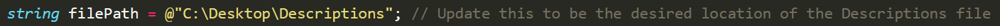
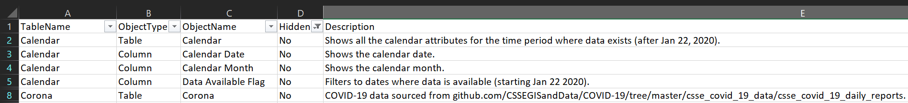
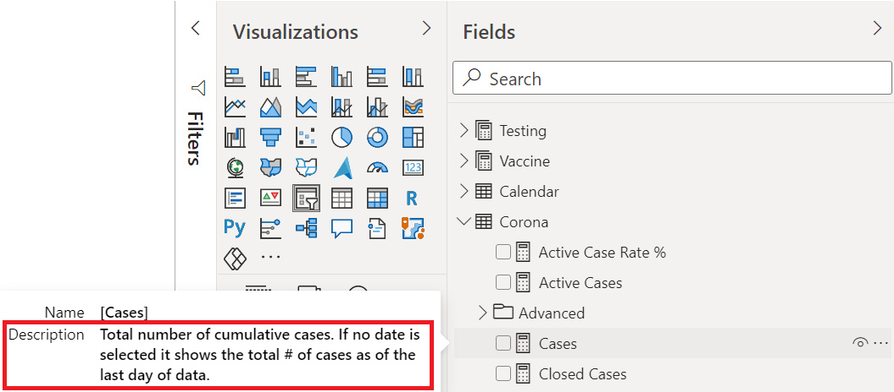

Adding descriptions to objects in your model (i.e. tables, columns, measures etc.) seems to always be the lowest priority task when creating a tabular model. If descriptions have been added to a model it seems to show that someone went above and beyond their job. This lack of priority is partly due to descriptions not being a necessary component of the model but also because they are cumbersome to manually enter into your modeling tool - whether it be [Power BI Desktop](https://powerbi.microsoft.com/desktop/), [Tabular Editor](https://tabulareditor.com/) or [SSDT](https://docs.microsoft.com/sql/ssdt/download-sql-server-data-tools-ssdt?view=sql-server-ver15). Additionally, the descriptions for objects may even be officially set by someone other than the developer which ends up in a long process of copying and pasting. Ugh! It's too much work! No wonder such few models have descriptions!

## The Value of Descriptions

While much of the focus of modeling is spent on performance (which of course is completely valid), there is another component which is very important. It is the user experience. The user experience includes aspects such as a star-schema architecture which is easy to navigate, [proper formatting and naming conventions](/post/tabularstyleguide), as well as generally ensuring that the user understands the model as best as possible. This last point is aided by creating a [Data Dictionary](/post/datadictionaryreinvented). This dictionary includes descriptions for each object in the model and helps users acquaint themselves with elements in the model. Thus, if the model has no descriptions, the Data Dictionary is not so helpful and it can be said that the development team could be doing more to aid its users. After all, users who know the model better will likely use it better, thereby creating better queries (i.e. not causing cartesian products) which in turn makes performance better for all users. In other words, adding descriptions can indirectly improve performance.

For more on creating automated Data Dictionaries, see my previous posts:

[Automated Data Dictionary](/post/datadictionary)

[Automated Data Dictionary - Reinvented](/post/datadictionaryreinvented)

[Automated Data Dictionary - Excel](/post/datadictionaryexcel)

## The Solution

Now that we have discussed the value of adding descriptions, let's talk about the best way to go about it. Since the descriptions are often managed by a stakeholder group, it is a good idea to externalize the model objects and descriptions outside of the development tool. The first tool that comes to mind for this purpose is Excel. It is an easy place to make quick changes on a list (of descriptions) and pretty much everyone is familiar with it. The other benefit of using Excel is that one can see all the descriptions at once (and therefore which objects do not have descriptions) which I believe gives it an advantage. That being said there is also a [best practice rule](https://powerbi.microsoft.com/blog/best-practice-rules-to-improve-your-models-performance/) for this.

Now that we identified Excel as our intermediary tool, let's lay out exactly what we need to do.

1. Create a list (table) of all the model objects and their current descriptions.
2. Export this list to Excel.
3. Make changes in Excel.
4. Import the Excel file back to the model.

Using a bit of C# it turns out that is pretty simple!

## Running the Scripts

I've created two [scripts](https://github.com/m-kovalsky/Tabular/tree/master/Descriptions) for this - one for exporting the description metadata to Excel and another for importing the description metadata back to the model.

Here are the steps for exporting the descriptions to Excel:

1. Open your model in [Tabular Editor](https://tabulareditor.com/).
2. Download the [ExportDescriptions](https://github.com/m-kovalsky/Tabular/tree/master/Descriptions) C# script.
3. Copy & paste the C# script into the [Advanced Scripting](https://docs.tabulareditor.com/Advanced-Scripting.html#working-with-the-model-object) window within Tabular Editor.
4. Update the filePath parameter to be the location where the Excel file with the descriptions will be saved (do *NOT* include the .xlsx suffix).

\5. Click the 'Play' button or press 'F5'.

After completing these steps, your description metadata will have been exported to an Excel in the location specified in step 4. Now you can update the descriptions in the Excel file or even share the Excel file with other folks for them to update it. Once you have updated the descriptions and are ready to import them into the model, follow the steps below.

<figure>

<figcaption>

Here is an example of the descriptions within the Excel file.

</figcaption>
</figure>

Here are the steps for importing the descriptions to the model:

1. Open your model in [Tabular Editor](https://tabulareditor.com/).
2. Download the [ImportDescriptions](https://github.com/m-kovalsky/Tabular/tree/master/Descriptions) C# script.
3. Copy & paste the C# script into the [Advanced Scripting](https://docs.tabulareditor.com/Advanced-Scripting.html#working-with-the-model-object) window within Tabular Editor.
4. Update the filePath parameter to be the location of the saved Excel file with the descriptions (do *NOT* include the .xlsx suffix).
5. Click the 'Play' button or press 'F5'.

After completing these steps, the descriptions in the Excel file will have been loaded into the model. You can check this by navigating to an object in the model and viewing the description within the properties window.

## Additional Notes

Other automated solutions for this may export the data to a text or .tsv file. However, those file types are not so friendly to work with - hence Excel. Actually, if you examine the C# script for exporting the data to Excel you will notice that it actually does export to a text file but then the code converts it into an Excel file. Simple things like this make life much easier. No one wants to edit a giant text file. Excel's user interface is far superior so why not take advantage of it.

With regard to managing the Excel file, I recommend putting it in a shared location so that both the development team and the stakeholder team can modify the file. And, whenever new objects (tables, measures, columns, hierarchies etc.) are added to the model, the export script is executed so that the Excel file has all the latest objects. If the Excel file has been tampered with and has mismatching objects, they will be skipped (and no error will show). This helps maintain accuracy and also stresses the importance of exporting the descriptions on a regular basis so that the definitions can be updated properly.

The Excel file that is generated by the export script includes a column indicating whether the object is hidden or not. Since hidden objects are not shown to the end user it is generally advisable to only set descriptions for visible objects. As such, simply filter the Excel file to see where the 'HiddenFlag' equals 'No'.

One additional point to mention is that the descriptions will not only show in your [Data Dictionary](/post/datadictionaryreinvented) but will also appear when hovering over an object in the Fields pane (as shown below).

## Conclusion

In summary, descriptions are a great way to give your users additional context when navigating your model. I believe that this technique lowers the barrier to entry and makes managing descriptions easier as it allows for an automated loading process and eases collaboration on the description content. Naturally, if you know of a better method please comment below. I'm always looking to improve and find an even better way!
