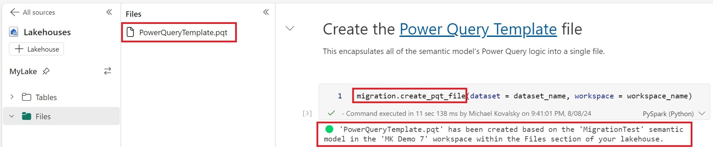
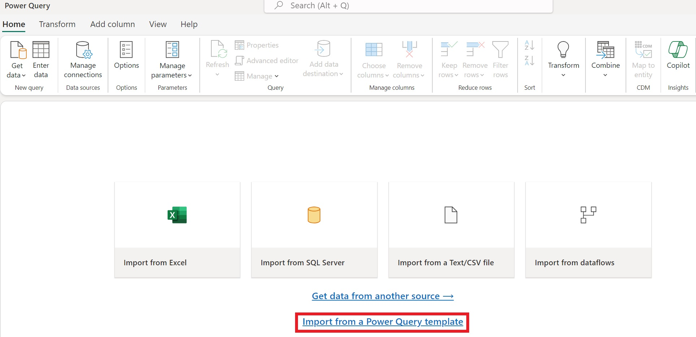
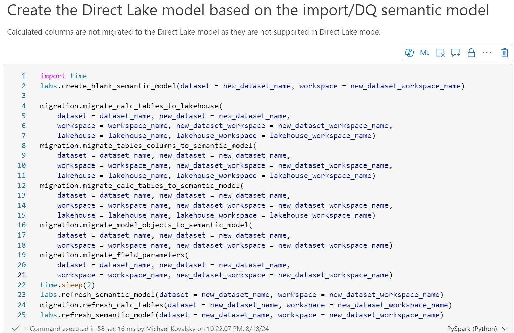
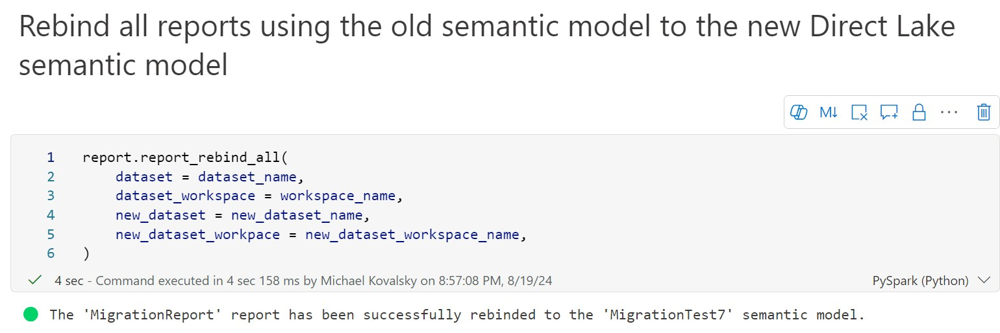
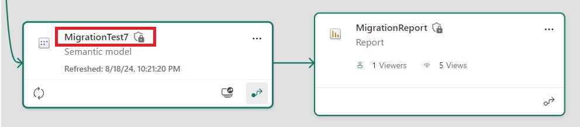
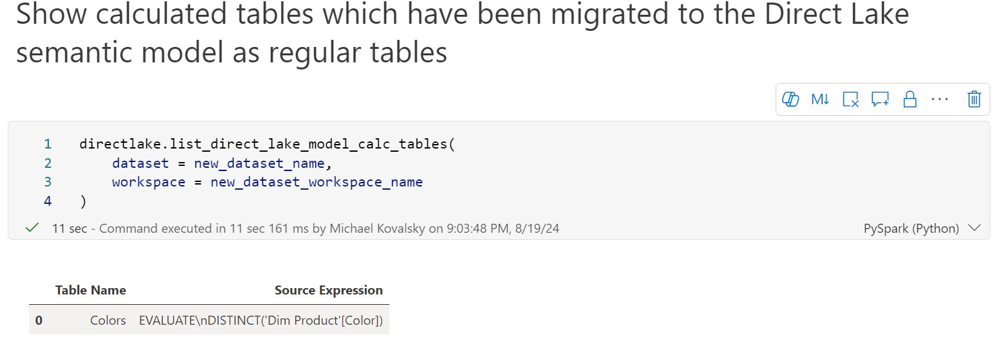

We are all familiar with import and DirectQuery as query modes for Analysis Services and Power BI semantic models. However, with the release of [Microsoft Fabric](https://learn.microsoft.com/fabric/get-started/microsoft-fabric-overview), there is a new kid on the block - [Direct Lake](https://learn.microsoft.com/power-bi/enterprise/directlake-overview)!

Direct Lake mode takes the advantages of both import and DirectQuery (the fast performance of import mode and the minimal latency of DirectQuery) and provides opportunities for larger and more complex semantic models to gain these substantial benefits. However, Direct Lake mode has some [intricacies](https://learn.microsoft.com/power-bi/enterprise/directlake-overview#known-issues-and-limitations) which make it fundamentally different than import or DirectQuery. As such, taking an existing import/DirectQuery semantic model and converting it into a Direct Lake semantic model may not be the simplest task...until now!

Breaking down the differences between what is supported in import/DirectQuery vs Direct Lake, I created an automated method for migrating an import/DirectQuery semantic model to Direct Lake.

## The Solution

This migration method runs in a Fabric notebook and uses a new python library called Semantic Link Labs. All you need to do is download [this notebook](https://github.com/microsoft/semantic-link-labs/blob/main/notebooks/Migration%20to%20Direct%20Lake.ipynb), and follow the steps outlined [here](https://github.com/microsoft/semantic-link-labs#direct-lake-migration) in the documentation.

Check out the video below for an in-depth demo of this Direct Lake migration process!

<iframe src="https://www.youtube-nocookie.com/embed/gGIxMrTVyyI" title="YouTube video" loading="lazy" allow="accelerometer; autoplay; clipboard-write; encrypted-media; gyroscope; picture-in-picture" allowfullscreen></iframe>

## The gory technical details

So how does this migration process work? Well, let's start with the primary differences of the structural differences in a Direct Lake semantic model.

- Direct Lake tables can only have a single partition which points directly to a delta table in a Fabric lakehouse.
- Power Query transformations are not supported in Direct Lake semantic models.
- Calculated columns are not supported.
- Calculated tables which rely on data from your semantic model are not supported.
- Columns used in relationships must be of the same data type and not of DateTime data type.
- Columns of binary data type are not supported.

In order to solve the first 2 points, I leveraged [Power Query Templates](https://learn.microsoft.com/power-query/power-query-template) (thanks to [Alex Powers](https://itsnotaboutthecell.com/about/) for the idea!). Power Query Templates encapsulate all of a semantic model's Power Query logic into a single file. Power Query Template files can be imported into Dataflows Gen2 (essentially Power Query online inside of Fabric). Publishing the Dataflows Gen2 creates delta tables in your Fabric lakehouse which can be used by the Direct Lake semantic model. The problem here was how to create the Power Query Template file as at present you can only create such a file from Excel or Dataflows Gen2.

After reviewing the format of the Power Query Template (.pqt) file, I created a function within the Semantic Link Labs library which dynamically generates a Power Query Template file based on a semantic model ([create\_pqt\_file](https://semantic-link-labs.readthedocs.io/en/stable/sempy_labs.migration.html#sempy_labs.migration.create_pqt_file)). This allows you to easily migrate your Power Query logic to Dataflows Gen2 while creating delta tables which feed your Direct Lake semantic model.

<figure>

<figcaption>

Dynamically generating a Power Query Template file

</figcaption>
</figure>

<figure>

<figcaption>

Importing a Power Query Template file in Dataflows Gen2

</figcaption>
</figure>

Once you have the delta tables in the lakehouse, the rest of the functions in the [notebook](https://github.com/microsoft/semantic-link-labs/blob/main/notebooks/Migration%20to%20Direct%20Lake.ipynb) create a new Direct Lake semantic model based on these tables in the lakehouse and migrate over all the objects and properties (i.e. table & column properties, measures, relationships, hierarchies, roles, row level security, perspectives, translations etc.) to the Direct Lake semantic model. In this state you have a functioning model in Direct Lake mode without calculated tables, calculated columns or other unsupported items. Running this set of functions also shows every add/modification done to the model so you know exactly what was done in the migration process.

<figure>

<figcaption>

Dynamically generating the Direct Lake semantic model

</figcaption>
</figure>

But what about all of your reports using the import/DirectQuery semantic model? For that you can use the [report\_rebind\_all](https://semantic-link-labs.readthedocs.io/en/stable/sempy_labs.report.html#sempy_labs.report.report_rebind_all) function which rebinds all reports which use the import/DQ semantic model to the Direct Lake semantic model in one click.

<figure>

<figcaption>

Reports successfully rebinded to the Direct Lake semantic model

</figcaption>
</figure>

<figure>

<figcaption>

Lineage view showing the report now using the Direct Lake semantic model

</figcaption>
</figure>

## Calculated Tables

Calculated tables can also be migrated to your Direct Lake model (as long as they do not rely on calculated columns or other unsupported features). In order to solve this, I split the concept of 'calculated tables' into 2 categories:

1. Field Parameters
2. All other calculated tables

If you didn't know already, field parameters are actually just calculated tables - albeit very simple ones which do not rely on any actual data from the semantic model. As such, they can be migrated over 'as-is' (as actual calculated tables). This is accomplished by the [migrate\_field\_parameters](https://semantic-link-labs.readthedocs.io/en/stable/sempy_labs.migration.html#sempy_labs.migration.migrate_field_parameters) function.

The solution for migrating other calculated tables is more intricate. The DAX expression encapsulating the logic for a calculated table is run dynamically through [semantic-link](https://learn.microsoft.com/fabric/data-science/semantic-link-overview). The resulting table is then used to create a delta table in the Fabric lakehouse which will then be consumed by the Direct Lake semantic model. The DAX expression is stored as a model [annotation](https://github.com/m-kovalsky/Fabric?tab=readme-ov-file#list-the-annotations-within-a-given-dataset-semantic-model) in the Direct Lake semantic model so it can easily be [referenced](https://semantic-link-labs.readthedocs.io/en/stable/sempy_labs.directlake.html#sempy_labs.directlake.list_direct_lake_model_calc_tables) and called in the future to [refresh the lakehouse table](https://semantic-link-labs.readthedocs.io/en/stable/sempy_labs.migration.html#sempy_labs.migration.refresh_calc_tables) based on data in the Direct Lake semantic model. As such, these calculated tables in the import/DirectQuery semantic model are now regular tables in the Direct Lake semantic model.

## Summary

All in all, with this method, the vast majority of the migration process can be boiled down to running just a few lines of code. Yes, some things will not make it to the Direct Lake model (i.e. calculated columns) but honestly those are just technical debt which should be moved to the ETL layer anyway (in fact, there is a [best practice rule](https://github.com/microsoft/Analysis-Services/tree/master/BestPracticeRules) just for that!). In some ways, Direct Lake mode forces developers to follow the best practices, which in my opinion, is great.

## Bonus

Check out the [Semantic Link Labs](https://github.com/microsoft/semantic-link-labs) library and you will find that there is much more than just the functions relevant to migration to Direct Lake. In future posts I will cover other features within this library so stay tuned!
