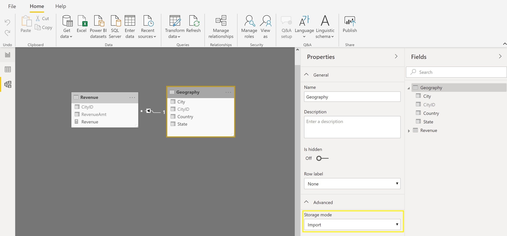
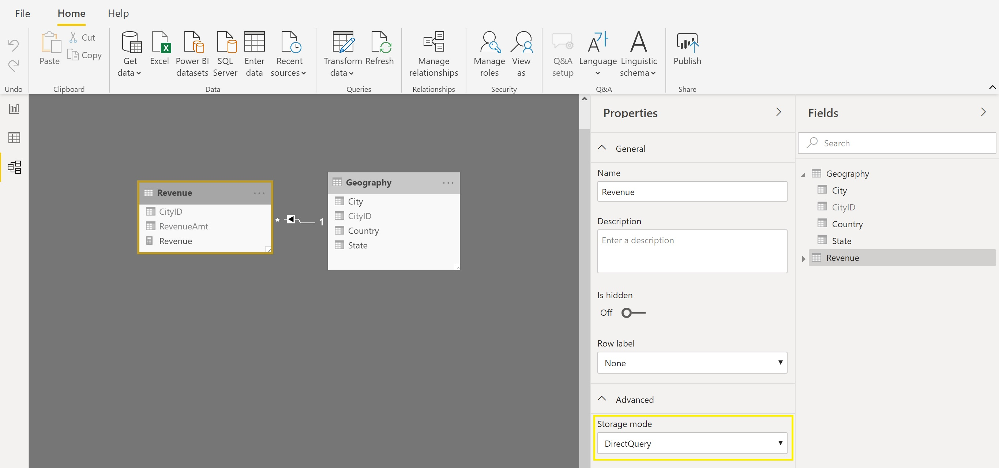
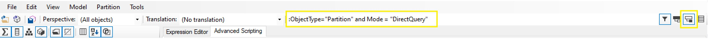

There are two modes available in Tabular models: Import Mode and [Direct Query](https://docs.microsoft.com/en-us/analysis-services/tabular-models/directquery-mode-ssas-tabular). Import Mode is the default mode and is generally the recommended approach as it yields the best performance in Tabular. The reason Import Mode excels in performance is mainly due to two factors. The data are compressed using the Vertipaq engine so that they take up less space which yields more performant queries. Additionally, the model is stored in-memory so it is easily accessible as the entire model is in a single location on a single server.

The other mode, Direct Query is generally not as performant as Import Mode but there are several reasons where one should consider using it.

1.) If your dataset is too large to fit within your server's memory (and you don't have access to a larger server which could fit it), Direct Query is a good option. This is due to the fact that in Direct Query the data is not held in memory so you are not limited by the RAM available in the Analysis Services server.

2.) If your [SLA](https://en.wikipedia.org/wiki/Service-level_agreement) is such that you don't have time to process the data in your model, you should consider Direct Query. Direct Query models do not need to be processed (whereas Import Mode models do) so you can save time in getting the data to your users.

If your model doesn't fit either of the above scenarios, make sure you stick with Import Mode. It is in your best interest and will yield the best user experience. I'm specifically stating user experience as Import Mode does not just yield better performance (in general) but Direct Query also has several important [limitations](https://docs.microsoft.com/en-us/power-bi/desktop-directquery-about#modeling-limitations) that must be taken into consideration.

## Composite Models

Now let's say you have one or several very large fact tables but the rest of your tables are small. In this case it would be great to have the large fact tables in Direct Query while maintaining the small tables in Import Mode (since Import Mode is preferred). This is where the [Composite Models](https://docs.microsoft.com/en-us/power-bi/desktop-composite-models) feature in [Power BI Desktop](https://powerbi.microsoft.com/en-us/desktop/) comes into play. Composite Models allow you to have some tables in Import Mode and others in Direct Query - within the same model. It should be noted that this is only at the table level and not at the partition level (all partitions in a table must be in the same mode). Composite models are a great option for this scenario but it should be noted that this feature is only available for models created in Power BI Desktop and that there could be some performance issues that arise from the fact that data is in several places. When models are in Import Mode, the entire model is on the Analysis Services server. When models are in Direct Query, the entire model must refer to a single connection string so again, all the data is in one place. Whenever data is coming from different places there is a cost of collecting it from those places and showing the results to the end user.

One additional limitation within Direct Query must be mentioned. In-memory models can scale to multiple VMs in parallel ([scale-out in Azure Analysis Services](https://docs.microsoft.com/en-us/azure/analysis-services/analysis-services-scale-out) or [Power BI Premium nodes](https://docs.microsoft.com/en-us/power-bi/service-premium-what-is) or multiple [IaaS VMs](https://azure.microsoft.com/en-us/pricing/details/virtual-machines/windows/) linked via Load Balancer) which allows them to service a higher concurrent user base. DQ models and tables using DQ within Composite Models send queries directly to a database which is only a single instance so it doesn't scale as well in a scenario with many concurrent users.

There's not much instruction to give regarding Composite Models. There's no setting to enable. It just happens naturally whenever you are using both Import Mode & Direct Query within a model in Power BI Desktop. It is important to note that once a table is in Import Mode it *cannot* be switched back to Direct Query. Plan this ahead of time so you don't have to redo any of your development.

If you're using a Composite Model, here is an easy way to tell which tables in your model are using Import Mode vs Direct Query. Just navigate to the Diagram View, select a table and view the Storage mode within the Advanced Properties pane (as shown below).

<figure>

<figcaption>

The Geography table is in Import mode

</figcaption>
</figure>

<figure>

<figcaption>

The Revenue table is in Direct Query mode

</figcaption>
</figure>

If you want to get a bit fancier, you can see this through [Tabular Editor](https://github.com/otykier/TabularEditor/releases). Once your model is connected in Tabular Editor, you can use the following filters to see all the tables/partitions that are in each mode.

:ObjectType=`"Partition"` and Mode = `"Import"`

:ObjectType=`"Partition"` and Mode = `"DirectQuery"`

To learn how to open your Power BI Desktop file as a model in Tabular Editor, follow steps 1-4A in [this post](/post/columnmeasurereference). Make sure the filter is specified exactly as shown above and that the middle option for filters is selected (highlighted on the far right of the screenshot below).

---

## Conclusion

As shown in this post, there are really only two reasons one would use Direct Query. The vast majority of cases should use Import Mode. If your model falls into one of the two cases you should consider Direct Query but also look at ways of either shrinking the dataset so it can fit in memory or clarifying with your stakeholders on whether they really need data fed into the model so quickly that there is no time for processing. Oftentimes folks will ask for 'live' data but in actuality they don't need it refreshed so often and thus Import Mode will be sufficient. Essentially, try to have models in Import Mode unless there is no other option.
