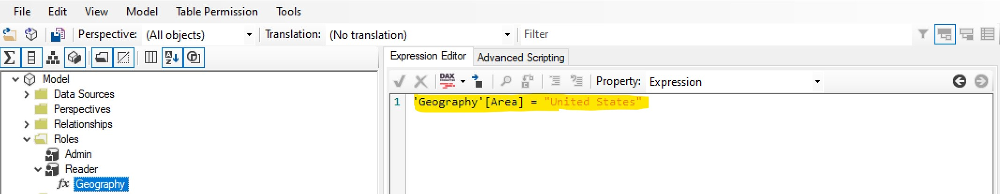
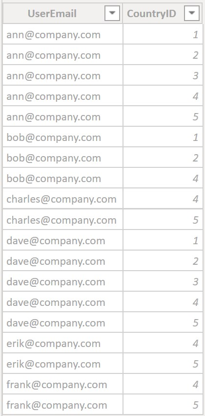
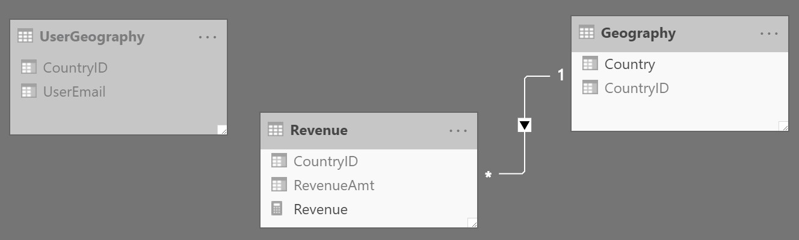
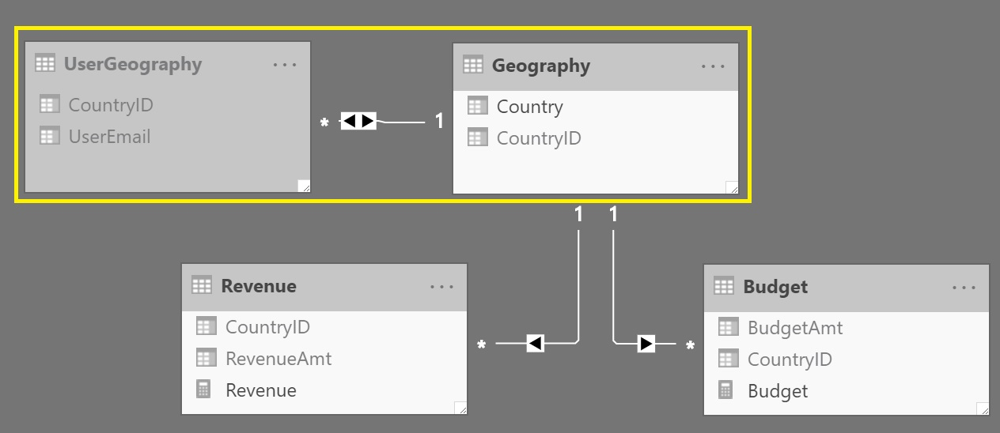
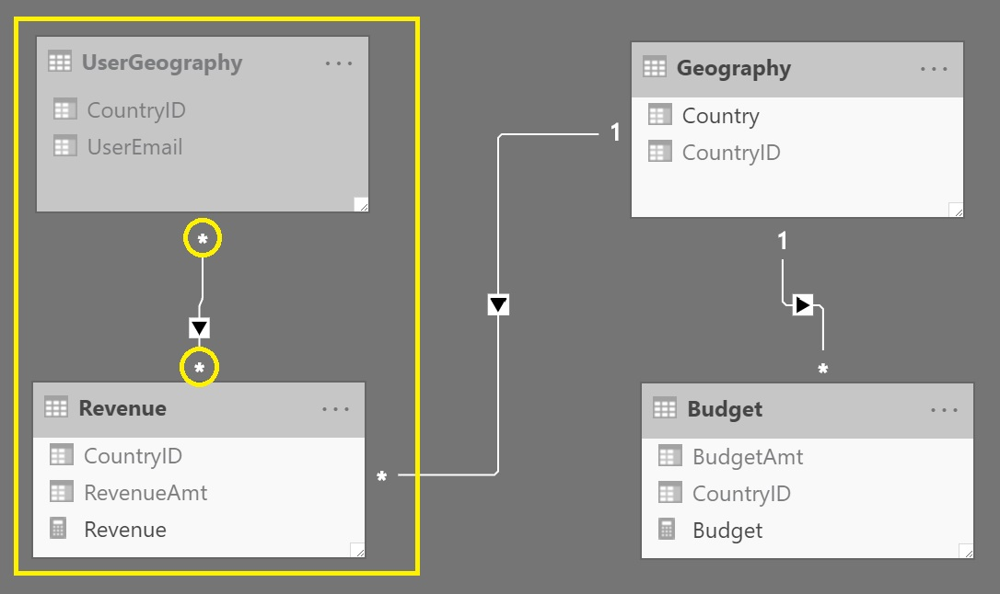
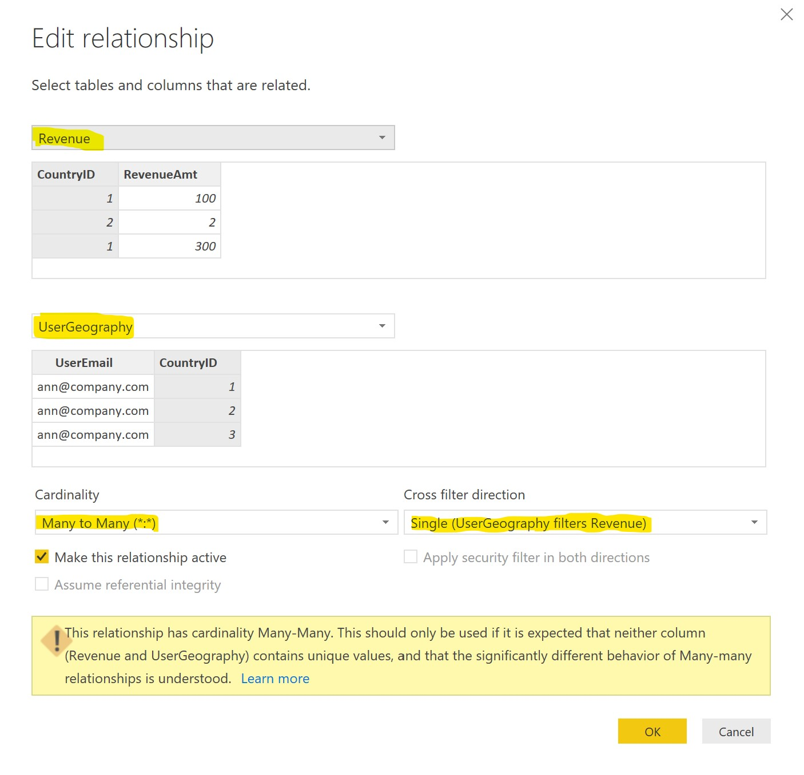
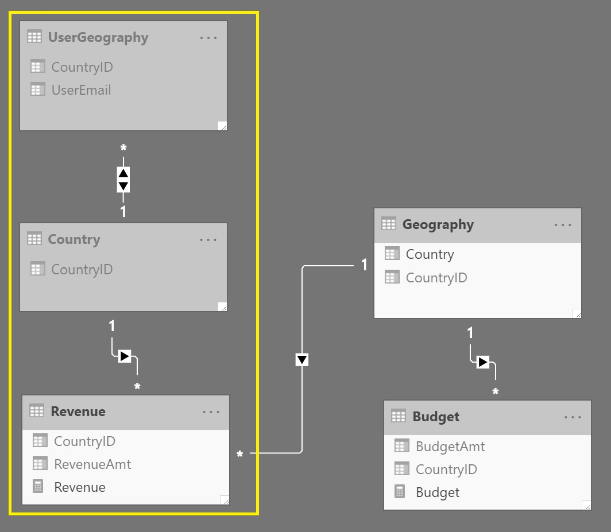
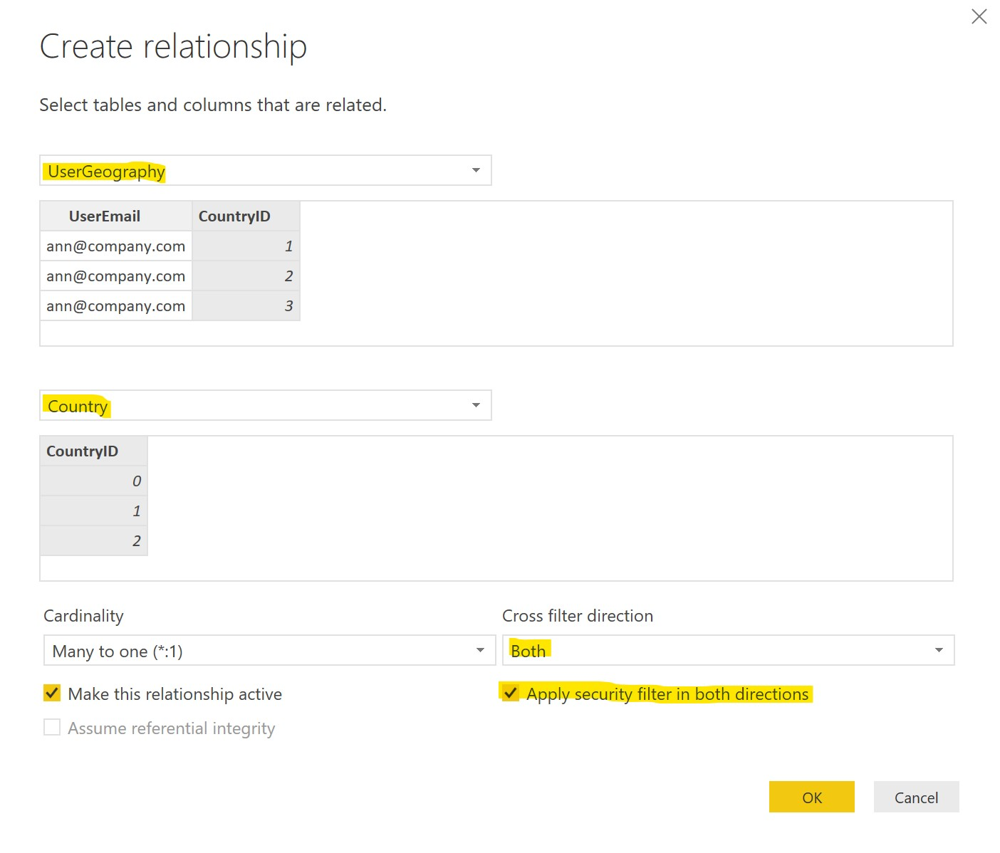

Row Level Security is the primary method for securing data in tabular models\*. As the name implies, data is secured horizontally (by rows) so that specific users (or user groups) are only able to see the data they are permitted to see. There are 2 primary methods of implementing RLS: 'Static' and 'Dynamic'.

\**The secondary method for securing tabular models is* [*Object Level Security*](https://docs.microsoft.com/en-us/analysis-services/tabular-models/object-level-security) *(OLS) which is not covered in this article.*

## Static vs Dynamic

Static RLS is simple. It is used when there is a requirement to restrict a specific user group to see the only *same* part of the data. For example, you may want to restrict US salespeople to only view US data. If that's the case, you can simply add a role, specifying the members (security group) and the following DAX as RLS on the Geography table (naturally you should account for naming differences). This RLS will ensure that the members of this role will only see data for the US.



Dynamic RLS is a bit more complicated, primarily because it has more capabilities. It is used when there is a requirement to restrict a specific user group to see *different* parts of the data. For example, perhaps different users are allowed to see different countries or different sets of countries. For example, some users can see only the United States, while others can see all countries and others can see only the countries in Western Europe and so on. This could be achieved with static RLS but it would require so many roles to be created that it would quickly become unmanageable. Plus, if a user's security requirements changed (to see different countries in this example) you would have to move them between different security groups or roles. In a short time it would become very painful. That is where Dynamic RLS comes in handy.

The first part of implementing Dynamic RLS is to create a security table. This table will be referenced when a user queries the model. Continuing with our example, the security table will be a list of email addresses and the CountryIDs each user is permitted to see (see below).



Now that we have the security table, we have to answer the following question:

*Will security be applied to all the fact tables that relate to the dimension table (in this case Geography)?*

Depending on the answer, the RLS will be different. Sometimes we only want to secure certain fact tables by a dimension. In other cases we want to secure all facts related to a dimension. Each pattern shown below will have an 'A' or 'B' delineation.

Pattern Type 'A' is for securing ALL the fact tables related to the dimension.

Pattern Type 'B' is for securing ONLY specific fact tables related to the dimension.

## Pattern 1: Using `LOOKUPVALUE`

In this pattern, there is no need to create a relationship to/from the security table. The only relationship needed is from the fact table(s) to the dimension. In this case that would be 'Revenue'\[CountryID\] -\> 'Geography'\[CountryID\].



Types A & B use the exact same model. The only difference is where the RLS is applied. For Type A, the RLS is placed on the dimension table (in this case Geography). For Type B, the RLS is placed on the fact table (in this case Revenue - as we only want to secure the Revenue table, not the Budget table).

## Type A

```dax
'Geography'[CountryID]=
            LOOKUPVALUE(
            'UserGeography'[CountryID],
                'UserGeography'[UserEmail],
                USERPRINCIPALNAME(),
                'UserGeography'[CountryID],
                'Geography'[CountryID]
            )
```

## Type B

```dax
'Revenue'[CountryID]=
            LOOKUPVALUE(
            'UserGeography'[CountryID],
                'UserGeography'[UserEmail],
                USERPRINCIPALNAME(),
                'UserGeography'[CountryID],
                'Revenue'[CountryID]
            )
```

## Pattern 2: Using Advanced Relationships

We can achieve the same result as above by using Bi-Directional (Bi-Di) or Many-to-Many (M2M) relationships. This results in less verbose DAX but at the same time we must be extra careful when using these relationships by examining the entire model and ensuring it is accomplishing exactly what we intend.

## Type A

In this pattern, Type A is best accomplished via a Bi-Di relationship between 'UserGeography'\[CountryID\] -\> 'Geography'\[CountryID\]. As stated above, the DAX used for the RLS here is very simple (shown below).

```dax
      'UserGeography'[UserEmail] = USERPRINCIPALNAME()
```



## Type B (M2M)

In this pattern, Type B is can be accomplished with either M2M or Bi-Di. The reason we need such a relationship is because we need the relationship to traverse between the CountryID columns of the Revenue and UserGeography tables - and neither column in these tables is unique.

Let's start with M2M. As you can see below, there is a M2M relationship between Revenue'\[CountryID\] and 'UserGeography'\[CountryID\]. The asterisks (\*) on both sides indicate the M2M relationship. Since only the Revenue table is related to the UserGeography table, it is the only fact table that is secured by it (Budget is not secured as it is not have a relationship path to UserGeography). The DAX for RLS is the same as in Type A - very simple.

```dax
'UserGeography'[UserEmail] = USERPRINCIPALNAME()
```



Make sure the relationship is set up exactly as shown below.



## Type B (Bi-Di)

Now let's see how to do the same thing (Type B) using Bi-Di. In this case we will be simulating a M2M relationship only using Bi-Di with a bridge table to accomplish it. As shown below, we have added a new hidden table: Country. This table acts as a bridge between Revenue and UserGeography. It is necessary here as Bi-Di requires Many-to-One relationships. The Country table is simply a unique list of CountryIDs (can just do a `SELECT DISTINCT` \[CountryID\] from the Geography table).

The relationships used are as follows:

Revenue'\[CountryID\] -\> 'Country'\[CountryID\]

'UserGeography'\[CountryID\] \<-\> 'Country\[CountryID\]

Again, the DAX is the same as when using the M2M relationship.

```dax
'UserGeography'[UserEmail] = USERPRINCIPALNAME()
```



Make sure to specify the Bi-Di relationship exactly as shown below so that you achieve the proper results.



---

## Conclusion

Now that we have gone through the options for implementing Dynamic RLS, we have to make a decision on what is the best approach. The best approach defaults to the approach that has the best performance. I strongly suggest always testing the patterns yourself on your dataset to ensure optimal performance.

In order to use M2M you must either create your model in [Power BI Desktop](https://powerbi.microsoft.com/en-us/desktop/), use [Azure Analysis Services](https://azure.microsoft.com/en-us/services/analysis-services/), or use [SQL 2019 CTP 2.4 or higher](https://docs.microsoft.com/en-us/sql/sql-server/sql-server-version-15-release-notes?view=sql-server-ver15). If you are not using these, M2M is not an option. When selecting between Bi-Di and M2M, I recommend using M2M. The first reason to choose M2M over Bi-Di is that it makes the model simpler - fewer tables and relationships. The second (and more important) reason is that M2M has a performance advantage built into the engine that Bi-Di does not have.

There are a few last (but important) considerations to be made when implementing RLS. First, minimize the DAX logic used for RLS. As you can see the DAX used above is simplified. For example, we have avoided the need to parse out a domain name (DOMAIN\\alias -\> alias). Instead we have used the [`USERPRINCIPALNAME`](https://dax.guide/userprincipalname/) function which directly compares to the email address with no transformations needed. As with the rest of the model, limiting transformations done in any area of the model will further optimize model performance. The other point to consider is minimizing the amount of rows in the security table. Limiting this table to only the necessary rows as this will also improve performance. This brings up an additional consideration for performance optimization which I will discuss in an upcoming post.
