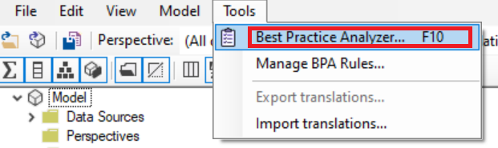
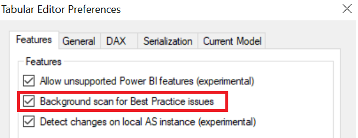
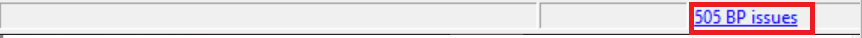
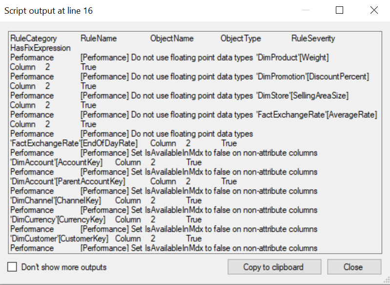

[Tabular Editor](https://tabulareditor.com/)'s [Best Practice Analyzer](https://docs.tabulareditor.com/Best-Practice-Analyzer.html) is a fantastic tool for ensuring your tabular models abide by a set of best practice rules. In fact, I wrote a post on a collection of [Best Practice Rules](https://powerbi.microsoft.com/blog/best-practice-rules-to-improve-your-models-performance/) which can be [downloaded from GitHub](https://github.com/microsoft/Analysis-Services/tree/master/BestPracticeRules) and immediately used to check your model. That article was followed up by an [additional post](https://powerbi.microsoft.com/blog/best-practice-rules-to-improve-your-models-performance-and-design-v1-1/) which revealed more updates and new best practice rules.

There are several common ways to run the Best Practice Analyzer:

1. Navigate to Tools -\> Best Practice Analyzer.



\2. Enable Best Practice Analyzer rules to run behind the scenes (File -\> Preferences -\> Background scan for Best Practice issues).



Once this feature is enabled you will see the number of Best Practice issues shown at the bottom of the Tabular Editor window (as shown in the screenshot below).



\3. Run the Best Practice Analyzer in the Command Line (see the [official documentation](https://docs.tabulareditor.com/Command-line-Options.html#running-the-best-practice-analyzer)).

## The Export Method

These 3 methods are the common methods used for running the Best Practice Analyzer. However, there is one additional method which is less well known. [Thanks to Daniel Otykier](https://github.com/otykier/TabularEditor/issues/848), we can run a simple C# script in the [Advanced Scripting](https://docs.tabulareditor.com/Advanced-Scripting.html#working-with-the-model-object) window which executes the Best Practice Analyzer. The advantage of running it in this manner is that we can easily export all of the results.

```csharp
using TabularEditor.BestPracticeAnalyzer;

var bpa = new Analyzer();
bpa.SetModel(Model);

var sb = new System.Text.StringBuilder();
string newline = Environment.NewLine;

sb.Append("RuleCategory" + '\t' + "RuleName" + '\t' + "ObjectName" + '\t' + "ObjectType" + '\t' + "RuleSeverity" + '\t' + "HasFixExpression" + newline);

foreach (var a in bpa.AnalyzeAll().ToList())
{
    sb.Append(a.Rule.Category + '\t' + a.RuleName + '\t' + a.ObjectName + '\t' + a.ObjectType + '\t' + a.Rule.Severity + '\t' + a.CanFix + newline);
}

sb.Output();
```

\*\*\*Note: If you are using [Tabular Editor 3](https://tabulareditor.com/), change the first line of the script above to the code shown below. This script works in Tabular Editor 3.0.6 or higher.

```csharp
using TabularEditor.Shared.BPA;
```

Executing the script above will run all of the Best Practice Analyzer rules and output the results into a tab-delimited string (as shown below). This can easily be copied and pasted into Excel for further analysis.

<figure>



<figcaption>

An example of the Best Practice Analyzer output.

</figcaption>
</figure>

## Conclusion

Each of the above methods for running the BPA tool has its use. I heard feedback from several folks asking for the ability to export the BPA results and now we have it! The ability to export the BPA results provides yet another great capability when using [Tabular Editor](https://tabulareditor.com/) and allows a new method for exploring and filtering the BPA results.
