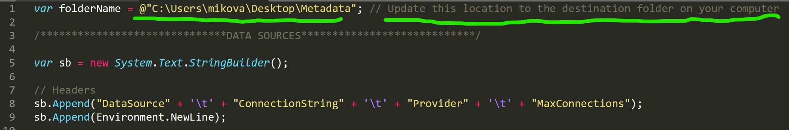
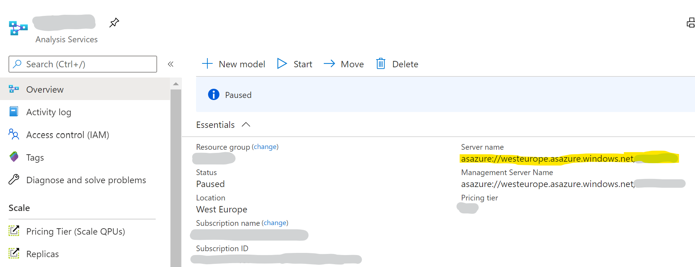
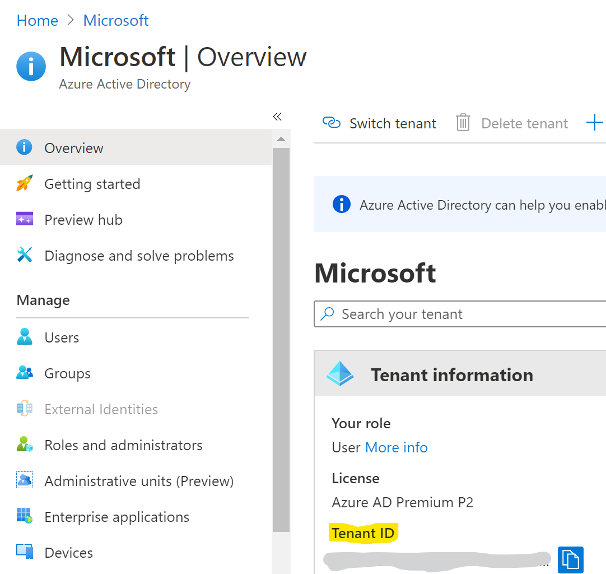
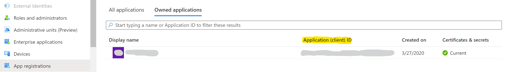
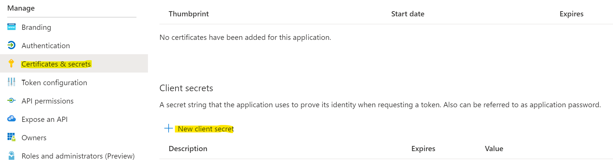
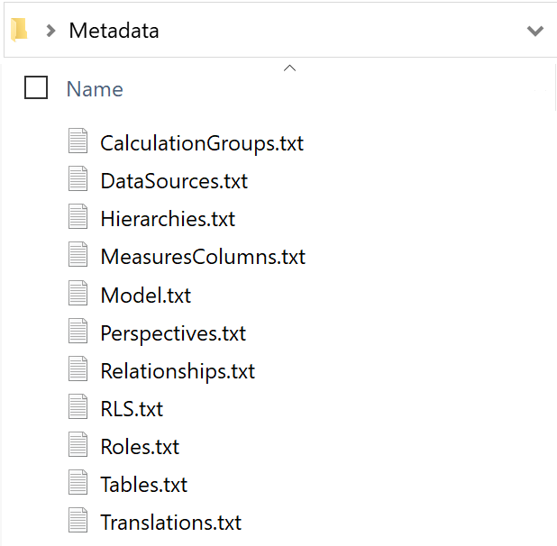

Trying to extract information about your tabular model? Here is a way to quickly extract relevant metadata for all common model elements (listed below).

- Tables
- Columns
- Measures
- Hierarchies
- Data Sources
- Relationships
- Roles\*
- Row Level Security
- Perspectives
- Translations
- Calculation Groups
- KPIs
- Object Level Security
- Model

This can be done for any form of tabular model - a .bim file, database.json file, SSAS Server, Azure Analysis Services Server, or a Power BI Premium dataset. Power BI Premium datasets are able to do this via the [XMLA endpoints](https://docs.microsoft.com/en-us/power-bi/admin/service-premium-connect-tools) as well as the [support for Service Principals using the XMLA endpoints](https://powerbi.microsoft.com/en-us/blog/announcing-support-for-service-principals-using-the-xmla-endpoint-in-power-bi-premium/).

\*Note that the Role metadata cannot yet be extracted for Power BI Premium datasets. This is expected to be possible once the XMLA endpoints feature becomes [generally available](https://docs.microsoft.com/en-us/power-platform-release-plan/2020wave1/business-intelligence/xmla-readwrite) later this month.

## How to do it

1.) Download and install [Tabular Editor](https://github.com/otykier/TabularEditor/releases).

2.) Download the C# script available [here on GitHub](https://github.com/m-kovalsky/Tabular/releases/).

3.) Open the script in a text editor and update the folderName parameter to a folder on your computer (this is where the metadata will go).



4.) Identify where you want to extract metadata from based on the options below.

- .bim file
- database.json file
- SQL Server Analysis Services Server
- Azure Analysis Services Server
- Power BI Premium dataset

5.) Run the relevant script below accordingly from the command prompt. Make sure to update the items in orange, using the details below for assistance. All of the \< and \> signs are to be omitted and are simply placeholders.

.bim File

```bat
start /wait /d "C:\Program Files (x86)\Tabular Editor" TabularEditor.exe "<.bim file location>" -S "<C# script file location>"
```

database.json File (based on the [Save-to-Folder](https://docs.tabulareditor.com/Advanced-features.html#folder-serialization) technique)

```bat
start /wait /d "C:\Program Files (x86)\Tabular Editor" TabularEditor.exe "<database.json file location>" -S "<C# script file location>"
```

SSAS Server

```bat
start /wait /d "C:\Program Files (x86)\Tabular Editor" TabularEditor.exe "<Server Name>" "<Database Name>" -S "<C# script file location>"
```

Azure Analysis Services

```bat
start /wait /d "C:\Program Files (x86)\Tabular Editor" TabularEditor.exe "Provider=MSOLAP;Data Source=asazure://<westeurope>.asazure.windows.net/<AASServerName>;User ID=<xxxxx>;Password=<xxxxx>;Persist Security Info=True;Impersonation Level=Impersonate" "<Database Name>" -S "<C# script file location>"
```

Power BI Premium Dataset

```bat
start /wait /d "C:\Program Files (x86)\Tabular Editor" TabularEditor.exe "Provider=MSOLAP;Data Source=powerbi://api.powerbi.com/v1.0/myorg/<Premium Workspace>;User ID=app:<Application ID>@<Tenant ID>;Password=<Application Secret>" "<Dataset Name>" -S "<C# script file location>"
```

Note: If using Power BI Premium, make sure to enable XMLA Read/Write Endpoints by following the instructions [here](https://aka.ms/XmlaEndpoint) (note the minimum SKU to enable XMLA Read/Write is an [A3](https://docs.microsoft.com/en-us/power-bi/admin/service-premium-what-is#capacity-nodes)).

## Where to get the Azure Analysis Services Info

1.) Go to to the Azure Portal: [portal.azure.com](http://portal.azure.com).

2.) In the search bar, search for 'Analysis Services'.

3.) Select your Azure AS instance.

4.) On the Overview tab, copy the Server Name (as highlighted below).



## Where to get the app info

1.) Go to the Azure Portal: [portal.azure.com](http://portal.azure.com).

2.) In the search bar, search for 'Azure Active Directory'.

3.) Copy the Tenant ID from the Overview page (as shown below).



4.) Go to the 'App Registrations' page (there is a link on the left navigation bar).

5.) Copy the Application ID (as shown below).



6.) Click on the 'Display Name' (here you will again see the App ID & Tenant ID).

7.) Click on 'Certificates & Secrets' (there is a link on the left navigation bar).

8.) Click 'New Client Secret', give it a name, and click 'Add'.



9.) Copy the client secret (make sure to write this down somewhere as you won't be able to go back and retrieve it from the portal).

## Result

The resulting output of running these scripts is a set of text files with the extracted metadata - one text file for each of the model elements. The text files will appear in the folder specified in the folderName parameter within the C# script.



Simply copy these results into Excel for easy viewing and filtering.

## Conclusion

Thanks to the [TOM API](https://docs.microsoft.com/en-us/analysis-services/tom/introduction-to-the-tabular-object-model-tom-in-analysis-services-amo?view=asallproducts-allversions) and [Tabular Editor](https://github.com/otykier/TabularEditor/releases), model metadata can easily be extracted programmatically. Additionally, this capability and much more is now available to folks using Power BI Premium thanks to the enabling XMLA Endpoints and Service Principals. Lastly, this gives a taste of the automation capabilities at your fingertips when using Tabular Editor for any tabular modeling scenario.
