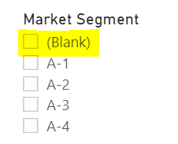
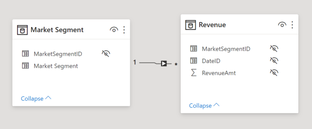
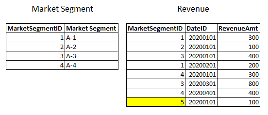
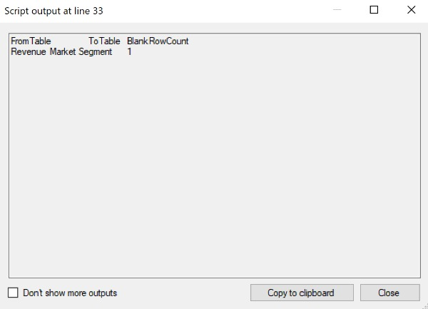

We are all familiar with the classic situation where a report has a slicer that shows the dreaded 'blank' value. This instantly makes a report look less professional and can also lead to confusion for users.

<figure>

<figcaption>

Blank value showing in a slicer

</figcaption>
</figure>

## The Cause

The blank row is generated by the tabular engine due to an invalid relationship. What this means is that there is a value on one side (the 'from-side') of a relationship that does not exist in the other side (the 'to-side') of the relationship.

In the example below, there is a fact table (Revenue) which is related to a dimension table (Market Segment). The tables are related via a many-to-one relationship - from the Revenue table to the Market Segment table.

As highlighted above, the Revenue table has a row with a MarketSegmentID value of 5. However, no such value for MarketSegmentID exists in the Market Segment table. This is the exact situation which will cause the blank value to appear in slicers as well as in other visuals.

Once we are aware of this issue, it is usually relatively simple to fix it. However, in a complex model with many tables, it is often quite time consuming to identify which relationships are causing the issue.

## The Solution

The solution is a [C# script](https://github.com/m-kovalsky/Tabular/blob/master/BlankRowFinder.cs) which automates the process of identifying invalid relationships (which produce the blank value) in your model. Simply run the script inside of [Tabular Editor](https://github.com/otykier/TabularEditor/releases/). It scans all the relationships in your model, checks to see if there are blank values, and provides a list detailing all invalid relationships.

## Steps

1. Download the [C# script](https://github.com/m-kovalsky/Tabular/blob/master/BlankRowFinder.cs).
2. Open your model in Tabular Editor\*.
3. Open the [Advanced Scripting](https://docs.tabulareditor.com/Advanced-Scripting.html#working-with-the-model-object) window.
4. Paste and run the C# script (click the play button or press F5).

\**In order to run this script, you must be live-connected to a model in Tabular Editor.*

After running these steps, you will get a window as the one below which shows all invalid relationships and how many blank rows each produces.

<figure>

<figcaption>

An example of the output of the C# script

</figcaption>
</figure>

Equipped with this information, you can then turn upstream to your data warehouse to see which specific values are in the 'FromTable' and not in the 'ToTable' and make the necessary corrections to alleviate the blank row issue.

## Conclusion

This solution provides a quick way to easily fix your blank row issues and keep your reports looking clean and elegant. Doing this manually on a model with many tables would be extremely time consuming and monotonous. Luckily, Tabular Editor's capability to access the [Tabular Object Model](https://docs.microsoft.com/en-us/analysis-services/tom/introduction-to-the-tabular-object-model-tom-in-analysis-services-amo?view=asallproducts-allversions) (TOM) and connect to the Analysis Services engine allows this process to be automated as should be done for all such processes.
