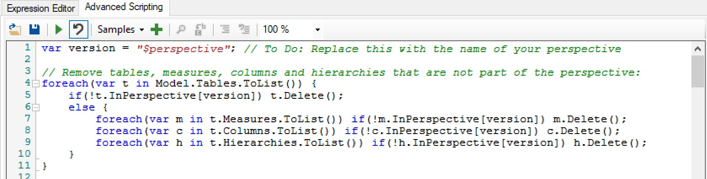
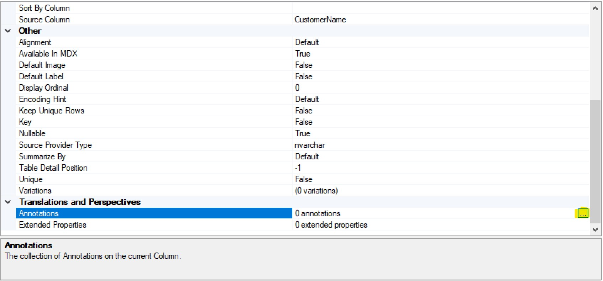
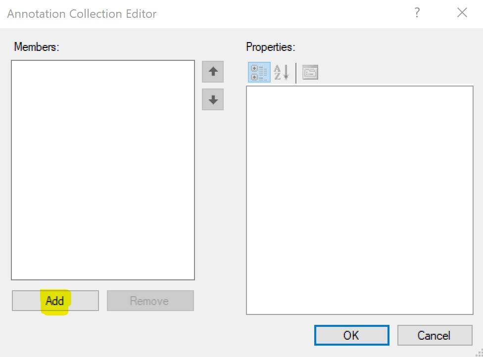
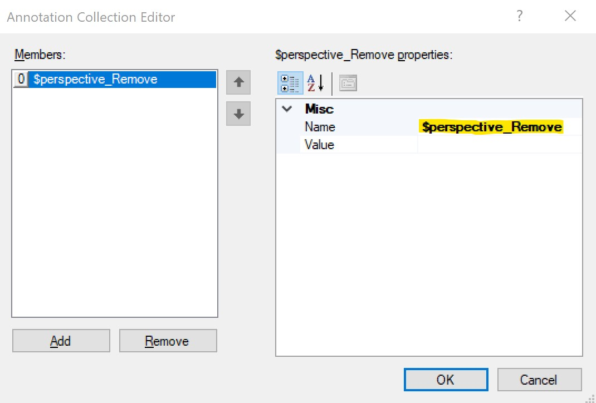
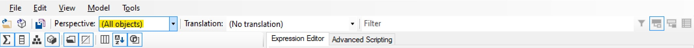
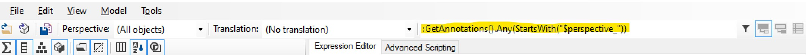

\*\*\*Be sure to also check out the [Mini Model Builder](https://github.com/m-kovalsky/MiniModelBuilder) tool which simplifies the implementation of this technique.

---

When architecting Enterprise BI solutio**ns, it is essential** to focus on the scalability and performance of your solution. In such a situation you may have thousands of users querying your model(s) on a daily basis and providing them with an optimal experience is of utmost importance.

Master Model is a technique for creating derivative tabular models based on a single tabular solution. It allows you to scale your model to a larger user base while providing a tailored experience for each user group.

It is important to mention that this technique should not be the first approach to optimizing tabular performance. It is **critical to first start with the basics** - architecture, data granularity, column compression, relationships, DAX, Row Level Security (RLS) and infrastructure. Master Model may be used after one has optimized around the other areas. However, it should be noted that any improvements in the 'master' model will pass down to the derivative models so there is no need to create the perfect model before beginning this process.

The first question to ask yourself is: 'Do you have different types of users?'. That is, do you have groups of users that use different parts of the model. In many situations, you will have some users who use the whole data model but many other users who only use a small portion of the data model. The Master Model technique is able to leverage this for the benefit of all - the user and the developer.

## How does it work?

Master Model uses the [Advanced Scripting](https://docs.tabulareditor.com/Advanced-Scripting.html) functionality within [Tabular Editor](https://github.com/otykier/TabularEditor/releases) which accesses the [Tabular Object Model](https://docs.microsoft.com/en-us/bi-reference/tom/introduction-to-the-tabular-object-model-tom-in-analysis-services-amo) (TOM) libraries. This allows you to programmatically modify any object within a model (i.e. removing a table/partition/column/measure, updating a partition query, or updating RLS). The Advanced Scripting functionality uses a bit of C# code to reference [perspectives](https://docs.microsoft.com/en-us/analysis-services/tabular-models/perspectives-ssas-tabular) and/or [annotations](https://docs.microsoft.com/en-us/dotnet/api/microsoft.analysisservices.tabular.annotation?view=analysisservices-dotnet) which denote which objects to modify.

Since perspectives are used to manage tables, columns, measures and hierarchies, they are a natural fit in this technique for denoting which of these objects should be in the derivative model. Modifying any other object or making changes other than removals to the aforementioned objects requires using annotations.

## Master Model Advantages

- Tailored experience for each user group so they see only what they use
- Reduced dataset in derivative model provides a performance boost
- Consistent user experience between models
- Less development time
- Minimal maintenance
- Easy to see the differences between models
- Only a small amount of code

## How to create a Master Model

1. Identify a user group that only uses part of the model
2. Identify which objects the target group uses. Notice any differences in granularity or other needs (i.e. different RLS etc.)
3. Create a new perspective\* in the model, adding all objects (tables, columns, measures, hierarchies) which are needed in the derivative model.
4. Create annotations for removals (i.e. Partitions, Data Sources, Roles, Perspectives, KPIs)
5. Create annotations for hiding/unhiding (Tables, Columns, Measures, Hierarchies)
6. Create annotations for updates (i.e. Partition Queries, DAX, Data Sources, RLS, Role Members)

\**I prefer to prefix models used solely for Master Model with '$'. This differentiates perspectives used solely for Master Model compared to 'real' perspectives.*

Here is a link to the full [C# script on GitHub](https://github.com/m-kovalsky/Tabular).

Steps 1-2 are to be decided by the business stakeholder in discussions with the developer/architect.

Step 3: After you have created a new perspective and added the objects necessary for the derivative model to that perspective, you may continue with writing the following C# code in the advanced script window. When executed, this code will remove any table, column, measure or hierarchy that is not included in the perspective called '$perspective'. Naturally, this is an example and you should replace $perspective with a more aptly named perspective.

```csharp
var version = "$perspective"; // To Do: Replace this with the name of your perspective

// Remove tables, measures, columns and hierarchies that are not part of the perspective
foreach(var t in Model.Tables.ToList()) {
     if(!t.InPerspective[version]) t.Delete();
     else {
        foreach(var m in t.Measures.ToList()) if(!m.InPerspective[version]) m.Delete();
        foreach(var c in t.Columns.ToList()) if(!c.InPerspective[version]) c.Delete();
        foreach(var h in t.Hierarchies.ToList()) if(!h.InPerspective[version]) h.Delete();
    }
}
```

<figure>



<figcaption>

C# code shown within the Advanced Scripting window in Tabular Editor

</figcaption>
</figure>

Step 4: Since perspectives only handle tables, columns, measures and hierarchies, we will use annotations to denote the removal of other objects. Annotations are notes that are generally auto-generated by [SSDT](https://docs.microsoft.com/en-us/sql/ssdt/download-sql-server-data-tools-ssdt?view=sql-server-2017) and don't actually impact the model. However, they are quite convenient for our needs in this scenario. The following shows the C# code which will remove any Perspective, Data Source, Role, Partition or KPI as denoted by annotations.

```csharp
// Remove Perspectives based on annotations
foreach(Perspective x in Model.Perspectives.ToList()) {
   var expr = x.GetAnnotation(version + "_Remove"); if(expr == null) continue;
   x.Delete();
}
// Remove Data Sources based on annotations
foreach(DataSource x in Model.DataSources.ToList()) {
   var expr = x.GetAnnotation(version + "_Remove"); if(expr == null) continue;
   x.Delete();
}
// Remove Roles based on annotations
foreach(ModelRole x in Model.Roles.ToList()) {
   var expr = x.GetAnnotation(version + "_Remove"); if(expr == null) continue;
   x.Delete();
}
// Remove Partitions based on annotations
foreach(Table t in Model.Tables) {
     // Loop through all partitions in this table
     foreach(Partition p in t.Partitions.ToList()) {
        var expr = p.GetAnnotation(version + "_Remove"); if(expr == null) continue;
        p.Delete();
   }
}
// Remove KPIs based on annotations
foreach(Measure x in Model.AllMeasures) {
   var expr = x.GetAnnotation(version + "_RemoveKPI"); if(expr == null) continue;
   x.KPI.Delete();
}
```

## How to create an Annotation within Tabular Editor

After you've selected the object on which you want to create an annotation, scroll in the properties to Annotations and click the '...' as highlighted below.



Next, click 'Add' to add a new annotation.



Finally, since in this example we want to remove this object we will add $perspective\_Remove as the Annotation Name. In this case we don't need the Annotation Value (in other cases we will). Then click OK.



Repeat this action for any objects that are to be removed from the model (not including any objects already handled in Step 3).

Step 5: Below shows the C# code to enable hiding/unhiding of objects. The annotations are done in a similar fashion to the removals in Step 4 only with the suffix \_Unhide or \_Hide. As an example, a column that is hidden but should be visible in the derivative model would have an annotation of $perspective\_Unhide.

```csharp
// *************   START UNHIDING   ************* //
// Modify columns to unhide based on annotations
foreach(Column x in Model.AllColumns) {
    var expr = x.GetAnnotation(version + "_Unhide"); if(expr == null) continue;
    x.IsHidden=false;
}
// Modify measures to unhide based on annotations
foreach(Measure x in Model.AllMeasures) {
    var expr = x.GetAnnotation(version + "_Unhide"); if(expr == null) continue;
    x.IsHidden=false;
}
// Modify tables to unhide based on annotations
foreach(Table x in Model.Tables.ToList()) {
    var expr = x.GetAnnotation(version + "_Unhide"); if(expr == null) continue;
    x.IsHidden=false;
}
// *************   END UNHIDING  ************* //

// *************   START HIDING   ************* //
// Modify columns to unhide based on annotations
foreach(Column x in Model.AllColumns) {
    var expr = x.GetAnnotation(version + "_Hide"); if(expr == null) continue;
    x.IsHidden=true;
}
// Modify measures to unhide based on annotations
foreach(Measure x in Model.AllMeasures) {
    var expr = x.GetAnnotation(version + "_Hide"); if(expr == null) continue;
    x.IsHidden=false;
}
// Modify tables to unhide based on annotations
foreach(Table x in Model.Tables.ToList()) {
    var expr = x.GetAnnotation(version + "_Hide"); if(expr == null) continue;
    x.IsHidden=true;
}
// **************   END HIDING  ************** //
```

Step 6: One example of an 'update' is to modify the DAX of a measure. Below is the C# code that accomplishes that by updating the DAX of any measure with an annotation suffix of \_Expression. It updates the DAX to the content of the Annotation Value so be sure to add the new DAX there.

```csharp
// Modify measures based on annotations
foreach(Measure x in Model.AllMeasures) {
    var expr = x.GetAnnotation(version + "_Expression"); if(expr == null) continue;
    x.Expression = expr;
}
```

Another example of an update is updating the partition query. Here we are changing the statement that acquires data from the data source. This is where can gain some significant performance savings. As an example, say we don't need several columns in the Revenue table of our derivative model. We can create a new view in our database which removes those columns and aggregates the data (reducing the row count). We can use this technique to point the partition (or table) to the new (and aggregated) view.

The C# code below replaces the word 'Master' with 'Derivative' (as an example) in the partition query. For this to work optimally, it's best to keep partition queries concise and simply have the find/replace functionality below switch the schema of the view.

```csharp
// Set partition queries according to annotations
foreach(Table t in Model.Tables) {
 var replaceValue = t.GetAnnotation(version + "_UpdatePartitionQuery");
if(replaceValue == null) continue;

    // Loop through all partitions in this table
   foreach(Partition p in t.Partitions)
     var finalQuery = p.Query.Replace("Master", "Derivative");

     // Replace all placeholder values
     foreach(var placeholder in p.Annotations.Keys) {
         finalQuery = finalQuery.Replace("%" + placeholder + "%",
         p.GetAnnotation(placeholder));
        }
        p.Query = finalQuery;
    }
}
```

Partition Query before:

```sql
SELECT * FROM [MasterModelView].[FACT_Revenue]
```

Partition Query after:

```sql
SELECT * FROM [DerivativeModelView].[FACT_Revenue]
```

Here is the code for additional updates (Data Sources, RLS, and Role Members). When updating Data Sources, make sure to put the new data source as the Annotation Value (and ensure that the new data source exists as a data source in the model. When adding RLS, add the annotation on the role and append the Annotation Name with \_RLS\_ followed by the table name (i.e $perspective\_RLS\_Geography). The annotation value will become the new RLS on the table specified in the Annotation Name. Role Members is done in a similar fashion - the annotation value becomes the new role members\*.

\**Note that when adding multiple members to a role you must click the '...' and enter the values in separate lines. Adding in the same line or with semicolons will not work.*

```csharp
// Set partition data sources according to annotations
foreach(Table t in Model.Tables) {
   var dataSourceName = t.GetAnnotation(version + "_UpdateDataSource");
      if(dataSourceName == null) continue;

       // Loop through all partitions in this table
      foreach(Partition p in t.Partitions) {
          p.DataSource = Model.DataSources[dataSourceName];
    }
}

// Update RLS based on annotations
foreach(Table t in Model.Tables) {
    foreach(ModelRole r in Model.Roles) {
        var rls = r.GetAnnotation(version + "_RLS_" + t.Name); if(rls == null) continue;
        t.RowLevelSecurity[r] = rls;
    }
}

// Update Role Members based on annotations
foreach(ModelRole r in Model.Roles) {
 var rm = r.GetAnnotation(version + "_UpdateRoleMembers"); if(rm == null) continue;
    r.RoleMembers = rm;
}
```

## How to execute the C# code

1. Clicking the play button in the Advanced Scripting window in Tabular Editor
2. Executing the code via a command line

- Save the C# code to a .cs file
- Deploy your model to a server
- Run the code below, replacing the parameters as specified below

```bat
start /wait /d "C\Program Files (x86)\Tabular Editor" TabularEditor.exe ServerName "ModelName" -S "ScriptFile.cs" -D ServerName "ModelName" -O -R -P -C -M
```

ServerName: This is the name of the server that hosts your tabular model

ModelName: This is the database name of your model

ScriptFile.cs: This is the location and file name of the C# script

*Note: If you're curious as to the syntax and options of the command-line code, see more details* [*here*](https://docs.tabulareditor.com/Command-line-Options.html)*.*

## Processing/Deployment Strategy

I recommend running the C# script within Tabular Editor for dev/testing purposes. However when it comes to moving your solution to production it is best to run the C# script through the command-line code.

To generate the derivative model, first back up the processed model on your processing server. Restore it (either to a new or the same server) and rename it to the derivative model's name. Then execute the command-line code leveraging your C# script against the server/model (derivative). If you have made any structural changes that require processing (i.e. updating partition queries), make sure to process those tables/partitions. Finally, do a process [recalc](https://docs.microsoft.com/en-us/analysis-services/tabular-models/process-database-table-or-partition-analysis-services) and publish your models to their production environment(s).

## Comparing Master and Derivative Models

As stated earlier, one of the advantages of this method is the ease of seeing the difference between the master and derivative models. Here is how to do it.

First, you can easily view which tables, measures, columns and hierarchies are in your derivative model by viewing the model by the Perspective.

<figure>



<figcaption>

Filter on a perspective by using the highlighted drop down menu in Tabular Editor

</figcaption>
</figure>

Second, you can easily view other differences captured by annotations by using the following filter within the Filter pane in Tabular Editor. This filters the objects in the model to only those with annotations relevant to the derivative model.

:GetAnnotations().Any(StartsWith("$perspective\_"))

Just replace $perspective with the perspective you are using.

<figure>



<figcaption>

Filter annotations in Tabular Editor

</figcaption>
</figure>

---

## Conclusion

Master Model is a simple and effective technique for tailoring your model to specific user groups. However, it will not turn a poorly designed model into a best-in-class model. That is why it is important to focus on optimizing architecture, DAX and other elements before jumping to create a Master Model solution.

The modifications and associated scripts above are just a fraction of what you can do with this technique. That being said they cover the primary scenarios one will encounter when creating a derivative model. Feel free to comment on this post with new ways in which you have used this technique.
