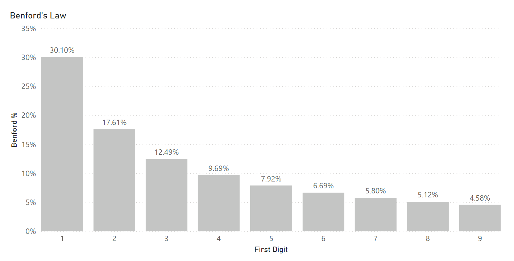
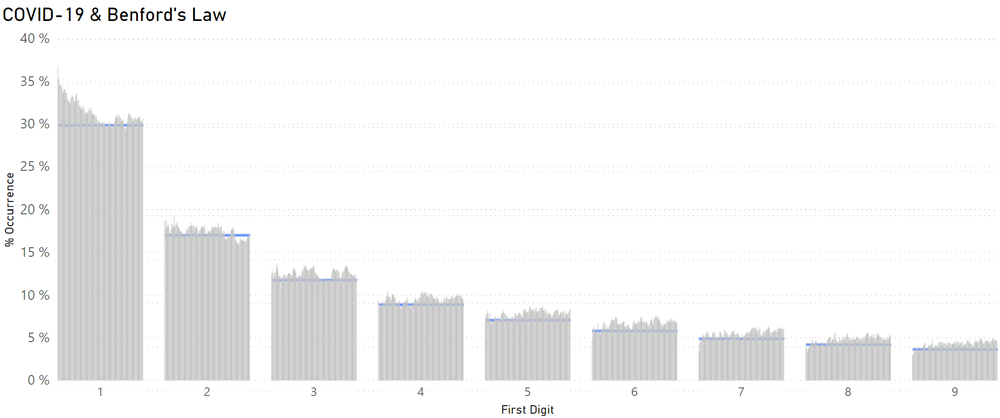
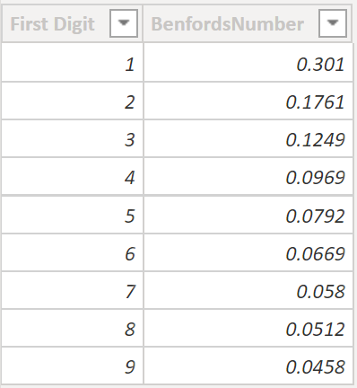
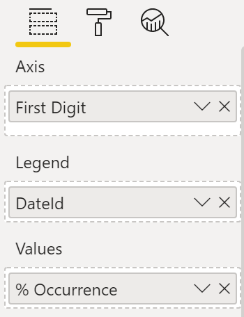
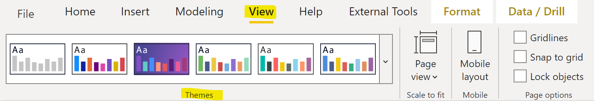

Is the distribution of the leading digits of numbers found in nature random? At first thought it seems the answer is yes - that the leading digits would have an equal probability of occurring. However, it turns out that this is not the case - as proven by [Benford's law](https://en.wikipedia.org/wiki/Benford%27s_law).

I recently happened upon Benford's law and immediately found it fascinating. As stated before, it is a bit unintuitive at first so I set out to prove its veracity. It is pretty simple to validate, and since I already have a list of all the counties in the US and their populations (used in the [COVID-19 report](/post/covid-19-report)), I quickly ran the numbers. I took the first digit of all the aforementioned population numbers (if the population is 2,458,935 you take the 2). Then, I counted the number of times each digit (1-9) occurred. Turns out it, 1 occurs about 30% of the time, 2 occurs about 17% of the time, and the pattern continues - aligning to Benford's law within a very small margin. I must say, even though this was the expected outcome, there is always a feeling of satisfaction after proving something yourself.

<figure>



<figcaption>

Benford's Law: The percent occurrence of the first digits

</figcaption>
</figure>

It turns out that Benford's law applies to many things - from the distance of rivers in the world to the distance between Earth and all known galaxies. And for good measure (wow that was a bad pun!), it doesn't matter which measurement is used - miles, kilometers, light years, inches...it all comes back to align to Benford's law. Take the [Fibonacci Sequence](https://en.wikipedia.org/wiki/Fibonacci_number) for instance. The occurrence of the first digit of all the Fibonacci Numbers align to Benford's law. Multiply the Fibonacci Numbers by any integer and they still align to Benford's law. This revelation is fascinating as the Fibonacci Sequence and its inherent [Golden Ratio](https://en.wikipedia.org/wiki/Golden_ratio) are shown to frequently occur in nature. Seeing as Benford's law appears to be woven into the fabric of our universe it is incredible that the Fibonacci Sequence aligns to it. At the same time it seems natural.

## Benford's Law & COVID-19

Having seen all these patterns, I figured I would give Benford one more test. I have the Coronavirus case data, so let's see if these numbers hold up. I first analyzed a single day's cumulative case data - taking into account each country as well as cities and counties where the [data are available](https://github.com/cssegisanddata/covid-19/tree/master/csse_covid_19_data/csse_covid_19_daily_reports). Stunningly, one day's data aligned with Benford's law. Then I tested each day starting in April. Each day aligned almost exactly with Benford's law. Below is a picture of the chart using Power BI. Each gray vertical line represents a day. The blue horizontal line represents Benford's law. As you can see, there is a small amount of variation but overall the numbers follow the pattern established by Benford's law.



After completing this exercise, I searched online for Coronavirus and Benford's law. It turns out that researchers are actually using Benford's law to prove the veracity of the Coronavirus numbers and seek out mistakes/errors in the data. This makes sense as Benford's law has been applied to detect fraud in matters of financial accounting and even [social media](https://www.technologyreview.com/2015/04/21/168363/how-benfords-law-reveals-suspicious-activity-on-twitter/).

## How to Make the Chart

Now, let's discuss some modeling and Power BI. In making the chart above, I simply had to append my COVID-19 model to include Benford's law and then make a few measures. From a modeling perspective, Benford's law would need to be in its own table and wouldn't have any relationships with any other table (as it doesn't inherently relate with any of the COVID-19 data).

As such, I made the following table and named it 'Benford'. It shows the digits 1-9 (the possibilities for the first digit) as well as exact percentage according to Benford's law (available via a quick internet search).



Next, I made a new measure called '% Occurrence'. This is the crux of the chart and is likely the most difficult element. This calculates the percentage of the frequency of the first digit of the confirmed case count. Let's break it down.

```dax
% Occurrence =
VAR num =
    CALCULATE (
        COUNTROWS ( 'Corona' ),
        FILTER (
            'Corona',
            CONVERT ( LEFT ( 'Corona'[ConfirmedCount], 1 ), INTEGER )
                = MIN ( 'Benford'[First Digit] )
        )
    )
VAR denom =
    CALCULATE ( COUNTROWS ( 'Corona' ), 'Corona'[ConfirmedCount] <> 0 )
RETURN
    DIVIDE ( num, denom )
```

First, we know that this will be a percentage - so it will involve a numerator and denominator. Since [variables](https://dax.guide/st/var/) are an excellent way to keep code looking cleaner and concurrently improve performance, it makes sense to create a variable for the numerator and a variable for the denominator (hence num, denom above).

Second, we want to take the leftmost digit of the ConfirmedCount. This is simply done as it is the same in practically every programming language (even Excel).

```dax
LEFT ( 'Corona'[ConfirmedCount], 1 )
```

However, the [`LEFT`](https://dax.guide/left/) function returns a string (text) value. Seeing as we need to compare this to the 'First Digit' which is an integer, we need to convert the value to an integer. Hence the following DAX.

```dax
CONVERT ( LEFT ( 'Corona'[ConfirmedCount], 1 ), INTEGER )
```

Now, we want to calculate the frequency for the first digits. Frequency is simple - just count the number of rows using the [`COUNTROWS`](https://dax.guide/countrows/) function. However, we need to associate this with the First Digit. The solution here is the same as solving a dynamic segmentation scenario. Since there is no relationship between the Benford table and the Corona (fact) table, we can use the [`FILTER`](https://dax.guide/filter/) function to associate these two elements. Additionally, the [`FILTER`](https://dax.guide/filter/) function must filter against a measure value. That being the case, we add the following element which gives the proper filter context.

```dax
MIN ( 'Benford'[First Digit] )
```

Now we have completed the numerator. For the denominator, there's no need for the filter against the Benford table - however we do want to remove any instances of rows with 0 cases that would cause our numbers to be inaccurate - hence the following filter used within the [`CALCULATE`](https://dax.guide/calculate/) statement.

```dax
'Corona'[ConfirmedCount] <> 0
```

The last part is to actually divide the numerator and denominator, making sure to include the [`RETURN`](https://dax.guide/st/return/) syntax.

## Now Let's really discuss The Chart

As to the chart, I used a clustered column chart and filled out the fields as such.



In order to get all the bars to show as gray, I customized the report theme. To do this, click the drop-down within the Themes section (as shown below) and then click 'Customize current theme'.



Once in the customization window, you can select all the Theme colors as the same gray color (see below). Don't forget to click 'Apply'.


## The Last Component

There's one piece missing now - it's the horizontal blue line showing Benford's law. This is where we have to get a bit creative. It is actually a stacked bar chart hiding behind the chart we just completed.

To accomplish this we will need 2 simple measures.

```dax
benNum = SUM ( 'Benford'[BenfordsNumber] )
```

```dax
constant = 0.003
```

You may say - "but hey, we can't add Benford's number as it is a percentage". Don't worry as we're not adding it - just using it in measure form against the First Digit.

Add both of these measures as values to a stacked bar chart, with the First Digit on the axis. Set the both X & Y axis font colors to white and set the background to off. Then, set the data color for the BenNum value to white and set the Constant value's data color to blue. Move this stacked bar chart to be on top of the clustered column chart. Then, using the Selection Pane (View -\> Selection), select the stacked bar chart and send it to the back (Format -\> Send backward -\> Send to back). This will create the desired illusion - that Benford's law is shown in a horizontal blue bar while the vertical gray bars represent the daily case data. The contrast in colors aids in differentiating and comparing the two.

## Conclusion

There are several points I'd like to highlight from this post. First, Power BI, despite its name, can aid in analyzing and visualizing topics well beyond business intelligence. Its primary market may be business intelligence but it is certainly not limited in this manner. Second, we must think creatively with regard to our solutions - not just for solving modeling problems but also for creating the best visual. As we saw here, the visual required two charts together to achieve the desired effect. We could have said it's not possible as no visual offers this solution out of the box. However, we learned that it is possible if we expand our thinking beyond the traditional methods. Lastly, the connections that follow Benford's law reveal another pattern inherent in the design of our world.
