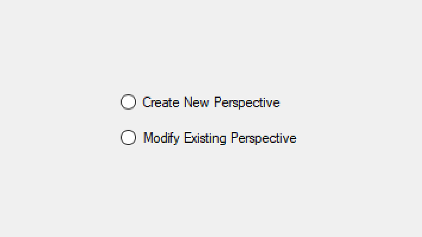
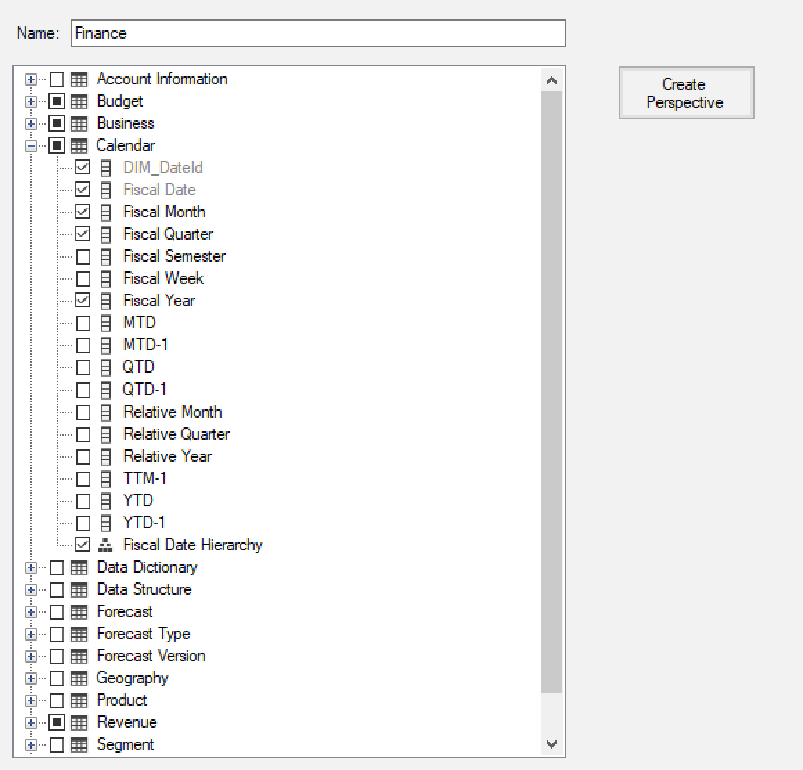
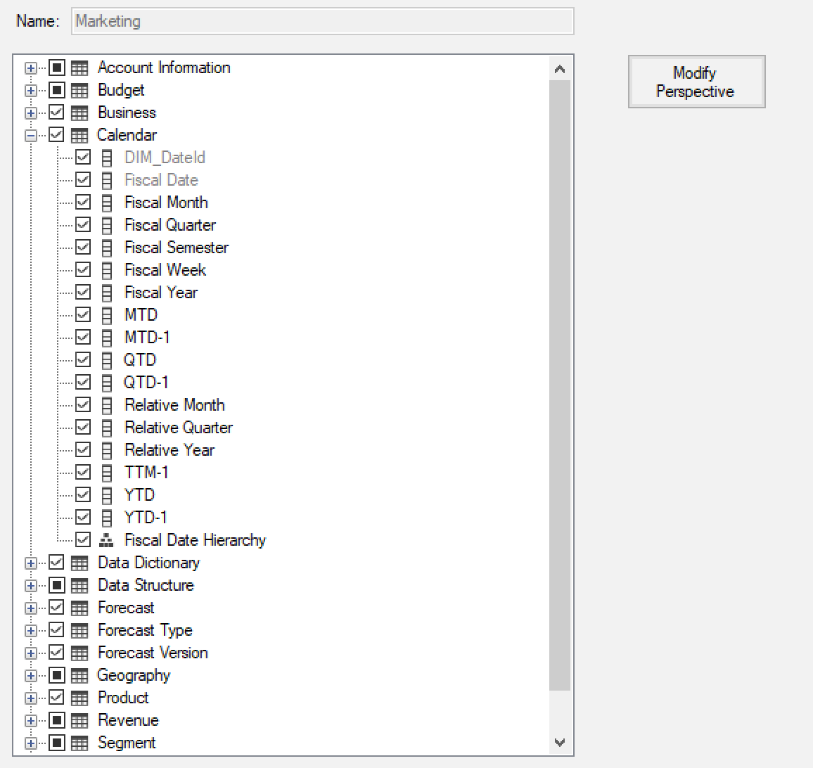
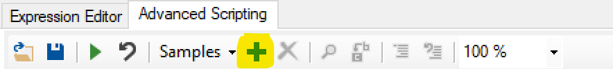
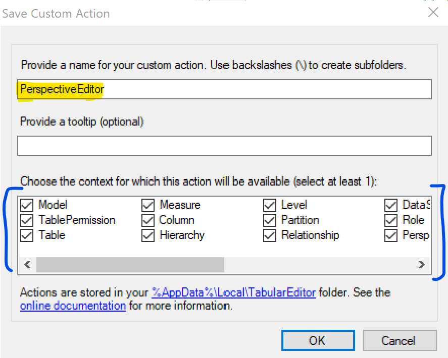

If you enjoy the visual experience of editing perspectives in SQL Server Data Tools (SSDT) and wish that [Tabular Editor](https://github.com/otykier/TabularEditor/releases) had such a feature, you are now in luck. I wrote a program (which is available on my [GitHub](https://github.com/m-kovalsky/Tabular/blob/master/PerspectiveEditor.cs)) that creates a similar 'perspective editor' experience inside of Tabular Editor.

To run this program simply follow these steps:

1. Open your model within Tabular Editor.
2. Paste the program's [script](https://github.com/m-kovalsky/Tabular/blob/master/PerspectiveEditor.cs) into the [Advanced Scripting](https://docs.tabulareditor.com/Advanced-Scripting.html) window.
3. Click the Play button (or F5).

Once you open the Perspective Editor program, the interface is quite simple. When you first run the script you will choose whether you want to create a new perspective or modify an existing perspective.

<figure>

<figcaption>

The first screen within Perspective Editor

</figcaption>
</figure>

After making this selection, press Go. Next, you are presented with a tree view of all the tables, columns, measures, and hierarchies within your model (see images below). Here you can select any object you want to include in the perspective. Clicking the 'Create Perspective' button will create a new perspective, named as you specified, with the the selected objects included. Clicking the 'Modify Perspective' button will modify the existing perspective to include the objects selected.

<figure>

<figcaption>

Create a new perspective

</figcaption>
</figure>

<figure>

<figcaption>

Modify an existing perspective

</figcaption>
</figure>

To make this program easier to run, I recommend adding it as a [Custom Action](https://docs.tabulareditor.com/Custom-Actions.html). This will allow you to run the program anytime - without having to copy and paste the script. In fact, I recommend doing this with the all the programs I have created which are available [here](https://github.com/m-kovalsky/Tabular). To create this as a Custom Action, follow the steps below.

\1. Click the Plus sign within the Advanced Scripting pane.

\2. Fill out the form as below. Make sure to check all the checkboxes.

\3. Click OK.

After completing these steps, this script is now saved as a Custom Action and can be called and opened at any time by clicking within the 'Samples' button on the Advanced Scripting pane, selecting 'Custom Actions' and then selecting 'PerspectiveEditor'.

## Conclusion

This program/script provides a visual interface for editing perspectives which may be more user-friendly to some developers. Additionally, the ability to see which objects are in a perspective relative to all the objects in the model may be quite useful. Lastly, this script is just a small preview of something bigger coming for tabular model enhancement.
