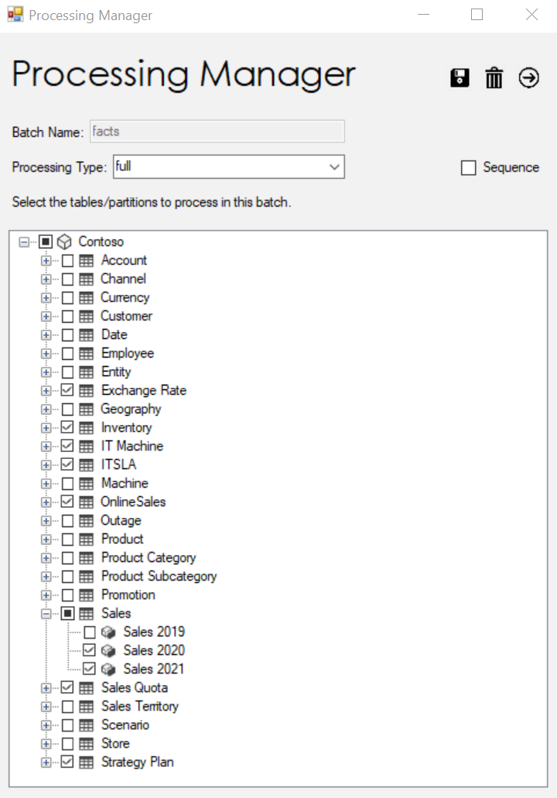
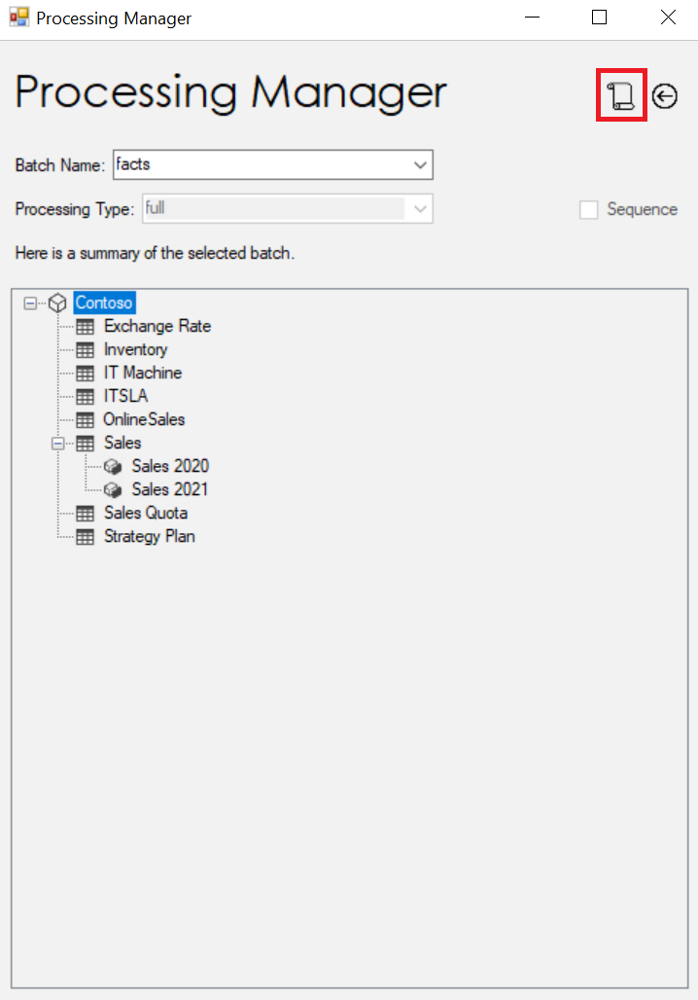
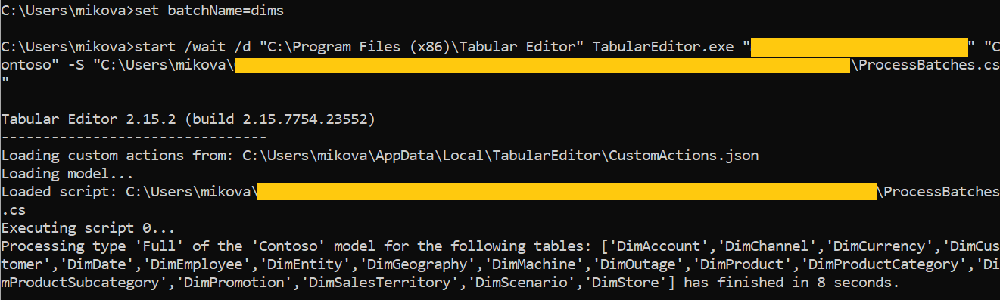
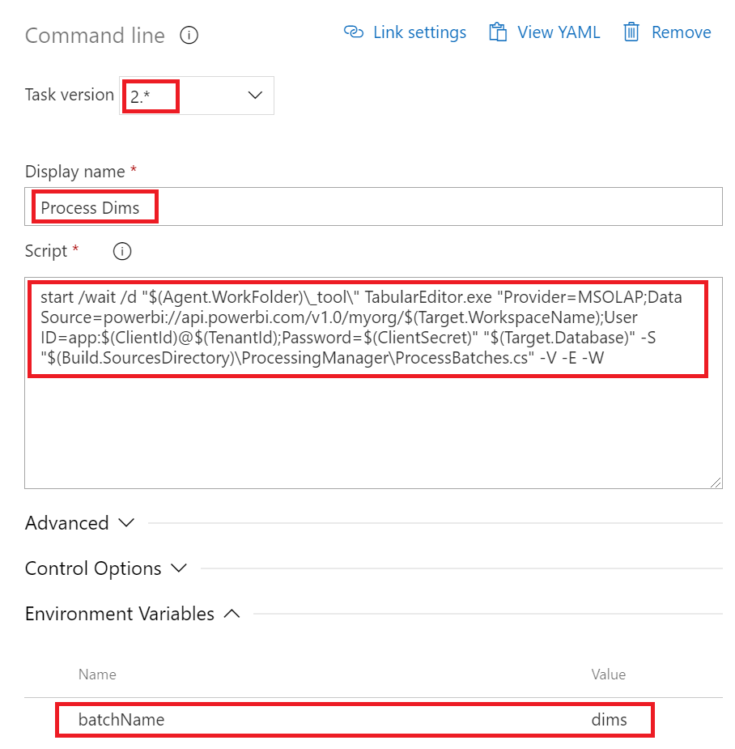

Today marks the debut of a new tool called [Processing Manager](https://github.com/m-kovalsky/ProcessingManager). This tool is designed to simplify the management of processing large tabular models and is compatible for all incarnations of tabular - [SSAS](https://docs.microsoft.com/analysis-services/ssas-overview?view=asallproducts-allversions), [Azure AS](https://azure.microsoft.com/services/analysis-services/) and [Power BI Premium](https://powerbi.microsoft.com/power-bi-premium/) (using the [XMLA R/W endpoint](https://docs.microsoft.com/power-bi/admin/service-premium-connect-tools) and a [Service Principal](https://tabulareditor.com/2020/06/02/PBI-SP-Access.html)).

## Current Processing Options

Currently, there are several classic methods for processing a model. These common methods are:

1. Scripting out TMSL for processing specific tables and running it in a window in SSMS, in a SQL job or in a different program (i.e. Azure Data Factory).
2. Using the [Data Refresh API](https://docs.microsoft.com/rest/api/power-bi/datasets/refreshdatasetingroup) for Power BI Premium models.
3. Clicking the 'refresh' button for a Power BI dataset within the Power BI Service.
4. Using PowerShell to loop through tables and process them individually.

## Challenges

While each of these methods clearly work, they may not provide enough flexibility when it comes to larger and more complex models. This is for several reasons:

1. Processing the whole dataset (methods 2&3) may not be feasible because the data volume is too large.
2. Processing the whole dataset (methods 2&3) may not be desired because data from different sources are made available at different times.
3. Removing/modifying tables or partitions requires searching for the processing job(s), finding the step(s) that processes the object(s) and removing them.

The [Processing Manager](https://github.com/m-kovalsky/ProcessingManager) tool solves each of these challenges and offers a new level of flexibility using a simple design.

## The Tool

The [Processing Manager](https://github.com/m-kovalsky/ProcessingManager) tool runs inside of [Tabular Editor](https://tabulareditor.com/). To run the tool, simply download the ProcessingManager.cs code from [GitHub](https://github.com/m-kovalsky/ProcessingManager) and execute it in the [Advanced Scripting](https://docs.tabulareditor.com/Advanced-Scripting.html) window in Tabular Editor.

Running the code launches the GUI for the tool. Within the tool, you can create or modify 'batches' and designate which objects (tables, partitions or the whole model) are to be processed in that batch. As shown in the image below, you can set the processing type (i.e. full, data, calculate) for the batch and can also enable the [Sequence](https://docs.microsoft.com/analysis-services/tmsl/sequence-command-tmsl?view=asallproducts-allversions) command by selecting the Sequence checkbox. Selecting the 'Sequence' checkbox allows you to set the [Max Parallelism](https://docs.microsoft.com/analysis-services/tmsl/sequence-command-tmsl?view=asallproducts-allversions#request). Note that 'Sequence' and 'Max Parallelism' are both optional.



After customizing your batch, make sure to click the Save button within the tool. This saves your changes back to the model. Note that there is no processing happening at this time. Saving the changes back to the model is simply saving the instructions as metadata back to your model. More explicitly, it is setting [annotations](https://docs.microsoft.com/dotnet/api/microsoft.analysisservices.tabular.annotation?view=analysisservices-dotnet) within the selected objects back to your model. These annotations are subsequently read by an additional script (ProcessBatches.cs) when you want to process a batch.

Clicking the 'forward' button will take you to a summary page which shows you all the objects which are part of the specified batch (see the image below). Here you can also navigate to see other batches and view their settings.

<figure>



<figcaption>

The summary page shows the objects to be processed in the selected batch. The 'script' button is selected in red.

</figcaption>
</figure>

Clicking the 'script' button within the Summary page will dynamically generate a C# script file which will be saved to your desktop. This C# script can be executed in the Advanced Scripting window and will delete and recreate the selected batch within the model. This feature is designed for ALM scenarios where you may want to copy a batch's changes from one version of the model to another (i.e. prod to dev).

## Processing the batches

After creating and saving your batch, you can close out of the Processing Manager tool. As you have noticed, we have not actually processed anything as of yet. The tool itself just saves the batch processing instructions within the model.

Now - how do we actually process the batches? For this, we leverage Tabular Editor's [command line options](https://docs.tabulareditor.com/Command-line-Options.html). This allows us to submit our batch, connect to our model and process it as we specified in the tool. Below I have summarized the command line code for all scenarios - Power BI Premium, Azure Analysis Services and SSAS. All you need to do is fill in the parameters (in orange).

The first line of the command line code is used to set the batch name (via an environment variable). The -S switch contains the ProcessBatches.cs file which is contained in the [GitHub repo](https://github.com/m-kovalsky/ProcessingManager) along with the tool. The use of the environment variable allows the same ProcessBatches.cs script to be used for processing batches of any/all models.

[Power BI Premium](https://powerbi.microsoft.com/power-bi-premium/)

set batchName=`batchName`

start /wait /d "C:\\Program Files (x86)\\Tabular Editor" TabularEditor.exe "Provider=MSOLAP;Data Source=powerbi://api.powerbi.com/v1.0/myorg/`<Premium Workspace>`;User ID=app:`<Application ID>@<Tenant ID>`;Password=`<Application Secret>`" "`<Premium Dataset>`" -S "`<C# Script File Location (ProcessBatches.cs)>`"

[Azure Analysis Services](https://azure.microsoft.com/services/analysis-services/)

set batchName=`batchName`

start /wait /d "C:\\Program Files (x86)\\Tabular Editor" TabularEditor.exe "Provider=MSOLAP;Data Source=asazure://`<AAS Region>`.asazure.windows.net/`<AAS Server Name>`;User ID=`<xxxxx>`;Password=`<xxxxx>`;Persist Security Info=True;Impersonation Level=Impersonate" "`<Database Name>`" -S "`<C# Script File Location (ProcessBatches.cs)>`"

[SQL Server Analysis Services](https://docs.microsoft.com/analysis-services/ssas-overview?view=asallproducts-allversions)

set batchName=`batchName`

start /wait /d "C:\\Program Files (x86)\\Tabular Editor" TabularEditor.exe "`<Server Name>`" "`<Database Name>`" -S "`<C# Script File Location (ProcessBatches.cs)>`"

Here you can see the input and output of running the command line code.



## Integration with Azure DevOps

Seeing as the batch processing can be executed via command line, we can transport this part to any program than can run command line code. One such option is [Azure DevOps](https://azure.microsoft.com/services/devops/). Setting this up is very similar to the steps outlined in my [previous post](/post/canceldatarefreshado) so if you have not read that I suggest reading it now!

1. Save the ProcessBatches.cs script to your File Repo.
2. Follow the steps in my [previous post](/post/canceldatarefreshado) for setting up the Agent Pool, creating a new Pipeline as well as setting up a [Service Principal](https://tabulareditor.com/2020/06/02/PBI-SP-Access.html#create-a-service-principal) and [Key Vault](https://azuredevopslabs.com/labs/vstsextend/azurekeyvault/#task-2-creating-a-key-vault).
3. Create a new Command line task (must be Task version 2.\*).
4. Within the 'script', simply paste in the command line code shown earlier (an example is shown below as well). As shown in the screenshot below, the only difference here is the reference to Tabular Editor via the WorkFolder, the use of parameters within the Pipeline, as well as appending the script with -V -E -W options. I recommend adding these options when running command line code inside of Azure DevOps as they enable the error/warning messages to appear.
5. Set the Environment Variable with the desired batch name you want to process.

<figure>



<figcaption>

An example task to process a batch for a Power BI Premium dataset.

</figcaption>
</figure>

Here is the code as shown above for processing a batch for a Power BI Premium dataset.

```bat
start /wait /d "$(Agent.WorkFolder)\_tool\" TabularEditor.exe "Provider=MSOLAP;Data Source=powerbi://api.powerbi.com/v1.0/myorg/$(Target.WorkspaceName);User ID=app:$(ClientId)@$(TenantId);Password=$(ClientSecret)" "$(Target.Database)" -S "$(Build.SourcesDirectory)\ProcessingManager\ProcessBatches.cs" -V -E -W
```

Running this pipeline in Azure DevOps will use the ProcessBatches.cs script to read the annotations within the model and process it accordingly. If you examine the code of this script it is using the same method as an [earlier post](/post/datarefreshintabulareditor).

## Conclusion

The [Processing Manager](https://github.com/m-kovalsky/ProcessingManager) tool and its integration into tools such as Azure DevOps solves all three issues listed earlier in this post. In doing so, it empowers developers to have a heightened level of control and flexibility for processing large tabular models. Make sure to follow the [GitHub repo](https://github.com/m-kovalsky/ProcessingManager) for updates to this tool as well as my [main GitHub page](https://github.com/m-kovalsky) for many other tools and techniques!
