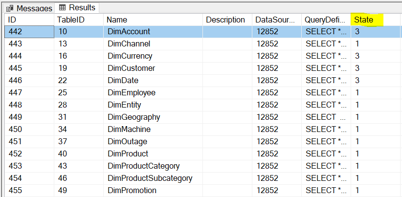
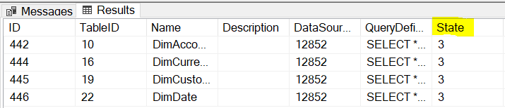
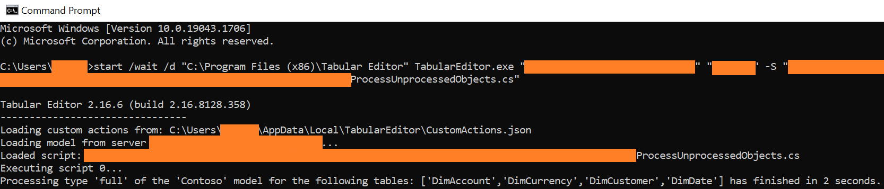
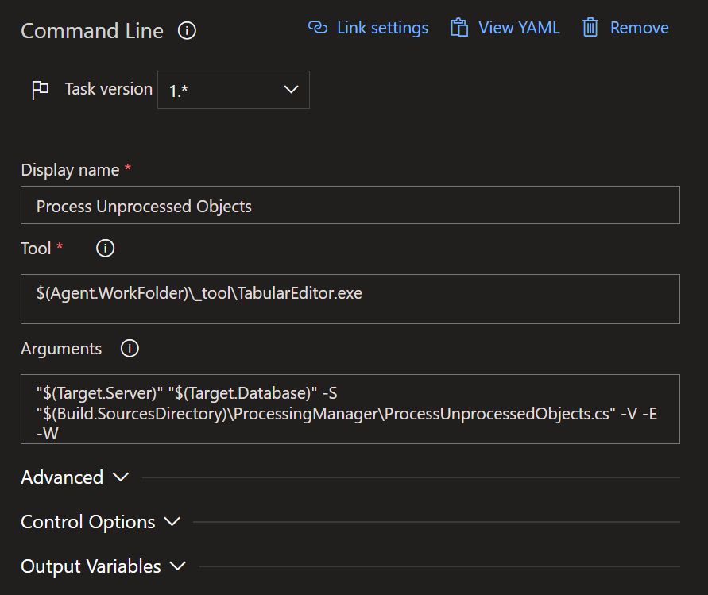

After deploying a model/dataset, it is imperative to identify which tables or partitions must be processed (and process them). Failing to process the necessary tables will lead to data being unavailable and error messages when using the model. One could simply process the entire model but this is oftentimes not necessary and also takes more time than necessary. It is best to identify what needs to be processed (based on structural changes to the model) and process just those objects (tables/partitions).

## The Common Method

A common method of identifying what needs to be processed is by the developer attempting to remember which tables had structural changes (i.e. the addition/modification of a column, table, partition or relationship). It should be noted that adding/removing/modifying measures in itself does not require any processing.

The above method relies on human memory - which can be inaccurate - especially when it comes to larger models with more tables. Let's discuss a different approach which does not rely on human memory.

## A Better Method

A better way to accomplish this task is to leverage a particular [DMV](https://docs.microsoft.com/analysis-services/instances/use-dynamic-management-views-dmvs-to-monitor-analysis-services?view=sql-analysis-services-2022). DMVs are quite powerful and tell us lots of relevant information. In this example, a DMV tells us which partitions are fully processed and which are not. Running the query below in an MDX query against our model (in SSMS) will show all the partitions in our model.

```sql
SELECT * FROM $SYSTEM.TMSCHEMA_PARTITIONS
```

<figure>



<figcaption>

This is an example of the output of the query above.

</figcaption>
</figure>

The 'State' column tells us ([see pages 39-40](https://sqlprotocoldoc.blob.core.windows.net/productionsqlarchives/MS-SSAS-T/%5bMS-SSAS-T%5d.pdf)) that any value besides 1 for this column indicates that the partition needs to be processed. We can filter the query to these exact partitions by using the query below.

```sql
SELECT * FROM $SYSTEM.TMSCHEMA_PARTITIONS
WHERE [State] <> 1
```



Identifying the partition by the partition name is simple if your partitions are named properly. If not, we can also look up the table name by using the TableID column against the TMSCHEMA\_TABLES DMV. However, this part is tedious and we can do better.

## Taking it a step further

We can take this a step further by running a script which automatically identifies the tables/partitions which need to be processed and subsequently trigger those tables/partitions to process. This is accomplished via a [C# script](https://github.com/m-kovalsky/Tabular/blob/master/Processing/ProcessUnprocessedObjects.cs). The script uses the same automated method shown above (DMVs), filtering where the State column is not equal to 1, and then generates a request to process those tables/partitions against the specified server/database.

Here are the steps:

1. Download the [C# script](https://github.com/m-kovalsky/Tabular/blob/master/Processing/ProcessUnprocessedObjects.cs).
2. Run the command line code below (according to your version of tabular / Power BI. Make sure to update the parameters in orange.

SQL Server Analysis Services

```bat
start /wait /d "C:\Program Files (x86)\Tabular Editor" TabularEditor.exe "<ServerName>" "<DatabaseName>" -S "<C# Script File Location>"
```

Azure Analysis Services

```bat
start /wait /d "C:\Program Files (x86)\Tabular Editor" TabularEditor.exe "Provider=MSOLAP;Data Source=asazure://<AAS Region>.asazure.windows.net/<AAS Server Name>;User ID=<xxxxx>;Password=<xxxxx>;Persist Security Info=True;Impersonation Level=Impersonate" "<Database Name>" -S "<C# Script File Location>"
```

Power BI Premium (XMLA R/W Endpoint Enabled)

```bat
start /wait /d "C:\Program Files (x86)\Tabular Editor" TabularEditor.exe "Provider=MSOLAP;Data Source=powerbi://api.powerbi.com/v1.0/myorg/<Premium Workspace>;User ID=app:<Application ID>@<Tenant ID>;Password=<Application Secret>" "<Premium Dataset>" -S "<C# Script File Location>"
```

After running this code, the unprocessed tables/partitions will be processed. A message confirming success will appear in the command line window. You may also run SQL Profiler to see the processing request hit the server and execute.

<figure>



<figcaption>

Running the command line code and seeing the success message (bottom line).

</figcaption>
</figure>

## YET ONE MORE NOTCH

We can take this one level higher by integrating it into an Azure DevOps pipeline. This is particularly useful as part of a pipeline which deploys your model. To accomplish this, first follow the steps outlined in this [blog post series](https://tabulareditor.github.io/2019/02/20/DevOps1.html). Next, upload the [C# script](https://github.com/m-kovalsky/Tabular/blob/master/Processing/ProcessUnprocessedObjects.cs) to your Azure DevOps repository. Finally, create a command line task (see below) within your pipeline which references Tabular Editor's command line options (as shown above) in the task arguments. The image below shows an example for a model using SQL Server Analysis Services. The same can be applied to Azure Analysis Services and Power BI Premium models. Note that you will need to set up a Service Principal and use Azure Key Vault (see this [post](/post/canceldatarefreshado) for instructions).



The above task in Azure DevOps will run the C# script against your 'Target.Server' and 'Target.Database' and subsequently process each table/partition which needs to be processed. It is completely automated with no human touch needed.

## Conclusion

As is the theme of many of my posts - if something can be automated, it generally should be. This is a classic example of such a scenario. If you are wondering, the script I shared in this post is closely related to the code used in the [Processing Manager](/post/processingmanager). Both are intended to save you time and provide additional capabilities for managing an enterprise scale platform.
