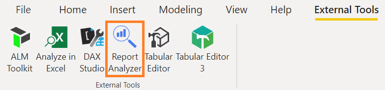
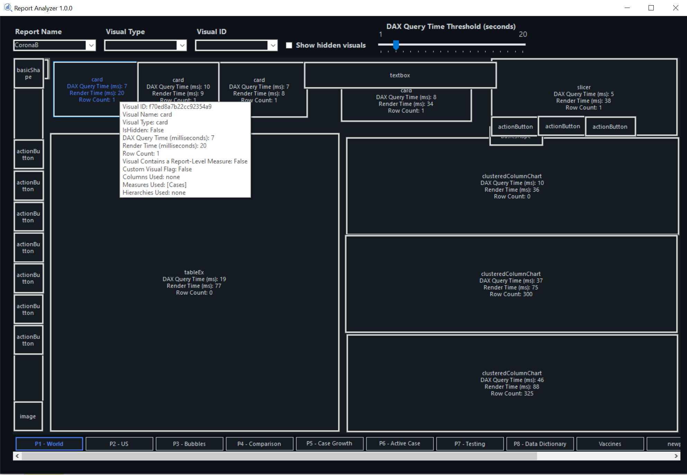

If you are a Power BI developer, I'm sure you are aware of the constant process of creating a model, creating a report and optimizing it. The optimization process is not so simple and is oftentimes frustrating and time consuming. It is for this reason that I built a new tool, called the Report Analyzer. The objective of this tool is to simplify the process for performance optimization, creating a more visual experience, and increase the probability that a Power BI developer creates a performant report.

Report Analyzer is [available on GitHub](https://github.com/m-kovalsky/ReportAnalyzer) an [External Tool](https://docs.microsoft.com/power-bi/transform-model/desktop-external-tools) for Power BI Desktop.

## Getting Started

Once you have [downloaded](https://github.com/m-kovalsky/ReportAnalyzer) and installed the tool, you can open it from Power BI Desktop by navigating to the External Tools ribbon. Once you have opened the tool, click the 'Browse...' button and enter the folder which contains your Power BI Desktop (or Power BI Template) file. In order to take full advantage of the tool, make sure to run the [Performance Analyzer](https://docs.microsoft.com/power-bi/create-reports/desktop-performance-analyzer) against all tabs in your Power BI report and [export](https://docs.microsoft.com/en-us/power-bi/create-reports/desktop-performance-analyzer#saving-performance-information) the results to a (.json) file. Save this Performance Data file to the same folder which contains your Power BI report.

*NOTE: Report Analyzer may also be downloaded as part of* [*PowerBI.Tips' Business Ops package*](https://powerbi.tips/product/business-ops/)*.*

## How it works

Once you select the folder which contains your Power BI report and Performance Analyzer export file, Report Analyzer scans the metadata behind each of these files and merges them into a simulated Power BI canvas, overlaid with the Performance Analyzer data as well as additional rich metadata.

## Features

Here is the initial list of features as of the writing of this article:

- Visually see Performance Analyzer data overlaid on each visual on a simulated Power BI Desktop canvas.
- Find a specific visual by searching by Visual ID (especially useful for matching Visual IDs from [Log Analytics](https://docs.microsoft.com/power-bi/transform-model/log-analytics/desktop-log-analytics-overview)). See more info [here](https://github.com/m-kovalsky/ReportAnalyzer/blob/main/README.md#log-analytics-visual-matching).
- Easily see all visuals of a specific visual type (i.e. card).
- Use the slider to select a DAX Query Time which highlights visuals (with a red border) with DAX Query times slower than the selected time (in seconds).
- Hover over a visual to see additional tooltip information.
  - Visual ID, Visual Name, Page Name, Report Name, DAX Query Time, Render Time, Row Count, Columns Used, Measures Used, Hierarchies Used, Custom Visual Flag, Visual Contains a [Report-Level Measure](/post/reportlevelmeasures).
- Click on a visual to copy additional information to the clipboard (including the DAX Query).
- Supports loading multiple Power BI Desktop/Template files and automatically associating them with the Performance Analyzer .json files (must all be in the folder selected in the start screen).
- Dark mode out of the box.

## How to Use The Tool

Report Analyzer is most effectively used when the Performance Analyzer data has been loaded. With this information displayed, you can easily see the performance of every visual on every page in your report. By selecting a DAX Query time in the slider, you can target the worst performing visuals for performance optimization. For example, easily seeing every visual which had a DAX Query time longer than 3 seconds. Once you target a visual, you can hover over it to see tooltips with rich metadata. Additionally, you can click on the visual and paste the metadata into another tool. This metadata contains all the elements used to create the visual along with the DAX query (which can be pasted into [DAX Studio](https://daxstudio.org/)) and a variety of other information.

## Next Steps

With all of this metadata in one place, there are many additional features which can be incorporated - some of which are already planned. If you have suggestions for the tool, I would appreciate your feedback. Please post your feedback on the [GitHub issues page](https://github.com/m-kovalsky/ReportAnalyzer/issues).

## Conclusion

I hope that this tool empowers Power BI developers with a richer experience for optimizing the performance of their model. Performance management is not simple, but hopefully it just got better!
