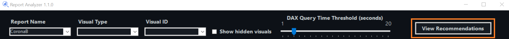
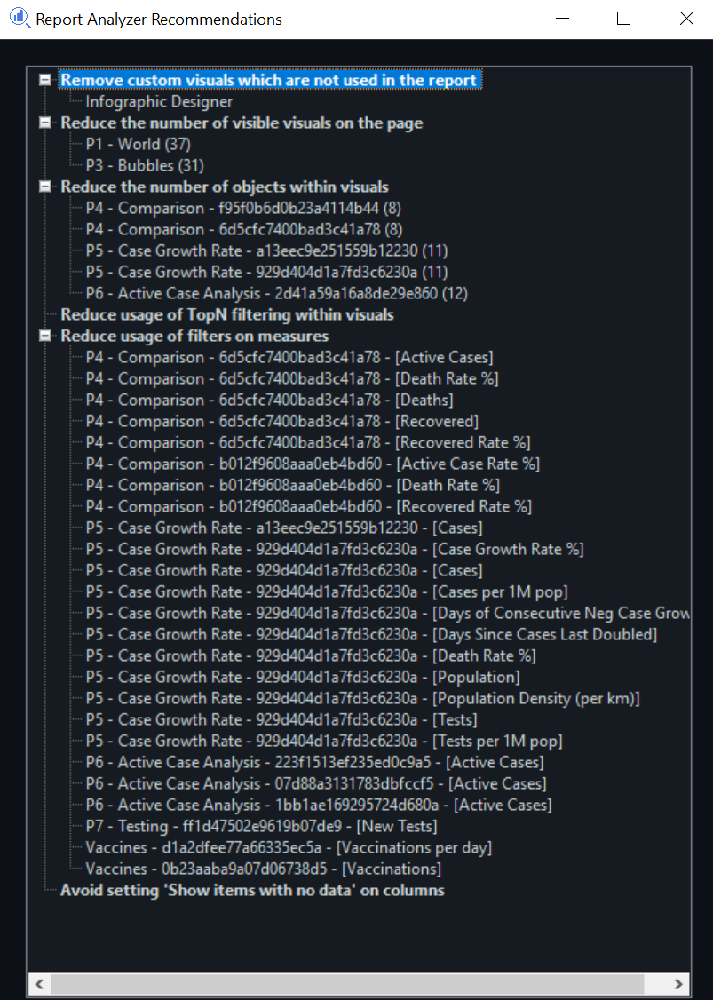

We are all (hopefully) familiar with the [Best Practice Analyzer](https://docs.tabulareditor.com/te2/Best-Practice-Analyzer.html) in the amazing [Tabular Editor](https://tabulareditor.com/). Following the [Best Practice Rules](https://github.com/microsoft/Analysis-Services/tree/master/BestPracticeRules) in the aforementioned tool allow you to hone and optimize the performance and design of your Power BI (tabular) model. However, what about optimizing the actual Power BI report? Aren't there best practice rules for designing a performant Power BI report?

## Report Analyzer Recommendations

[Version 1.1.0 of Report Analyzer](https://github.com/m-kovalsky/ReportAnalyzer/releases/latest) comes with a new feature which is the start of just that. A recommendation engine for ensuring best practices are followed on the report side. This version of Report Analyzer provides 6 out-of-the-box recommendations which are accessible via the 'View Recommendations' button on the top right of the screen (see below).

Once you click on the 'View Recommendations' button, [Report Analyzer](https://github.com/m-kovalsky/ReportAnalyzer/releases/latest) scans your report to check for violations of the set recommendations. Additional context is provided via tooltips (on hover) for both the recommendations and the objects which violate the recommendation. Additionally, clicking on an object which violates a recommendation will navigate you to that particular object (or the relevant page).

## The Recommendations

1. Remove custom visuals which are not used in the report.
   1. Custom visuals which are not used in the report should be removed. Having them in the report may take up extra resources.
2. Reduce the number of visible visuals on the page.
   1. Having too many visible visuals on a page is a classic reason for poor performing reports. Reducing this (where possible) may help improve performance.
3. Reduce the number of objects within visuals.
   1. Sometimes there are tons of measures and columns on a single visual (usually a table or matrix). Having a plethora of such objects can make performance worse. Therefore, reducing the number of objects may improve the visual's performance.
4. Reduce usage of TopN filtering within visuals.
   1. TopN filtering can be an expensive operation (depending on the measure and column cardinality).
5. Reduce usage of filters on measures.
   1. Filtering on a measure within a visual can add a performance overhead tax. Reducing usage of such filters (where possible) may speed up your visual.
6. Avoid setting 'Show items with no data' on columns.
   1. This setting should always be avoided as it creates a much larger table for Power BI's engine to scan and the resulting output is not necessarily useful.

## Conclusion

Currently the rules are coded into the tool and cannot be modified. This is likely to change in a future version of [Report Analyzer](https://github.com/m-kovalsky/ReportAnalyzer/releases/latest). This release of the Recommendations engine is just a taste! Try it out and feel free to submit feedback (here in the comments or on [GitHub](https://github.com/m-kovalsky/ReportAnalyzer/issues/new/choose)).
