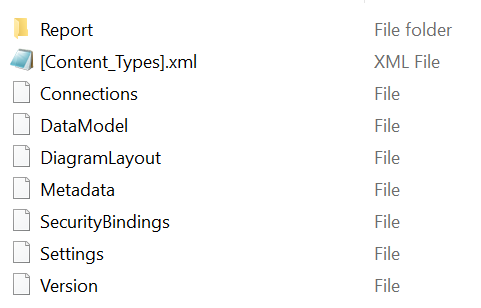
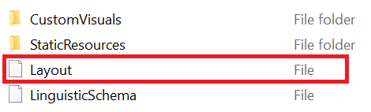

Have you ever created measures within a Power BI Desktop report and wanted to push those measures into your tabular model? This post shows an automated way for doing just that and was inspired by this [issue raised on GitHub](https://github.com/microsoft/Analysis-Services/issues/113).

## Background

While measures are normally created within a tabular model, Power BI Desktop offers the ability to create measures on top of an existing tabular model or Power BI dataset. While this feature may be useful for analysts, it can also lead to increasing [technical debt](https://en.wikipedia.org/wiki/Technical_debt). At some point, it should be determined whether the report-level measures are valuable enough to migrate into the overall tabular model. One other consideration is that in some cases (especially in complex models with many measures) having report-level measures may decrease the performance of the report. This is because Power BI must conduct a dependency analysis to determine in which order it must execute the report's queries. Having report level measures may increase the complexity of this analysis.

## Problem

The problem is that there has not been a good way to push these report-level measures into the tabular model. Since they are contained within the report, they are not to be found in the 'Model.bim' file. And, since the report layer of Power BI does not have an accessible API as the Analysis Services portion does ([TOM](https://docs.microsoft.com/analysis-services/tom/introduction-to-the-tabular-object-model-tom-in-analysis-services-amo?view=asallproducts-allversions)), extracting this information is not so simple. In fact, the only way to access this information is by 'hacking' into the innards of the Power BI Desktop (.pbix or .pbit) file. It should be known that this 'hacking' process is not supported by Microsoft.

## Solution

If you are up for some 'hacking', let's carry on. The Power BI Desktop (.pbix or .pbit) file contains several files within it.

*Before we go any further, I must mention again that this process is unsupported and that you should make sure you back up your Power BI Desktop file before proceeding.*

These files can be accessed by '[zipping](<https://en.wikipedia.org/wiki/ZIP_(file_format)>)' the file. Once you zip the Power BI Desktop file, you have access to the following files.



Within the 'Report' folder, you can see the following files/folders. We are interested in the 'Layout' file as this contains all of the metadata information for the report - including the report-level measures. This file is akin to a .bim file in that it is also in a [.json](https://www.json.org/json-en.html) format.



Once we obtain the Layout file, we need to parse the JSON to extract the report-level measures and their metadata. That is where my script comes into play.

## The Script

In fact, the [C# script](https://github.com/m-kovalsky/Tabular/blob/master/ReportLevelMeasures.cs) I am sharing does everything for you. All you need to do is tell it 2 things:

1. The location of your Power BI Desktop file (or Power BI Template file).
2. Whether you want to actually create the measures within a model file or just extract the code for creating the measures.

```csharp
bool createMeasures = false;
string pbiFile = @"C:\Desktop\ReportFile.pbix";
```

Download the C# script [here](https://github.com/m-kovalsky/Tabular/blob/master/ReportLevelMeasures.cs).

\*\*\*If your model was created in Power BI Desktop, follow these instructions:

1. Open your Power BI Desktop report.
2. Open [Tabular Editor](https://tabulareditor.com/) via the External Tools ribbon.
3. Close Power BI Desktop.
4. Copy and paste the C# script into the [Advanced Scripting](https://docs.tabulareditor.com/Advanced-Scripting.html) window within Tabular Editor.
5. Update line 8 of the script (pbiFile parameter) to be the location of your Power BI Desktop report.
6. Make sure that the 'createMeasures' parameter is set to 'false'.
7. Click the 'Play' button or press 'F5'.

You will get 2 outputs. The first is a list of all the report-level measures and their metadata (can copy and paste this into Excel). The second is dynamically-generated C# code which can be executed in the same Advanced Scripting window to create all of the report-level measures. After copying this code, open the Power BI Desktop model, open Tabular Editor via the External Tools ribbon, and paste and run this code in the Advanced Scripting window. Bam! All the measures are now in your tabular model.

\*\*\*If your model was created in SSDT or [Tabular Editor](https://tabulareditor.com/), follow these instructions:

1. Open your model (.bim) file in [Tabular Editor](https://tabulareditor.com/).
2. Copy and paste the C# script into the [Advanced Scripting](https://docs.tabulareditor.com/Advanced-Scripting.html) window within Tabular Editor.
3. Update line 8 of the script (pbiFile parameter) to be the location of your Power BI Desktop report.
4. Set the 'createMeasures' parameter accordingly ('true' if you want it to create the measures and 'false' if you want it to generate the C# code as mentioned above).
5. Click the 'Play' button or press 'F5'.

The first output is the same as above (the list of all the report-level measures). If you set 'createMeasures' to 'true', it will have created all the measures in your Model.bim file. If you set the 'createMeasures' to 'false', it will output dynamically-generated C# code which can be executed to create all the aforementioned measures.

It should be noted that along with creating the measures, this script also adds the expression (DAX formula) as well as the format string based on the Power BI Desktop file. It also hides the measure if it was hidden in the Power BI Desktop file.

## Conclusion

Although this method is not officially supported, it is an effective way to automate a process that would otherwise be quite time consuming - especially if there are many report-level measures. Having a report-level API in Power BI akin to the [Tabular Object Model](https://docs.microsoft.com/analysis-services/tom/introduction-to-the-tabular-object-model-tom-in-analysis-services-amo?view=asallproducts-allversions) (TOM) would simplify processes such as this one and enable many more amazing automation techniques. Please comment below if you would find such an API useful. As for now...enjoy the hacking!
