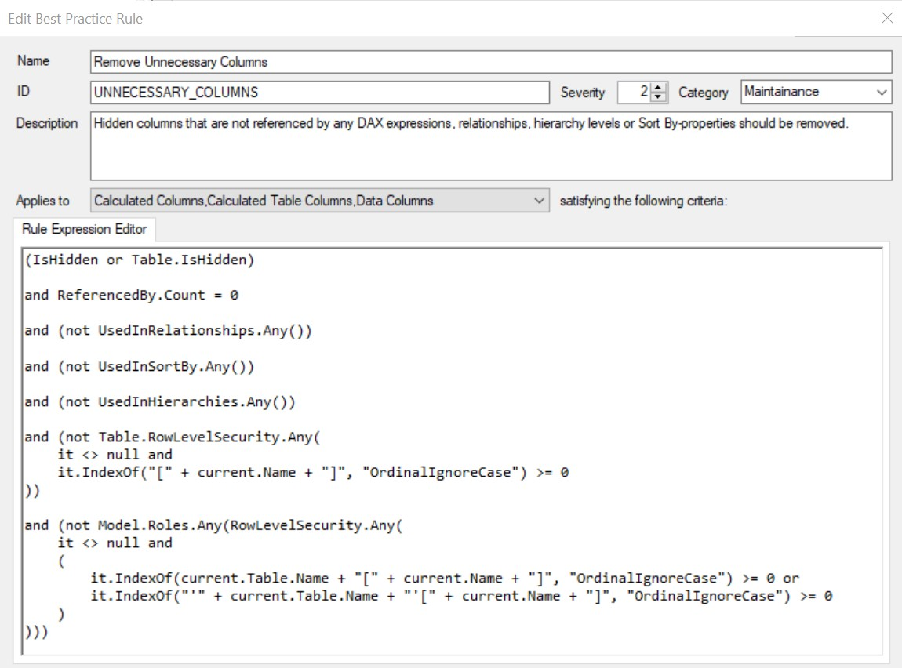
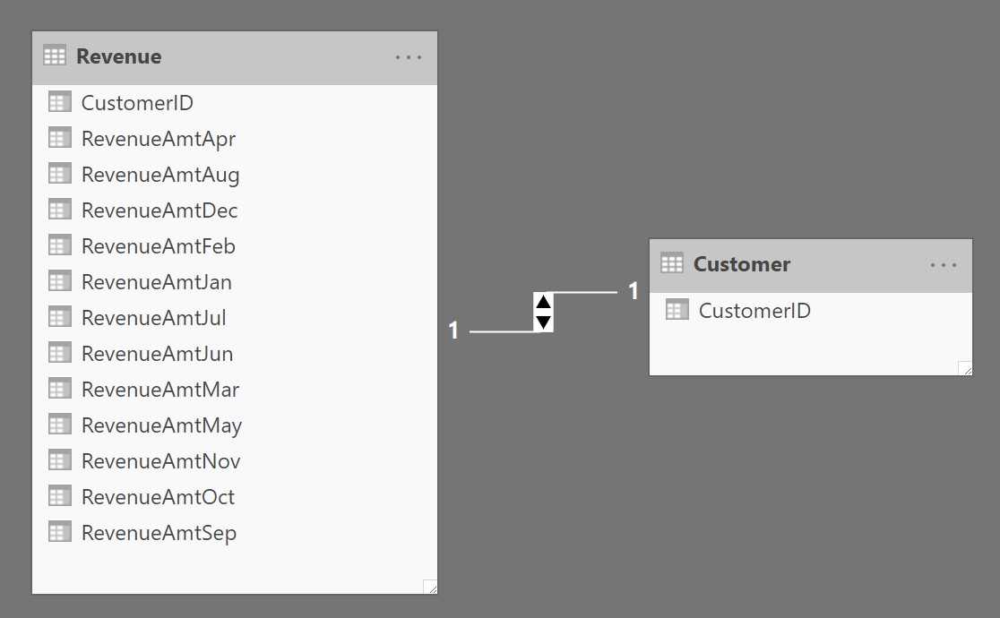
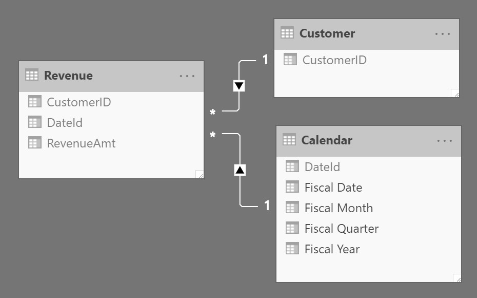
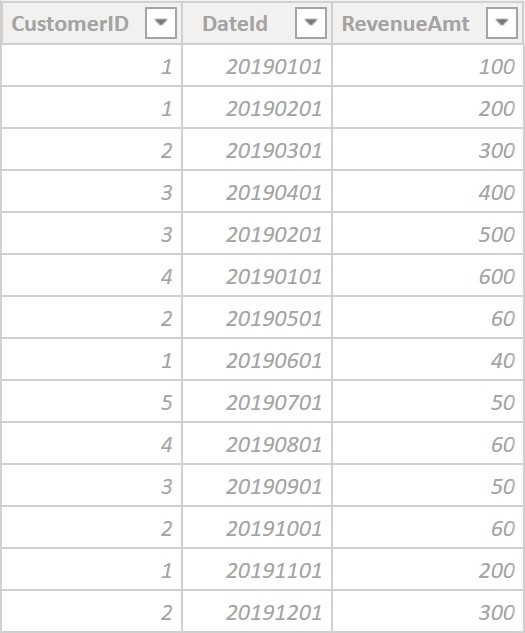
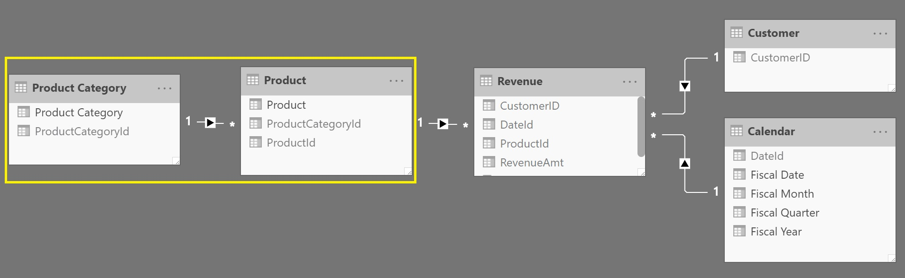
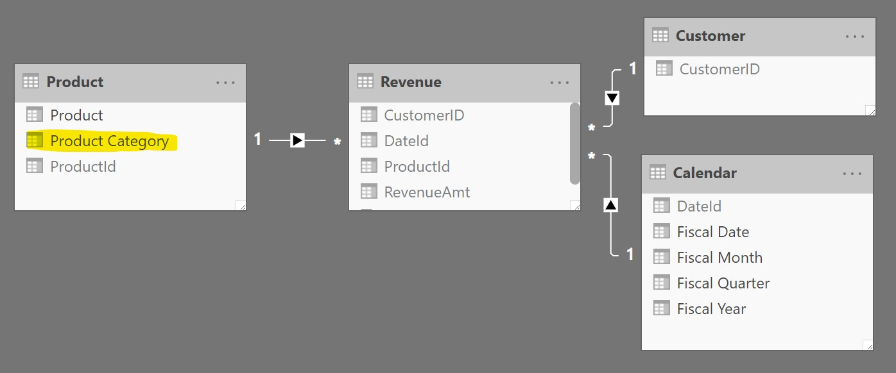
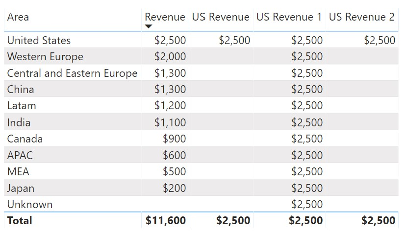

In this post I discuss common mistakes found in data models and simple ways to fix these issues. While some points may be about architecture and others about DAX, all of the points below are geared towards improving user-query performance, user experience, and creating an elegant solution.

## 1. Including all columns available in the database layer

It is imperative to only include the tables and columns necessary for the model to support your business needs. Any columns that are not absolutely necessary should be removed as they take up memory (for in-memory models), increase complexity for the users, and potentially increase data volume which decreases performance. This point is not just about minimizing the horizontal space (columns) of a model but also minimizing vertical space (rows) of a model. Fact tables where columns have been removed should be re-aggregated so that rows may also be removed. The smaller your model, the better the performance (all else equal).

One common culprit is having a unique ID on fact tables. While this may be fine in the database layer, it should not be included in the data model unless it servers a concrete purpose (i.e. TransactionID for counting the number of transactions made). This type of column takes up a lot of space as it is unique and being that it is in a fact table it likely has many rows. Additionally, it removes any possibility of aggregating the table to have less granularity.

We want our models to be as light, fit, and nimble as possible. Removing nonessential columns is an easy and effective way to boost your model's performance.

Here is a simple way to identify unnecessary columns using [Tabular Editor](https://github.com/otykier/TabularEditor/releases)'s [Best Practice Analyzer](https://docs.tabulareditor.com/Best-Practice-Analyzer.html)\*. You can read an earlier [blog post](/post/columnmeasurereference) that shows how to create new best practice rules. As you can see in the code below it captures any valid use case of column (i.e. visible, referenced by a measure, used in a relationship, used as a sorting column, used in a hierarchy or used in row level security).

\**It is important to note that this* [*BPA*](https://docs.tabulareditor.com/Best-Practice-Analyzer.html) *rule catches the low-hanging fruit but it is also important to check with your stakeholders to see if there are other tables/columns that are not being used and can be removed from the model.*



Here is the code from the screenshot above so you don't have to write it all yourself.

```csharp
(IsHidden or Table.IsHidden)
and ReferencedBy.Count =  0
and (not UsedInRelationships.Any())
and (not UsedInSortBy.Any())
and (not UsedInHierarchies.Any())
and (not Table.RowLevelSecurity.Any(
    it <> null and
    it.IndexOf("[" + current.Name + "]", "OrdinalIgnoreCase") >= 0
))
and (not Model.Roles.Any(RowLevelSecurity.Any(
    it <> null and
    (
        it.IndexOf(current.Table.Name + "[" + current.Name + "]", "OrdinalIgnoreCase") >=  0 or
        it.IndexOf("'" + current.Table.Name + "'[" + current.Name + "]", "OrdinalIgnoreCase") >=  0
    )
)))
```

## 2. Using Pivoted Data

Of all the things not to do in a data model, this one makes me cringe the most. The reason is that it not only will lead to poor performance but it also makes the model so much more convoluted than it has to be and results in needing overly-complicated DAX to make up for it. Using pivoted data in a model is NEVER a good idea.

Here is an example of pivoted data in a data model (see screenshot below). The RevenueAmt column appears as 12 columns - one for each month. If we want to create a measure that sums up the RevenueAmt, we have to add all 12 columns together. Additionally, if we want to pivot around a time period or do any sort of [time intelligence](https://docs.microsoft.com/en-us/dax/time-intelligence-functions-dax) - forget about it - it's practically impossible from this setup. There is also no mention of the year in the RevenueAmt columns so ambiguity becomes prevalent.

It gets worse. The primary advantage of Tabular's [Vertipaq](https://www.sqlbi.com/tv/optimizing-multi-billion-row-tables-in-tabular-sqlbits-2017/?autoplay=1) engine is that it is able to compress rows of a column that have the same value. In our example below, it is likely that some of the values of the RevenueAmt across the months are the same. By using pivoted data you are not taking advantage of [Vertipaq](https://www.sqlbi.com/tv/optimizing-multi-billion-row-tables-in-tabular-sqlbits-2017/?autoplay=1)'s strength and actually doing the opposite. In general, it is much better to trade for having fewer columns and more rows (think tall and skinny vs short and wide).

<figure>



<figcaption>

An example of pivoted data (by RevenueAmt)

</figcaption>
</figure>

Below is an unpivoted version of the above model. We have transformed the 12 RevenueAmt columns into 2 columns: a single RevenueAmt column and a corresponding DateId column. Modeling the data in this manner allows us to relate the Revenue table to the Calendar table and easily slice Revenue by Date/Month/Quarter/Year (or any date-related attribute). By setting the Calendar table as a [date table](https://docs.microsoft.com/en-us/analysis-services/tabular-models/specify-mark-as-date-table-for-use-with-time-intelligence-ssas-tabular), we can then easily create measures based on [time intelligence](https://docs.microsoft.com/en-us/dax/time-intelligence-functions-dax) to further enhance our model. This strategy has also improved our compression as we can now take advantage of rows in the RevenueAmt column that have the same value. If you're wondering how to do this, you can accomplish it via the [UNPIVOT](https://docs.microsoft.com/en-us/sql/t-sql/queries/from-using-pivot-and-unpivot?view=sql-server-ver15) function in SQL (or a similar function in other applications).



<figure>



<figcaption>

Unpivoted data showing DateId and RevenueAmt columns

</figcaption>
</figure>

Architecting your model properly starts before you bring the data into your model. Sometimes transformations are necessary (such as unpivoting data) and these should be done in the database layer. Just because tables/views are available to bring into the model doesn't mean that you should. Make the proper transformations to enable the best architectural foundation possible. Don't checkmate yourself (and your users) too early by not making the proper data transformations in the database layer.

## 3. Using a Snowflake Schema

It is a general best practice within tabular modeling to use a [star schema](https://docs.microsoft.com/en-us/power-bi/guidance/star-schema) and not use [snowflake schema](https://en.wikipedia.org/wiki/Snowflake_schema). Using snowflake schema creates more relationships for the queries to traverse and also adds extra foreign/primary keys which don't add value and simply take up extra memory. We want the model to be as simple as possible and using a star schema allows us to accomplish this.

Let's take a simple example. As you can see in the diagram below there are 2 tables holding information about products: Product, Product Category. The snowflake part is where Product relates to Product Category.

<figure>



<figcaption>

The Product Category table is snowflaked from the Product table

</figcaption>
</figure>

As shown below, we have resolved the snowflake into a star by moving the Product Category column to the Product table. We also removed the ProductCategoryId from the Product table as it is no longer necessary.

<figure>



<figcaption>

Product Category was moved into the Product table to create a Star Schema

</figcaption>
</figure>

One may argue in favor of a snowflake in this example, stating that the Product Category table is small (as it has just the unique list of product categories) and therefore it is better than having the Product Category column in the Product table. However, this argument is not considering the proficiency of Tabular's Vertipaq engine. Vertipaq thrives on non-unique values. Thus, the Product Category column in the Product table will be compressed to only its unique rows. Using a star schema plays to the strength of the Vertipaq engine. Additionally, it is much easier for users to see all the product-related attributes in a single table rather than having to go through several tables to find them all. The star schema not only helps performance but improves the user experience.

## 4. Too much Logic in the model

As is the case with most things in this world, a solid foundation is the key to future success. In terms of data modeling, the foundation refers to the database layer. A high quality database layer makes it much easier to create a solid and optimized data model.

In order to create the best performing model, put as much of your logic as possible in the database layer and completed as part of the [ETL](https://en.wikipedia.org/wiki/Extract,_transform,_load) process. This will significantly minimize your need for calculated columns, calculated tables, as well as complex and slow DAX - some of they key culprits causing poor performance.

If you are using [Direct Query](https://docs.microsoft.com/en-us/power-bi/desktop-use-directquery) mode, be sure that your model references only views with *absolutely no logic*. Using logic in views in this case will destroy performance. As a solution, put the logic into a stored procedure that creates a new table which the model can reference. Indexes (preferably [clustered columnstore](https://docs.microsoft.com/en-us/sql/database-engine/using-clustered-columnstore-indexes?view=sql-server-2014)) are also a must for large tables when using [Direct Query](https://docs.microsoft.com/en-us/power-bi/desktop-use-directquery) mode.

Having logic in views that feed the data model is also not a good idea when using In-Memory models (Import mode) as this will slow down the processing speed of your model. It is fine to use filters within views but make sure you minimize the logic in them. Another reason to minimize logic in these views is that you may have other models that necessitate the same logic. Putting the logic as far upstream as possible (in stored procedures that create tables) enables all your models to use the same logic - based on the same set of tables - so you have a single source of truth.

This is the optimal flow of data and logic:

1. Acquire data from external sources to your DB server.
2. Use stored procedures to conform the data to a star schema, apply business logic, format columns and keys, and aggregate data to the required granularity.
3. Create views for your data model based on the tables generated by the stored procedure. For [Direct Query](https://docs.microsoft.com/en-us/power-bi/desktop-use-directquery) models, these views should have no logic and just be `SELECT` \* `FROM` \[DatabaseName\].\[SchemaName\].\[TableName\]. For Import models, these views may have filters (`WHERE` clause) but should not have any logic.
4. The views feed directly into the data model - again with no logic in the partition query (as that would just slow down processing).

## 5. Using '/' for division

Instead of using '/' when dividing in DAX, use the [`DIVIDE`](https://dax.guide/divide/) function. Using '/' may yield an error if the denominator is 0. The [`DIVIDE`](https://dax.guide/divide/) function alleviates this problem as it removes the possibility of getting an error. It also allows you to specify a value in case of such an error (the third parameter of the function).

Avoid doing this:

```dax
Budget Attainment % = [Revenue] / [Budget]
```

Instead do this:

```dax
Budget Attainment % = DIVIDE ( [Revenue], [Budget] )
```

Or do this (if you want divide by zero errors to show as 0)

```dax
Budget Attainment % = DIVIDE ( [Revenue], [Budget], 0 )
```

## 6. Overusing Calculated Columns

In general, one should avoid using calculated columns. It is much better to have the columns in the database layer and bring them into the model as data columns.

Advantages of data columns

- Better compression than calculated columns
- Less processing time than calculated columns (for tables and for [recalc](https://docs.microsoft.com/en-us/analysis-services/tabular-models/process-database-table-or-partition-analysis-services))
- Available for use by multiple models
- Greater data consistency used by multiple models

There are really only two reasons one would use a calculated column. First, if you are adding a column to a table where the column logic references a large table on a different server. In this case it may be too costly to move the full table (or even a bridge based on the large table) to the location of the table where the column is being placed. In that case, a calculated column provides a quick and easy solution. Second, if you do not have direct access to the database layer, are creating the model in Power BI and you don't know how to write a custom query against the database. This is not the best solution but for less technical users it is acceptable (although it would be better to learn how to query the database and create a custom data column).

All in all, avoid using calculated columns if possible and make yourself a rich database layer that will relieve your model of calculated columns.

## 7. `SEARCH`, `IFERROR`, `CONTAINS`, and `INTERSECT` functions

These functions should be avoided wherever possible.

The [`SEARCH`](https://dax.guide/search/) function is expensive as it has to scan each row for a given value. A better solution is to create a new column in your database and then bring it into the model as a data column. This function is especially detrimental when used in measures as it has to perform the search operation on the fly. If it's not possible to create the new column in the database, the next best option is to create a calculated column and have the measure refer to that column - however note the previous rule (#6).

The [`IFERROR`](https://dax.guide/iferror/) function seems rather innocuous as it is often used in Excel. However, using it in DAX causes performance degradation. Luckily, there are simple ways to avoid using it. For example, in rule #5 we used the [`DIVIDE`](https://dax.guide/divide/) function to avoid the divide by zero error. We could have done this instead (but don't).

```dax
Budget Attainment % = IFERROR ( [Revenue] / [Budget], BLANK () )
```

The [`DIVIDE`](https://dax.guide/divide/) function has a built-in process to not produce an error and it is also more performant than using [`IFERROR`](https://dax.guide/iferror/).

The [`CONTAINS`](https://dax.guide/contains/) function is occasionally used for [virtual relationships](https://www.sqlbi.com/articles/physical-and-virtual-relationships-in-dax/). However, it is very inefficient and causes serious performance degradation. The next best solution is to use [`INTERSECT`](https://dax.guide/intersect/). However, this function has also been surpassed with regard to performance. [`TREATAS`](https://dax.guide/treatas/) should be used exclusively when using virtual relationships. If you want more detail please read [here](https://www.sqlbi.com/articles/propagate-filters-using-treatas-in-dax/). Note that using the TREATAS function requires using compatibility level [1400](https://docs.microsoft.com/en-us/analysis-services/tabular-models/compatibility-level-for-tabular-models-in-analysis-services) or higher and at least SQL 2017.

I recommend setting up a [BPA](https://docs.tabulareditor.com/Best-Practice-Analyzer.html) rule to catch any use of these functions so that you can ensure you steer clear of them.

## 8. Column/Measure References

See this [blog post](/post/columnmeasurereference).

## 9. Filtering a column

The [`FILTER`](https://dax.guide/filter/) function is often overused. Its main purpose is for filtering columns based on measure values. If you're just filtering a column value, there's generally no need to use this function. In fact, using it in that scenario often degrades performance.

Don't use this logic:

```dax
US Revenue = CALCULATE ( [Revenue], FILTER ( 'Geography', 'Geography'[Area] = "United States" ) )
```

Option 1:

```dax
US Revenue 1 = CALCULATE ( [Revenue], 'Geography'[Area] = "United States" )
```

Option 2:

```dax
US Revenue 2 = CALCULATE ( [Revenue], KEEPFILTERS ( 'Geography'[Area] = "United States" ) )
```

Option 1 and 2 are both good options however their results show a bit differently and it is important to know the distinction.

As you can see below, Option 2 shows the same as the original US Revenue measure. However, Option 2 will perform better as the filter applies directly to the column instead of navigating the table first. Option 1 may appear strange here as it shows the US amount for all areas. However, this option may come in handy as sometimes you want a value to show regardless of if a certain filter is applied.



## 10. Overusing expensive relationships

When I say expensive relationships, I'm referring to Bi-Directional (Bi-Di) and Many-to-Many\* ([M2M](https://blogs.msdn.microsoft.com/analysisservices/2019/03/26/whats-new-for-sql-server-2019-analysis-services-ctp-2-4/)). Both of these types of relationships cause the engine to work harder and can easily cause performance degradation. In order for a query to resolve, it must navigate more pathways and check more data points. These relationships are especially risky (for performance) when they traverse large bridge tables (for Bi-Di) or large dimension tables (for Bi-Di and M2M). The default for relationships in a model should always be Many-to-One and Single Direction (not Bi-Di). Bi-Di and M2M should be used only if no other modeling option is available or they are used against a very small bridge/dimension table where they simultaneously serve to significantly simplify the DAX.

If you have a valid Many-to-Many scenario, it is recommended to use a M2M relationship instead of Bi-Di. This may seem intuitive now but M2M relationships are a relatively new feature in Tabular and previously one had to use Bi-Di with a bridge table. There is an optimization in the engine for M2M relationships that Bi-Di relationships does not have so if you find yourself in such a scenario, opt for M2M (and replace any necessary Bi-Di with bridge tables to use M2M).

Another way of creating a Bi-Di relationship is through DAX via the [`CROSSFILTER`](https://dax.guide/crossfilter/) function. This function allows you to change an existing relationship from Single-Direction to Bi-Directional (or vice versa). This function is handy because it gives you more control to specify exactly when you want the relationship to be Bi-Directional. The drawback is that it has to be implemented measure-by-measure. The primary use case of this function is when it is combined with an [`IF`](https://dax.guide/if/) statement so that the crossfiltering only applies when it is needed. This is can help to mitigate performance issues so that the potential performance degradation only occurs when the Bi-Directional is needed - not 100% of the time. The DAX below shows an example of using an IF statement to specify when the Bi-Di should be used.

```dax
Revenue Bi-Di =
 IF (
    ISFILTERED ( 'Customer'[Customer] ),
    CALCULATE (
        [Revenue],
        CROSSFILTER ( 'Revenue'[CustomerID], 'Customer'[CustomerID], BOTH )
    ),
   [Revenue]
)
```

\**M2M relationships require using* [*SQL 2019 CTP 2.4 or higher*](https://docs.microsoft.com/en-us/sql/sql-server/sql-server-ver15-release-notes?view=sqlallproducts-allversions)*,* [*Azure Analysis Services*](https://azure.microsoft.com/en-us/services/analysis-services/)*,* [*Power BI Desktop*](https://powerbi.microsoft.com/en-us/desktop/) *or* [*Power BI Premium*](https://powerbi.microsoft.com/en-us/power-bi-premium/)*.*

---

## Conclusion

Following these simple guidelines will lead to a much more streamlined process, improved user-query performance, and a better user experience. Data modeling and DAX do not have to be difficult - and can be quite simple if one uses the proper approach.
