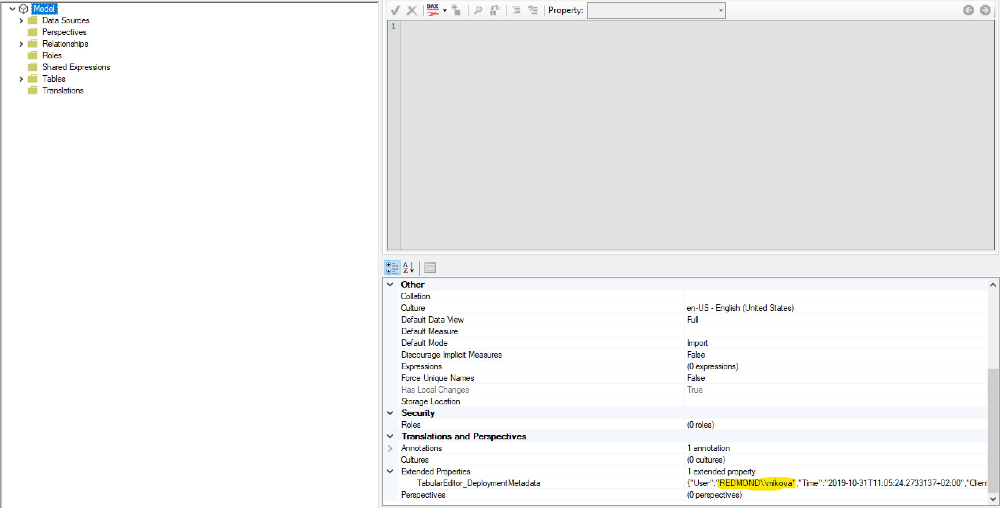
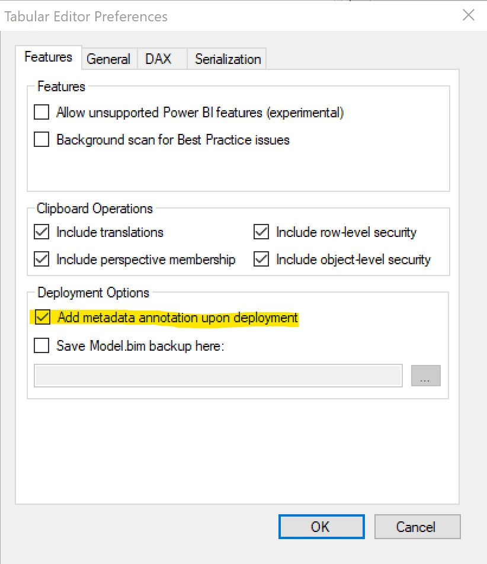

The other week I heard a request from someone who was looking to monitor [Direct Query](https://docs.microsoft.com/en-us/analysis-services/tabular-models/directquery-mode-ssas-tabular) (DQ) models on their platform. This brings up the very important point of creating autonomous methods of tracking the models on your platform - especially for enterprise BI systems and platforms at scale.

In this case the goal is to find out which models are DQ, who is working on them, and to provide an option to delete the model. Essentially, we need to set up a model-management system that can automatically track the information we need and complete tasks based on said information. Sounds complicated? Think again!

## The Solution

The SQL stored procedure shown below allows you to specify two parameters. First the server name (Analysis Services), and second a flag to delete a model if it is DQ (in this case). The proc scans the server provided in the first parameter, finds all the models, records if they are using Import Mode or Direct Query, notes down the person who last deployed the model\*, and deletes the DQ models if specified.

\**This is accomplished via a nifty feature in* [*Tabular Editor*](https://github.com/otykier/TabularEditor/releases)*. If the model has been deployed to the server using Tabular Editor, it adds an* [*Extended Property*](https://docs.microsoft.com/en-us/dotnet/api/microsoft.analysisservices.tabular.extendedproperty?view=analysisservices-dotnet) *to the model which specifies the Domain\\\\Alias of the person who last deployed the model.*

<figure>



<figcaption>

Domain\\\\Alias of last person to deploy the model in Tabular Editor

</figcaption>
</figure>

In order for [Tabular Editor](https://github.com/otykier/TabularEditor/releases) to capture the deployer's metadata, make sure to select the following option within File -\> Preferences in Tabular Editor.



## Creating the stored procedure

Here is the code to create the stored procedure.

```sql
CREATE PROC [dbo].[usp_ModelModeTracker]

 @ServerName VARCHAR(100)
,@RemoveDQ INT --Specify 1 if you want to delete Direct Query models.

AS

DECLARE @SQL NVARCHAR(MAX)
DECLARE @DatabaseName VARCHAR(100) = ''

DROP TABLE IF EXISTS [dbo].[ModelModeTracker]

CREATE TABLE [dbo].[ModelModeTracker]
(
 [Id] INT NULL
,[DatabaseName] VARCHAR(200) NULL
,[DefaultMode] VARCHAR(30) NULL
,[DeployerName] VARCHAR(200) NULL
)
;

/*****Find all the models on the server*****/
SET @SQL =
'WITH
Catalogs AS
(
	 SELECT *
	 FROM OPENROWSET(''MSOLAP'',''DATASOURCE='+@ServerName+'; Initial Catalog='+@DatabaseName+';'',
	 ''SELECT * FROM [$SYSTEM].[DBSCHEMA_CATALOGS]'')
)

INSERT INTO [dbo].[ModelModeTracker]
SELECT
 ROW_NUMBER() OVER(PARTITION BY NULL ORDER BY CAST([CATALOG_NAME] AS VARCHAR(150))) AS [Id]
,CAST([CATALOG_NAME] AS VARCHAR(150)) AS [DatabaseName]
,NULL AS [DefaultMode]
,NULL AS [DeployerName]
FROM Catalogs'

EXEC (@SQL)

DECLARE @a INT = 1
DECLARE @b INT = (SELECT MAX([Id]) FROM [dbo].[ModelModeTracker])
DECLARE @SQL2 NVARCHAR(MAX)

/******Loop through all the models and note their Default Mode*******/
WHILE @a<=@b
	BEGIN
		SET @DatabaseName = (SELECT [DatabaseName] FROM [dbo].[ModelModeTracker] WHERE [Id] = @a)
		SET @SQL2 =

		'WITH
		Models as
		(
			 SELECT *
			 FROM OPENROWSET(''MSOLAP'',''DATASOURCE='+@ServerName+'; Initial Catalog='+@DatabaseName+';'',
			 ''SELECT * FROM [$SYSTEM].[TMSCHEMA_MODEL]'')
		)
		,ExtendedProperties AS
		(
			 SELECT *
			 FROM OPENROWSET(''MSOLAP'',''DATASOURCE='+@ServerName+'; Initial Catalog='+@DatabaseName+';'',
			 ''SELECT * FROM [$System].[TMSCHEMA_EXTENDED_PROPERTIES]'')
		)

		UPDATE d
		SET'
		/*******Specify models as Import or DQ*******/
		+
		'd.[DefaultMode] = CASE CAST(m.[DefaultMode] AS INT)
			WHEN 0 THEN ''Import''
			WHEN 1 THEN ''DQ''
			ELSE ''Other''
			END'
		/*****Extract the model deployer's domain\alias******/
		+'
		,d.[DeployerName] = REPLACE(
		 SUBSTRING(
           SUBSTRING(CAST(ep.[Value] AS VARCHAR(MAX)),CHARINDEX(''"User":",'',CAST(ep.[Value] AS VARCHAR(MAX)))+10,100)
	         ,1,CHARINDEX(''"'',SUBSTRING(CAST(ep.[Value] AS VARCHAR(MAX)),CHARINDEX(''"User":",'',CAST(ep.[Value] AS VARCHAR(MAX)))+10,100))-1
	              ),''\\'',''\'')
		FROM Models m
		JOIN [dbo].[ModelModeTracker] d ON d.[DatabaseName] = '''+@DatabaseName+'''
		LEFT JOIN ExtendedProperties ep ON CAST(ep.[Name] AS VARCHAR(MAX)) = ''TabularEditor_DeploymentMetadata''
		'

		EXEC (@SQL2)

		SET @a=@a+1
	END

/*******Remove the Direct Query models*******/

DECLARE @SQL3 NVARCHAR(MAX)
SET @a=1

IF @RemoveDQ = 1 --If initial parameter is set to Remove DQ models then proceed.
	WHILE @a<=@b
		BEGIN
			SET @DatabaseName = (SELECT [DatabaseName] FROM [dbo].[ModelModeTracker] WHERE [Id] = @a AND [DefaultMode] = 'DQ')
			SET @SQL3 =

				N'EXEC (''' +
				'
				{
				  "delete": {
					"object": {
					  "database": "'+@DatabaseName+'"
					}
				  }
				}
				'
				+ N''') AT [' +@ServerName+ '-AS' + N']'

			EXEC (@SQL3)

			PRINT 'The '+@DatabaseName+' model on '+@ServerName+' is Direct Query and has been deleted'

			SET @a=@a+1
		END
```

## Executing the stored procedure

Run the following command to execute the stored procedure. Make sure you have a linked server set up to the Analysis Services instance (if you need help doing this see my [earlier post](/post/datadictionary)).

Run this if you *don't* want to delete the Direct Query models.

```sql
EXEC [dbo].[usp_ModelModeTracker] 'ServerName', 0
```

Run this if you *do* want to delete the Direct Query models.

```sql
EXEC [dbo].[usp_ModelModeTracker] 'ServerName', 1
```

*Note: In case you get an issue that says the 'SERVERNAME is not configured for RPC' just follow the instructions* [*here*](http://www.bradleyschacht.com/server-servername-is-not-configured-for-rpc/)*.*

It should be noted that this proc checks only for models that are fully in Direct Query mode. [Composite models](https://docs.microsoft.com/en-us/power-bi/desktop-composite-models) will need to use a different [DMV](https://docs.microsoft.com/en-us/analysis-services/instances/use-dynamic-management-views-dmvs-to-monitor-analysis-services) ($SYSTEM.TMSCHEMA\_PARTITIONS) as they need to check the Mode by table/partition instead of the overall model.

## Next steps

The 'delete model' part of this proc is really just to showcase different possibilities at hand. We can modify this to do practically anything we want to do to the model based on any metadata property. Simply find the [DMV](https://docs.microsoft.com/en-us/analysis-services/instances/use-dynamic-management-views-dmvs-to-monitor-analysis-services) that has the metadata you are looking for and set up the logic.

If you used Tabular Editor, it recorded who last deployed the model. This is a useful piece of information to have so we can ensure the correct people are making deployments and there are no rogue deployments. Additionally, we can leverage this to email people who either shouldn't be making deployments or someone who has deployed a model that has an issue. For example, if we want to give a heads up to anyone who has created a Direct Query model before deleting it we could extract the people from the \[DeployerName\] column in the \[dbo\].\[ModelModeTracker\] and [autogenerate an email](https://docs.microsoft.com/en-us/sql/relational-databases/system-stored-procedures/sp-send-dbmail-transact-sql?view=sql-server-ver15) to them.

---

## Conclusion

[Dynamic Management Views](https://docs.microsoft.com/en-us/analysis-services/instances/use-dynamic-management-views-dmvs-to-monitor-analysis-services) (DMVs) once again prove their value in allowing us to easily monitor our models and manage them in a systematic way so we can spend our time on things that require higher-level thought and cannot be so easily automated. When you have an enterprise BI system, it is critical to set up automated monitoring as it allows you to autonomously and holistically supervise your platform. It ensures that proper deployments are being made, best practices are being followed, and your users are experiencing optimal performance.
