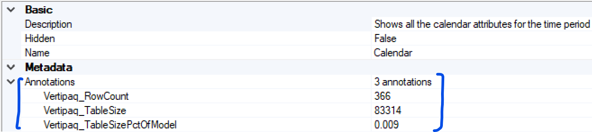
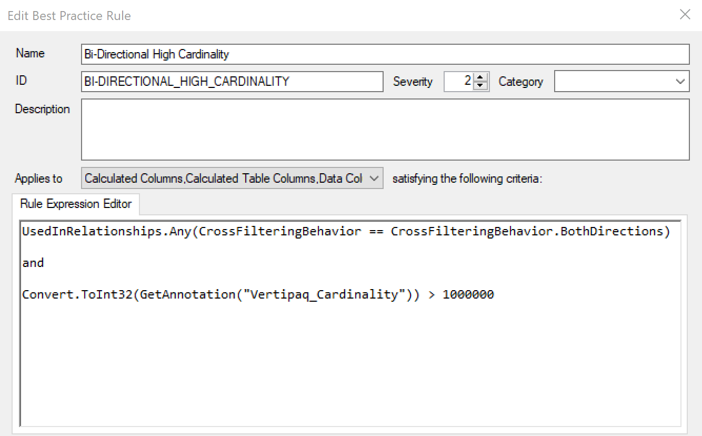

If you are serious about optimizing your tabular model (be it in Power BI, Azure Analysis Services, or SSAS), then you are likely familiar with [Vertipaq Analyzer](https://www.sqlbi.com/tools/vertipaq-analyzer/). It is a great tool which allows you to investigate detailed information as to the structure and compression of objects in your model. Earlier this year, Vertipaq Analyzer was integrated into [DAX Studio](https://daxstudio.org/) which makes this information even more accessible. In this post I'll show you how we can take things a step further.

## Best Practice Analyzer

If you are interested in ensuring your tabular models follow best practices for naming, formatting, and performance, [Tabular Editor](https://github.com/otykier/TabularEditor/releases) has a great feature called [Best Practice Analyzer](https://docs.tabulareditor.com/Best-Practice-Analyzer.html). If you are not using it yet, I highly recommend that you try it out. It is an efficient way to automatically scan your entire model and ensure that your team's best practices are kept.

## Combining Technologies

Now, when it comes to optimizing performance we often use Vertipaq Analyzer. And I just mentioned that we can codify best practice rules in Tabular Editor's Best Practice Analyzer. The natural next thought is - "what if we could write Best Practice Analyzer rules taking the Vertipaq Analyzer statistics into account?". One may think this is not possible as Tabular Editor only contains the metadata for the model (based on the .bim file) so Vertipaq stats are not available. However, this is no longer the case!

As shown in my [previous post](/post/datapreview), Tabular Editor is now able (when connected to a server or a Power BI Desktop model) to run live DAX queries. It turns out that you can also run [Dynamic Management Views](https://docs.microsoft.com/en-us/analysis-services/instances/use-dynamic-management-views-dmvs-to-monitor-analysis-services?view=asallproducts-allversions) (DMVs). Since all the Vertipaq Analyzer data comes from DMVs, we can extract this information and make it available in Tabular Editor. In fact, here is how to run a DMV query in Tabular Editor.

```csharp
var DMV_Tables = ExecuteDax("SELECT * FROM $SYSTEM.TMSCHEMA_TABLES").Tables[0];

DMV_Tables.Output();
```

## The Script & What It Does

Here is a link to the [script](https://github.com/m-kovalsky/Tabular/blob/master/VertipaqAnnotations.cs). In short, this script extracts a model's Vertipaq Analyzer statistics and saves them as [annotations](https://docs.microsoft.com/en-us/dotnet/api/microsoft.analysisservices.tabular.annotation?view=analysisservices-dotnet) to the model's file. All values are shown in bytes (unless they are indicated as a percentage). These annotations can easily be browsed and the best part is that they can easily be referenced using [Advanced Scripting](https://docs.tabulareditor.com/Advanced-Scripting.html) or the Best Practice Analyzer.

## Running the Script

Here are the steps:

1. Download the [script](https://github.com/m-kovalsky/Tabular/blob/master/VertipaqAnnotations.cs).
2. Open your model in [Tabular Editor](https://github.com/otykier/TabularEditor/releases)\*
3. Copy the script and paste it into the [Advanced Scripting](https://docs.tabulareditor.com/Advanced-Scripting.html) window.
4. Click the Play button (or press F5).

After completing these steps, the Vertipaq Analyzer statistics have been saved as annotations in your model.

\* *The model must be connected to a server or via Power BI Desktop.*

Note: If running this script against a Power BI Desktop model (using Tabular Editor as an External Tool), you must select the following setting within Tabular Editor:

File -\> Preferences -\> Features -\> Allow Unsupported Power BI features (experimental)

## Show Me the Annotations

[Annotations](https://docs.microsoft.com/en-us/dotnet/api/microsoft.analysisservices.tabular.annotation?view=analysisservices-dotnet) are simply notes that can be made on any object in the model. They can easily be viewed in Tabular Editor by selecting an object and expanding the Annotations dropdown in the Properties window.



## Which Vertipaq Statistics are saved?

Here is the full list of Vertipaq stats that are saved as annotations on the model. Each stat is saved within the respective object. For example, Relationship Size is stored as an annotation on each relationship in the model. Navigate to a relationship to see this statistic.

- **Model:** Model Size
- **Tables:** Row Count; Table Size; Table Size as a Percentage of the Model Size
- **Partitions:** Record Count; Segment Count; Records Per Segment
- **Columns:** Cardinality; Column Hierarchy Size; Column Size; Data Size; Dictionary Size; Column Size as a Percentage of the Table Size; Column Size as a Percentage of the Model Size
- **Hierarchies:** User Hierarchy Size
- **Relationships:** Relationship Size; Max From Cardinality; Max To Cardinality; Referential Integrity Violation Invalid Rows

This is also documented on the README section on my [GitHub](https://github.com/m-kovalsky/Tabular) page.

## Setting up a Rule based on Vertipaq

Now that we have the annotations stored, let's see how easy it is to create a Best Practice Analyzer rule. We know that bi-directional relationships are costly - but they are especially costly if they cross between large tables. Let's create a rule that detects this.

Here are the steps:

1. Within Tabular Editor, go to `Tools` -\> `Manage BPA Rules`
2. Click `Add` if you have not created any rules yet.
3. Click `New Rule`
4. `Name` the rule (i.e. Bi-Directional High Cardinality)
5. In the `Applies to` section, select the following: Calculated Columns, Calculated Table Columns, Data Columns
6. Enter the following in the `Rule Expression Editor`

```csharp
UsedInRelationships.Any(CrossFilteringBehavior == CrossFilteringBehavior.BothDirections)

and

Convert.ToInt32(GetAnnotation("Vertipaq_Cardinality")) > 1000000
```

<figure>



<figcaption>

Entire rule shown in Best Practice Analyzer's editor

</figcaption>
</figure>

This rule scans all the columns (of any type) in your model, checks whether they are used in a bi-directional relationship and if the cardinality of the column is more than 1 million unique records. Checking this manually would be quite a bit of work. Now, it's checked automatically and can be easily done for all your models.

## Conclusion

The BPA rule shown above is just an example to show a glimpse of what is now possible when combining Vertipaq Analyzer and Tabular Editor's Best Practice Analyzer. Ensuring your model follows an optimized structure and compression has never been easier. For more information on analyzing Vertipaq Analyzer statistics, see this [video](https://www.sqlbi.com/tv/checking-model-size-using-vertipaq-analyzer-in-dax-studio/).
